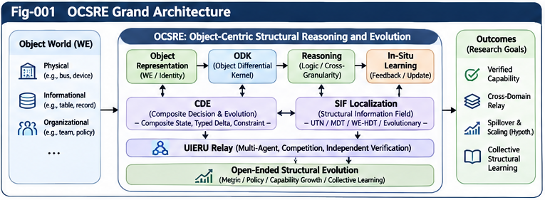

# OCSRE Figure Index

**Repository:** Object-Centric Structural Reasoning and Evolution (OCSRE)  
**Release target:** v1.0.0 — Research Framework and Contracts  
**Status:** Conceptual research illustrations; not evidence of implemented or validated systems  
**Authors:** Sizhe Tan & GPT-Obot  
**License:** Apache-2.0 (subject to repository asset provenance and licensing review)

## 1. Purpose and conventions

This index catalogs the eight OCSRE conceptual figures and recommends placements within the research papers. Figures are explanatory maps, not formal proofs, executable specifications, performance measurements, or empirical demonstrations. The authoritative semantics remain in the corresponding papers, specifications, and the [Definition Registry](research-trace/DEFINITION-REGISTRY.md).

All paths below are relative to the repository root. The image files belong in `figures/`; research papers belong in `docs/`, case studies in `cases/`, and extensions in `extensions/`. Suggested insertions are editorial recommendations, not claims that the images have already been embedded in every paper.

**Rendering note:** The initial eight PNG assets are landscape panels, each approximately **768 × 256 pixels**. Review legibility at typical GitHub reading widths before release; if embedded text is too small, redraw the figure at higher resolution rather than enlarging a blurry raster image. Check all arrows, labels, abbreviations, and semantic boundaries against the written specifications.

## 2. Figure catalog at a glance

| ID | Figure | Primary paper | Central question |
|---|---|---|---|
| Fig-001 | [OCSRE Grand Architecture](figures/Fig-001-OCSRE-Grand-Architecture.png) | OCSRE-001 | How do object representation, reasoning, learning, and evolution fit together? |
| Fig-002 | [From Classical Syllogism to Object-Centric Reasoning](figures/Fig-002-From-Classical-Syllogism-to-Object-Centric-Reasoning.png) | OCSRE-002 | How can a restricted classical core coexist with richer object semantics? |
| Fig-003 | [Object, Metric, Perspective and State](figures/Fig-003-Object-Metric-Perspective-and-State.png) | OCSRE-003 | What must be typed and aligned before objects can be compared or reasoned about? |
| Fig-004 | [Object Differential Kernel and Plugin Interfaces](figures/Fig-004-Object-Differential-Kernel-and-Plugin-Interfaces.png) | OCSRE-004 | What belongs to the generic kernel, and what remains domain-specific? |
| Fig-005 | [SQL-to-WE Attribute Transformation](figures/Fig-005-SQL-to-WE-Attribute-Transformation.png) | OCSRE-006 | How does relational data become semantically qualified WE/Object input? |
| Fig-006 | [In-Situ Object Intelligence Loop](figures/Fig-006-In-Situ-Object-Intelligence-Loop.png) | OCSRE-007 | How are observation, feedback, learning, and decisions governed? |
| Fig-007 | [WE-Native CDE and Composite State Evolution](figures/Fig-007-WE-Native-CDE-and-Composite-State-Evolution.png) | OCSRE-008 | How are candidate typed deltas evaluated without premature commitment? |
| Fig-008 | [Object Capability Spillover, Relay and Collective Learning](figures/Fig-008-Object-Capability-Spillover-Relay-and-Collective-Learning.png) | OCSRE-011 | When may a capability be transferred, validated, and accumulated? |

## 3. Individual figure records and insertion guidance

### Fig-001 — OCSRE Grand Architecture

**Asset:** [`figures/Fig-001-OCSRE-Grand-Architecture.png`](figures/Fig-001-OCSRE-Grand-Architecture.png)  
**Primary placement:** [`docs/OCSRE-001-The-Object-Centric-Structural-Intelligence-Thesis.md`](docs/OCSRE-001-The-Object-Centric-Structural-Intelligence-Thesis.md), **after §4, “Proposed architecture,”** before §5.  
**Secondary placement:** Repository `README.md`, after the introductory thesis and before the detailed document navigation.

**Intended reading:** WE/Object representation is the semantic anchor; the Object Differential Kernel (ODK), typed reasoning, in-situ learning, and constrained evolution form distinguishable functional surfaces. SIF localization and UIERU relay are connected architectural interfaces rather than subsystems proven to be equivalent.

**Suggested caption:** *Figure 1. Proposed OCSRE architecture: shared object interfaces connect representation, differential computation, reasoning, feedback, constrained evolution, localization, and structural capability relay.*

**Interpretation guard:** A directed arrow may indicate a proposed interface or information flow, not an automatic authorization to modify state. This diagram is an architectural hypothesis, not an operational deployment diagram.

### Fig-002 — From Classical Syllogism to Object-Centric Reasoning

**Asset:** [`figures/Fig-002-From-Classical-Syllogism-to-Object-Centric-Reasoning.png`](figures/Fig-002-From-Classical-Syllogism-to-Object-Centric-Reasoning.png)  
**Primary placement:** [`docs/OCSRE-002-From-Classical-Syllogism-to-Object-Centric-Structural-Reasoning.md`](docs/OCSRE-002-From-Classical-Syllogism-to-Object-Centric-Structural-Reasoning.md), **after §5, “From static predicates to object-centric structural assertions,”** before §6.  
**Secondary placement:** [`extensions/EXT-001-Object-Centric-Reasoning-and-the-History-of-Logic.md`](extensions/EXT-001-Object-Centric-Reasoning-and-the-History-of-Logic.md), adjacent to the comparison of classical and object-centric reasoning; [`cases/CASE-001-Person-and-Classical-Reasoning.md`](cases/CASE-001-Person-and-Classical-Reasoning.md), after its classical entailment example.

**Intended reading:** A restricted formal deduction fragment may preserve classical entailment while a wider object-centric layer adds typed identities, state, time, perspective, provenance, and granularity contracts.

**Suggested caption:** *Figure 2. Classical deductive validity is retained within a restricted logical fragment while object-centric reasoning introduces qualified identity, state, perspective, and relation interfaces.*

**Interpretation guard:** Object metrics, evidential support, and learned associations do **not** become formal entailments simply because they share an object identifier.

### Fig-003 — Object, Metric, Perspective and State

**Asset:** [`figures/Fig-003-Object-Metric-Perspective-and-State.png`](figures/Fig-003-Object-Metric-Perspective-and-State.png)  
**Primary placement:** [`docs/OCSRE-003-Dynamic-Relational-and-Multi-Granular-Reasoning.md`](docs/OCSRE-003-Dynamic-Relational-and-Multi-Granular-Reasoning.md), **after §6, “Perspectives: multiple views without contradictory truth promotion,”** before §7.  
**Secondary placement:** [`docs/OCSRE-004-Object-Differential-Kernel-and-Generic-Operators.md`](docs/OCSRE-004-Object-Differential-Kernel-and-Generic-Operators.md), after §2, “Semantic foundations and boundaries.”

**Intended reading:** An ObjectRef is not itself an observation, measurement, perspective, or versioned state. Metric comparison requires compatible units, time scopes, granularities, and provenance.

**Suggested caption:** *Figure 3. Object identity, metric indices, perspective, and state are distinct but composable coordinates of an object-centric reasoning context.*

**Interpretation guard:** Similar metric values do not establish identity; a perspective-dependent assertion cannot silently be promoted into an unqualified universal fact.

### Fig-004 — Object Differential Kernel and Plugin Interfaces

**Asset:** [`figures/Fig-004-Object-Differential-Kernel-and-Plugin-Interfaces.png`](figures/Fig-004-Object-Differential-Kernel-and-Plugin-Interfaces.png)  
**Primary placement:** [`docs/OCSRE-004-Object-Differential-Kernel-and-Generic-Operators.md`](docs/OCSRE-004-Object-Differential-Kernel-and-Generic-Operators.md), **after §5, “Generic operator catalog,”** before §6.  
**Secondary placement:** [`docs/OCSRE-005-Object-Plugins-and-Composable-Intelligence-Capabilities.md`](docs/OCSRE-005-Object-Plugins-and-Composable-Intelligence-Capabilities.md), after §7, “The Object Differential Kernel boundary”; [`cases/CASE-005-Cross-Domain-Object-Plugin-Relay.md`](cases/CASE-005-Cross-Domain-Object-Plugin-Relay.md), near the kernel-invariance experiment.

**Intended reading:** The ODK provides proposed generic comparison operations; Object Plugins supply domain-specific mapping, measurement, constraints, and evidence contracts.

**Suggested caption:** *Figure 4. The Object Differential Kernel separates generic typed comparison from domain-specific Object Plugin semantics and conformance requirements.*

**Interpretation guard:** An ODK differential is a measured or computed difference; it is **not** a CDE Typed Delta or permission to execute a state transition. Kernel reuse across domains remains a testable hypothesis.

### Fig-005 — SQL-to-WE Attribute Transformation

**Asset:** [`figures/Fig-005-SQL-to-WE-Attribute-Transformation.png`](figures/Fig-005-SQL-to-WE-Attribute-Transformation.png)  
**Primary placement:** [`docs/OCSRE-006-SQL-to-Object-Attribute-Transformation-and-Semantic-Alignment.md`](docs/OCSRE-006-SQL-to-Object-Attribute-Transformation-and-Semantic-Alignment.md), **after §7, “The SQL-to-WE transformation pipeline,”** before §8.  
**Secondary placement:** [`cases/CASE-002-SQL-Native-Object-Adaptation.md`](cases/CASE-002-SQL-Native-Object-Adaptation.md), after the semantic transformation pipeline or before the worked SQL fixtures.

**Intended reading:** Bucketize, Normalize, Combine, Encode, and Derive are typed transformation operations. SQL source semantics and WE/Object target semantics must be connected through explicit mapping contracts and lineage.

**Suggested caption:** *Figure 5. Proposed SQL-to-WE adaptation: typed attribute transformations produce object-facing representations while preserving source semantics, provenance, and access constraints.*

**Interpretation guard:** SQL row keys are not automatically WE identity. Preserve NULL and three-valued logic, join multiplicity, aggregation grain, snapshot boundaries, and row-level security; no visual arrow guarantees those properties.

### Fig-006 — In-Situ Object Intelligence Loop

**Asset:** [`figures/Fig-006-In-Situ-Object-Intelligence-Loop.png`](figures/Fig-006-In-Situ-Object-Intelligence-Loop.png)  
**Primary placement:** [`docs/OCSRE-007-In-Situ-Object-Learning-Decision-and-Feedback.md`](docs/OCSRE-007-In-Situ-Object-Learning-Decision-and-Feedback.md), **after §4, “The proposed in-situ intelligence loop,”** before §5.  
**Secondary placement:** [`extensions/EXT-004-Open-Ended-Metric-Plugin-and-Policy-Evolution.md`](extensions/EXT-004-Open-Ended-Metric-Plugin-and-Policy-Evolution.md), near the governed feedback and proposal cycle.

**Intended reading:** Observations, predictions, decisions, actions, outcomes, and feedback are separate records. Learning proposals can update models or metrics under defined contracts; execution and policy modification require their own authority gates.

**Suggested caption:** *Figure 6. Proposed in-situ object intelligence loop with qualified observations, differential feedback, learning proposals, and governed decisions.*

**Interpretation guard:** Feedback is not proof of causation; a learning update is not automatically an authorized action or a committed CDE state change.

### Fig-007 — WE-Native CDE and Composite State Evolution

**Asset:** [`figures/Fig-007-WE-Native-CDE-and-Composite-State-Evolution.png`](figures/Fig-007-WE-Native-CDE-and-Composite-State-Evolution.png)  
**Primary placement:** [`docs/OCSRE-008-WE-Native-CDE-and-Composite-State-Evolution.md`](docs/OCSRE-008-WE-Native-CDE-and-Composite-State-Evolution.md), **after §6, “Composite State-Containers and cross-object invariants,”** before §7.  
**Secondary placement:** [`cases/CASE-003-School-Bus-Scheduling-and-Composite-WE-State.md`](cases/CASE-003-School-Bus-Scheduling-and-Composite-WE-State.md), near the composite-state and typed-delta example; [`extensions/EXT-002-Object-Centric-SIF-Localization-and-Addressing.md`](extensions/EXT-002-Object-Centric-SIF-Localization-and-Addressing.md), near evolutionary localization.

**Intended reading:** Candidate Typed Deltas change proposed composite states; cross-object constraints, path-memory rules, evidence, and authority determine whether transitions may be promoted.

**Suggested caption:** *Figure 7. WE-native constrained delta evolution over composite state containers: generate candidate transitions, evaluate global invariants, and promote only after validation and authorization.*

**Interpretation guard:** An improved objective score is not sufficient for feasibility or deployment. Search branches, rollback, NoSubtree decisions, and loop-back handling require explicit semantics. CDE can contribute to SIF evolutionary localization without being identical to UTN addressing.

### Fig-008 — Object Capability Spillover, Relay and Collective Learning

**Asset:** [`figures/Fig-008-Object-Capability-Spillover-Relay-and-Collective-Learning.png`](figures/Fig-008-Object-Capability-Spillover-Relay-and-Collective-Learning.png)  
**Primary placement:** [`docs/OCSRE-011-Object-Capability-Spillover-Relay-and-Collective-Structural-Learning.md`](docs/OCSRE-011-Object-Capability-Spillover-Relay-and-Collective-Structural-Learning.md), **after §6, “Structural Relay: the proposed transfer protocol,”** before §7.  
**Secondary placement:** [`extensions/EXT-003-Multi-Agent-Object-Intelligence-and-Relay.md`](extensions/EXT-003-Multi-Agent-Object-Intelligence-and-Relay.md), near multi-agent relay; [`extensions/EXT-005-Structural-Capability-Spillover-and-Scaling-Hypotheses.md`](extensions/EXT-005-Structural-Capability-Spillover-and-Scaling-Hypotheses.md), near the spillover mechanism and proposed experiment; `README.md`, in the capability-growth overview.

**Intended reading:** A capability artifact moves from source to target domain through contract matching, adaptation, adversarial testing, independent validation, and monitored promotion. Both successes and failures can enter the collective research record.

**Suggested caption:** *Figure 8. Proposed object capability relay: governed transfer, independent validation, residual capture, and collective structural learning across domains.*

**Interpretation guard:** Reuse does not establish generalization; generalization does not establish untargeted spillover; spillover does not establish a sustained scaling law. Agent agreement is not independent verification.

## 4. Primary insertion matrix

| Figure | Insert in | Exact recommended anchor |
|---|---|---|
| Fig-001 | OCSRE-001 | After §4, “Proposed architecture” |
| Fig-002 | OCSRE-002 | After §5, “From static predicates to object-centric structural assertions” |
| Fig-003 | OCSRE-003 | After §6, “Perspectives: multiple views without contradictory truth promotion” |
| Fig-004 | OCSRE-004 | After §5, “Generic operator catalog” |
| Fig-005 | OCSRE-006 | After §7, “The SQL-to-WE transformation pipeline” |
| Fig-006 | OCSRE-007 | After §4, “The proposed in-situ intelligence loop” |
| Fig-007 | OCSRE-008 | After §6, “Composite State-Containers and cross-object invariants” |
| Fig-008 | OCSRE-011 | After §6, “Structural Relay: the proposed transfer protocol” |

The figure set is intentionally not one-to-one with all 12 core papers. OCSRE-005, 009, 010, and 012 can reference relevant existing figures without creating redundant artwork. In particular, epistemic separation in OCSRE-009 and SIF localization in OCSRE-010 must remain explicit in their text even when supported by Fig-003 or Fig-007.

## 5. Copy-ready Markdown embedding pattern

For a figure embedded in a document under `docs/`:

```md


*Figure 4. The Object Differential Kernel separates generic typed comparison from domain-specific Object Plugin semantics and conformance requirements.*
```

For a figure embedded in a root-level document such as `README.md`:

```md

```

For a figure embedded in `cases/` or `extensions/`, use `../figures/<exact-filename>.png`. Maintain descriptive alternative text and a separate caption; do not rely on text inside a raster image as the sole explanation.

## 6. Figure-to-hypothesis and conformance crosswalk

| Figure | Primary hypothesis connections | Relevant specification surfaces |
|---|---|---|
| Fig-001 | OCSH-001–011 (overview only) | SPEC-001–006 (overview only) |
| Fig-002 | OCSH-001, OCSH-006 | Object identity, reasoning and granularity contracts |
| Fig-003 | OCSH-002, OCSH-006 | ObjectRef, metric, perspective, temporal and state typing |
| Fig-004 | OCSH-002, OCSH-003 | ODK and Object Plugin conformance |
| Fig-005 | OCSH-007, OCSH-003 | SQL semantic adaptation, provenance and access control |
| Fig-006 | OCSH-004 | Feedback, evidence, decision and authority boundaries |
| Fig-007 | OCSH-005, OCSH-006 | CDE Typed Delta, composite-state and validation contracts |
| Fig-008 | OCSH-008, OCSH-009, OCSH-010 | Relay, conformance, provenance and growth-evaluation contracts |

This table is a conceptual navigation crosswalk. The hypothesis registry and specifications remain authoritative for exact obligations and test identifiers.

## 7. Editorial quality assurance before v1.0.0

- [ ] Verify all eight exact filenames, directory locations, and Markdown relative paths.
- [ ] Inspect every PNG at 100% and at typical GitHub display width for text readability and crop artifacts.
- [ ] Check that diagram arrows are not misread as causal proof, execution permission, or automatic promotion.
- [ ] Verify identity, metric, evidence, reasoning, CDE, and authorization remain distinct.
- [ ] Verify Fig-005 does not imply lossless SQL semantics without an adapter contract and tests.
- [ ] Verify Fig-007 depicts candidate-versus-committed state distinctions and cross-object constraints.
- [ ] Verify Fig-008 distinguishes reuse, transfer, spillover, and scaling.
- [ ] Match captions and insertion anchors to final published paper section headings.
- [ ] Keep diagram terminology synchronized with `GLOSSARY.md` and `research-trace/DEFINITION-REGISTRY.md`.
- [ ] Check figure provenance, licensing, versioning, and accessibility descriptions before release.
- [ ] If any figure is materially revised, record its revision in `CHANGELOG.md` and update this index.

## 8. Open figure-related residuals

1. **Readability:** The initial assets are compact raster panels; high-resolution redraws may be needed for publication.
2. **Semantic completeness:** A simplified diagram cannot enumerate every typed contract, security check, or failure mode.
3. **Formal traceability:** No diagram-to-formal-proof correspondence has yet been established.
4. **Validation status:** The diagrams depict proposed architectures and workflows, not tested performance or deployed capabilities.
5. **Future extensions:** Additional figures may be warranted for evidence governance, SIF localization, and code dependency analysis, but are outside the eight-figure v1.0.0 baseline.

Track substantive gaps in [`research-trace/UNRESOLVED-RESIDUALS.md`](research-trace/UNRESOLVED-RESIDUALS.md); do not silently treat visual simplification as a resolved research issue.

---

**Index status:** Eight conceptual figures cataloged. Suggested placements and captions are ready for editorial integration; visual and semantic quality assurance remains a release prerequisite.
