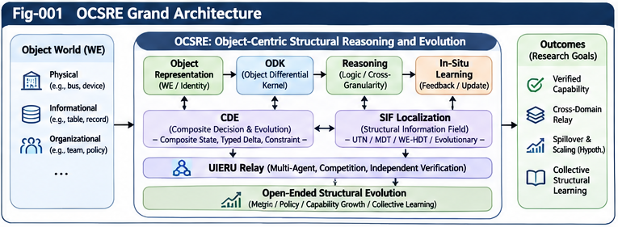
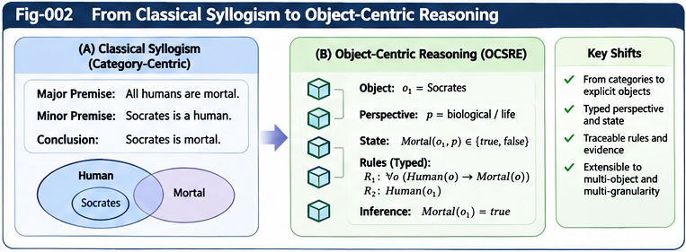
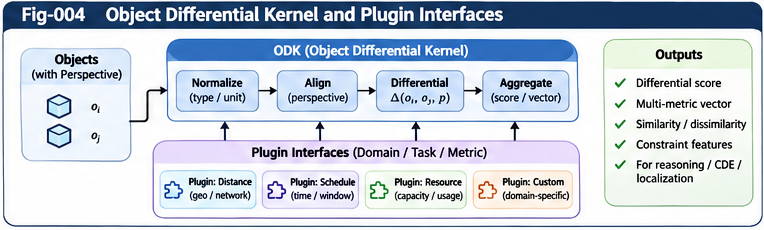
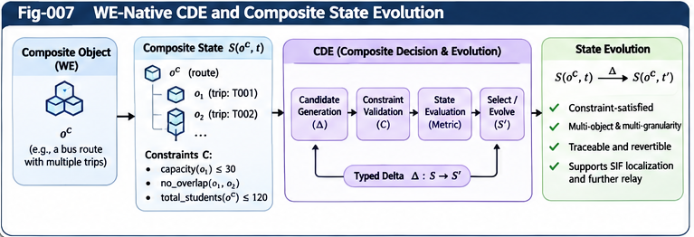
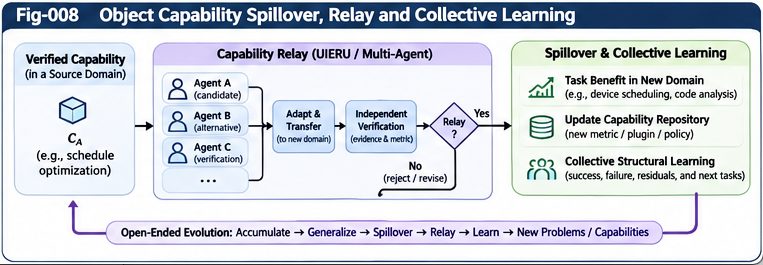

# Object-Centric Structural Reasoning and Evolution (OCSRE)

**From Classical Deduction to Differential Computation, In-Situ Learning, Constrained State Evolution, and Structural Capability Spillover**

**Release track:** v1.0.0 — Research Framework and Contracts  
**Authors (proposed):** Sizhe Tan & GPT-Obot  
**License:** Apache-2.0  
**Research status:** Proposed architecture, contracts, worked synthetic cases, and falsifiable hypotheses. **Not an empirically validated implementation or a demonstrated scaling law.**

> **Central proposition.** A typed, perspective-aware, versioned Object/World Entity (WE) interface may provide a reusable semantic anchor for computation, reasoning, feedback, constrained state evolution, and cross-domain capability relay—without assuming that the algorithms involved are equivalent.



## 1. Why this research?

A single real-world entity can appear as a SQL row, graph node, logical term, optimization variable, code artifact, or agent belief. These representations often lose meaning when moved across tools: identity is confused with a record key; a metric loses its units or perspective; an inferred relationship becomes a purported fact; a promising candidate is mistaken for an authorized action. OCSRE investigates whether **contract-governed object interfaces** can make these transitions safer, more traceable, and more reusable.

The proposed progression is:

**Object-Centric Representation → Differential Computation → Structural Reasoning → In-Situ Learning → Constrained Evolution → Validated Relay.**

The project does not claim that every problem is reducible to objects, that classical logic is obsolete, or that reuse automatically implies intelligence scaling.

## 2. The architecture at a glance

| Layer | Research concern | Primary artifacts |
|---|---|---|
| WE/Object representation | Stable identity, type, perspective, state, time, evidence, provenance, permissions | OCSRE-001, SPEC-001 |
| Object Differential Kernel (ODK) | Typed metric selection, alignment, comparison and differential evaluation | OCSRE-004, SPEC-002 |
| Reasoning | Restricted classical deduction; relational, temporal, multi-perspective and multi-granular reasoning | OCSRE-002/003/009, SPEC-003 |
| Object Plugins | Domain adapters, metrics, evaluators and composable capabilities | OCSRE-005/006, SPEC-004 |
| In-situ intelligence | Object-bound observation, feedback, learning and evidence governance | OCSRE-007/009, SPEC-005 |
| WE-native CDE | Typed Delta, single/composite State-Containers, constraint checking, candidate evolution | OCSRE-008, SPEC-006 |
| SIF localization | Problem/capability/object/state addressing; existing-object and evolutionary localization | OCSRE-010, EXT-002 |
| Relay and growth | Multi-agent validation, capability transfer, spillover, open-ended evolution hypotheses | OCSRE-011/012, EXT-003/004/005 |

### 2.1 The object interface

A *conceptual* object view (not a finalized serialization format) is:

```text
ObjectView = (
  identityRef, typeRef, perspectiveRef, stateRef, timeScope,
  metricBindings, relationBindings, evidenceRefs,
  capabilityRefs, policyRefs, provenanceRefs
)
```

`Object[metricIndices]` is a proposed **typed metric projection**, not an unqualified numeric array. Every selected metric requires declared meaning, comparator semantics, compatible units, perspective, time/state scope, provenance and access permissions. **Identity ≠ similarity; evidence support ≠ proof; ODK differential ≠ CDE state-changing Delta; candidate ≠ authorized action.**

### 2.2 Classical reasoning and richer semantics

For the restricted deductive example `∀x(Human(x) → Mortal(x))` and `Human(s)`, the conclusion `Mortal(s)` follows under the specified logical semantics. OCSRE studies formal embedding and preservation tests for such fragments; it does **not** claim a proven conservative extension. Outside that fragment, temporal changes, conflicting perspectives, uncertainty, granularity and evidence provenance require additional contracts.



### 2.3 ODK, plugins, and SQL adaptation

A common ODK is proposed to normalize, align, compare and aggregate compatible metrics; domain plugins supply the semantics it cannot infer. SQL-to-WE adaptation is **semantic interpretation, not format conversion**: Bucketize, Normalize, Combine, Encode and Derive must preserve relevant SQL NULL/three-valued semantics, join multiplicity, aggregation grain, transaction snapshots, provenance and security. SQL primary keys do not automatically establish WE identities.



### 2.4 WE-native CDE and composite state

A CDE State-Container may represent a single WE or a composite of WEs, relations and constraints. Typed Delta operations generate *candidate* transitions; global constraints, path memory, NoSubtree semantics, loop-back controls, independent validation and authorization govern whether a transition may be committed. CDE also provides a candidate **evolutionary localization** method within SIF: finding feasible new states, not merely addressing existing ones.



### 2.5 Relay, collective learning, and limits of scaling claims

Validated capability transfer is distinguished from untargeted spillover and from sustained scaling. Multi-agent agreement is not independent verification. A larger plugin library is not, by itself, evidence of increasing intelligence. OCSRE proposes frozen-task, cross-domain, resource-accounted evaluations with negative-transfer reporting.



## 3. Start reading

- **New readers:** [START-HERE.md](START-HERE.md) (guided reading path; root navigation asset).
- **Complete document index:** [CONTENTS.md](CONTENTS.md) (root navigation asset).
- **Foundational thesis:** [OCSRE-001](docs/OCSRE-001-The-Object-Centric-Structural-Intelligence-Thesis.md).
- **Contract-first entry:** [SPEC-001](specs/SPEC-001-Object-Identity-Perspective-and-State-Contract.md), [SPEC-002](specs/SPEC-002-Object-Differential-Kernel-and-Comparator-Contract.md), and [SPEC-006](specs/SPEC-006-WE-Native-CDE-Composite-State-and-Relay-Contract.md).
- **Concrete examples:** [CASE-001](cases/CASE-001-Person-and-Classical-Reasoning.md), [CASE-002](cases/CASE-002-SQL-Native-Object-Adaptation.md), [CASE-003](cases/CASE-003-School-Bus-Scheduling-and-Composite-WE-State.md), [CASE-004](cases/CASE-004-Transaction-and-Compositional-Identity.md), [CASE-005](cases/CASE-005-Cross-Domain-Object-Plugin-Relay.md), [CASE-006](cases/CASE-006-AI-Generated-Code-Governance-Through-Calling-Graphs-and-CDE.md).
- **Research evidence discipline:** [HYPOTHESIS-REGISTRY](research-trace/HYPOTHESIS-REGISTRY.md), [COUNTEREXAMPLE-REGISTRY](research-trace/COUNTEREXAMPLE-REGISTRY.md), and [UNRESOLVED-RESIDUALS](research-trace/UNRESOLVED-RESIDUALS.md).

## 4. Repository map

```text
.
├── README.md                         # Project overview and entry point
├── START-HERE.md / CONTENTS.md       # Reading guide and detailed index
├── GLOSSARY.md / FIGURE-INDEX.md     # Definitions and figure guide
├── FUTURE-DIRECTIONS.md              # Research outlook
├── OPEN-QUESTIONS.md                 # Open questions
├── TESTABLE-HYPOTHESES.md            # Falsifiable claims
├── VALIDATION-ROADMAP.md             # Planned evaluations
├── CHANGELOG.md / CITATION.cff       # Release and citation metadata
├── .zenodo.json / LICENSE            # DOI metadata and licensing
├── docs/                              # 12 foundational research papers
├── specs/                             # 6 normative/proposed contracts
├── cases/                             # 6 synthetic application cases
├── extensions/                        # 5 theoretical extensions
├── research-trace/                    # 5 governance registries
├── figures/                           # 8 architecture illustrations
└── release/                           # Release notes and RG assets
```

The map is the **target v1.0.0 repository layout**. Some root-level release/navigation assets may still be in preparation. Links become functional once the corresponding files are committed at these paths.

### 4.1 Core research papers (`docs/`)

| Paper | Focus |
|---|---|
| [OCSRE-001](docs/OCSRE-001-The-Object-Centric-Structural-Intelligence-Thesis.md) | Object-centric structural intelligence thesis |
| [OCSRE-002](docs/OCSRE-002-From-Classical-Syllogism-to-Object-Centric-Structural-Reasoning.md) | Classical deduction and formal embedding |
| [OCSRE-003](docs/OCSRE-003-Dynamic-Relational-and-Multi-Granular-Reasoning.md) | Dynamic, relational and multi-granular reasoning |
| [OCSRE-004](docs/OCSRE-004-Object-Differential-Kernel-and-Generic-Operators.md) | ODK and generic operators |
| [OCSRE-005](docs/OCSRE-005-Object-Plugins-and-Composable-Intelligence-Capabilities.md) | Plugins and capability composition |
| [OCSRE-006](docs/OCSRE-006-SQL-to-Object-Attribute-Transformation-and-Semantic-Alignment.md) | SQL semantic adaptation |
| [OCSRE-007](docs/OCSRE-007-In-Situ-Object-Learning-Decision-and-Feedback.md) | In-situ learning and feedback |
| [OCSRE-008](docs/OCSRE-008-WE-Native-CDE-and-Composite-State-Evolution.md) | CDE and composite states |
| [OCSRE-009](docs/OCSRE-009-Epistemic-Separation-and-Object-Centric-Evidence-Governance.md) | Epistemic separation and evidence |
| [OCSRE-010](docs/OCSRE-010-UTN-WE-HDT-and-SIF-Localization-Through-Shared-Object-Interfaces.md) | UTN, WE-HDT and SIF localization |
| [OCSRE-011](docs/OCSRE-011-Object-Capability-Spillover-Relay-and-Collective-Structural-Learning.md) | Relay and collective learning |
| [OCSRE-012](docs/OCSRE-012-Open-Ended-Object-Centric-Structural-Intelligence.md) | Open-ended structural evolution |

### 4.2 Specifications (`specs/`)

| Contract | Purpose |
|---|---|
| [SPEC-001](specs/SPEC-001-Object-Identity-Perspective-and-State-Contract.md) | Identity, perspective and state |
| [SPEC-002](specs/SPEC-002-Object-Differential-Kernel-and-Comparator-Contract.md) | ODK and comparator semantics |
| [SPEC-003](specs/SPEC-003-Classical-Reasoning-Preservation-and-Granularity-Contract.md) | Deductive preservation and granularity |
| [SPEC-004](specs/SPEC-004-Object-Plugin-and-Capability-Composition-Contract.md) | Plugin and capability composition |
| [SPEC-005](specs/SPEC-005-In-Situ-Learning-Feedback-and-Epistemic-Governance-Contract.md) | Feedback and epistemic governance |
| [SPEC-006](specs/SPEC-006-WE-Native-CDE-Composite-State-and-Relay-Contract.md) | CDE, composite state and relay |

Specifications are proposed contracts and conformance targets; they are not claims of a completed certified runtime.

### 4.3 Extensions (`extensions/`)

- [EXT-001 — Object-Centric Reasoning and the History of Logic](extensions/EXT-001-Object-Centric-Reasoning-and-the-History-of-Logic.md)
- [EXT-002 — Object-Centric SIF Localization and Addressing](extensions/EXT-002-Object-Centric-SIF-Localization-and-Addressing.md)
- [EXT-003 — Multi-Agent Object Intelligence and Relay](extensions/EXT-003-Multi-Agent-Object-Intelligence-and-Relay.md)
- [EXT-004 — Open-Ended Metric, Plugin, and Policy Evolution](extensions/EXT-004-Open-Ended-Metric-Plugin-and-Policy-Evolution.md)
- [EXT-005 — Structural Capability Spillover and Scaling Hypotheses](extensions/EXT-005-Structural-Capability-Spillover-and-Scaling-Hypotheses.md)

### 4.4 Research trace (`research-trace/`)

| Registry | Function |
|---|---|
| [HYPOTHESIS-REGISTRY](research-trace/HYPOTHESIS-REGISTRY.md) | Claims, baselines, falsifiers, evidence states |
| [DEFINITION-REGISTRY](research-trace/DEFINITION-REGISTRY.md) | Stable terminology and non-equivalences |
| [COUNTEREXAMPLE-REGISTRY](research-trace/COUNTEREXAMPLE-REGISTRY.md) | Adversarial cases and expected safe behavior |
| [DECISION-LOG](research-trace/DECISION-LOG.md) | Architecture decisions and revision triggers |
| [UNRESOLVED-RESIDUALS](research-trace/UNRESOLVED-RESIDUALS.md) | Open research and validation work |

## 5. Eleven falsifiable core hypotheses

| ID | Proposed claim (abbreviated) |
|---|---|
| OCSH-001 | Preserve deductive validity in a restricted classical fragment. |
| OCSH-002 | Reuse an unchanged ODK core across domains. |
| OCSH-003 | Reduce adaptation costs with contract-based Object Plugins. |
| OCSH-004 | Improve feedback use or traceability through in-situ learning. |
| OCSH-005 | Support single and composite WE transitions with CDE contracts. |
| OCSH-006 | Reduce invalid cross-granularity inheritance with explicit contracts. |
| OCSH-007 | Preserve SQL semantics/security while exposing reusable WE capabilities. |
| OCSH-008 | Obtain measurable validated cross-domain capability transfer. |
| OCSH-009 | Demonstrate benefits on genuinely untargeted tasks. |
| OCSH-010 | Test sustained, resource-accounted growth in validated capabilities/questions. |
| OCSH-011 | Improve code-change impact localization and governance traceability. |

**Evidence status: all eleven are E0 (Proposed).** See [HYPOTHESIS-REGISTRY.md](research-trace/HYPOTHESIS-REGISTRY.md) for canonical formulations, disconfirmation conditions, evaluation protocols and status rules. A synthetic demonstration or a proposed test is not an executed experiment.

## 6. Validation strategy

OCSRE prioritizes **Specifications/Contracts First → Conformance Before Runtime → Explicit Leftover**.

1. **Semantic and logical assurance:** Define identity, time, perspective, units, proof fragment, granularity, provenance and access boundaries. Check restricted deductive preservation with proof-oriented tests.
2. **Contract conformance:** Build positive, negative and adversarial fixtures for ODK, plugins, SQL adapters, CDE transitions, evidence governance and relay.
3. **Cross-domain comparisons:** Hold tasks and budgets constant; compare baselines with object-centric adapters, kernel reuse, and validated relay. Measure both gains and negative transfer.
4. **Governance and security:** Keep candidate generation, verification, approval, commit and deployment distinct. For AI-generated code, use calling graphs **plus** data/control dependencies, policy, tests and runtime evidence.
5. **Longitudinal growth tests:** Freeze untargeted evaluation tasks and report resource-normalized outcomes. Do not infer a scaling law from artifact counts or a few successful transfers.

Proposed metrics include conformance pass/fail, semantic violation rates, adaptation effort, kernel modification count, constraint satisfaction, false-positive identity attribution, impact-analysis precision/recall, independent verification cost, negative-transfer rate, and net utility on held-out tasks. The full protocols are research work to be executed; no benchmark scores are asserted here.

## 7. Relationship to adjacent research

- **WE-SIO:** Source semantics for World Entities, identity, representation, evidence, metrics, perspectives and operations. OCSRE consumes rather than supersedes these definitions.
- **UTN / MDT / WE-HDT:** Complementary typing, naming, localization and addressing structures. A shared ObjectRef interface does not establish algorithmic equivalence.
- **SIF:** Higher-level structural intelligence framework; OCSRE contributes an object-centric interface and investigates referential and evolutionary localization.
- **CDE:** Constrained Delta Evolution supplies typed state/delta search and composite state evolution; it is distinct from metric differentials computed by ODK.
- **UIERU / SSICR:** Relay and competitive multi-agent structures; validated handoffs require explicit contracts and independent checks.
- **ISGFTR:** Hypotheses concerning spillover, generalization, fluidity and transfer; sustained scaling remains unproven.

## 8. How to contribute or review

Useful contributions include formal countermodels, ambiguous-definition reports, executable conformance fixtures, SQL edge cases, independent replications, failed transfer experiments, alternative baselines, security tests, and reproducible benchmarks. Reference the affected `OCSRE`, `SPEC`, `CASE`, `EXT`, `OCSH`, `CEX`, or `ADR-OCSRE` identifiers. Preserve the original claim and record the proposed change, evidence, expected behavior and unresolved residuals. **A failure is valuable research evidence when its scope and provenance are retained.**

Suggested first reviews: test whether `Object[metricIndices]` preserves typed meaning; distinguish WE identity from SQL keys; probe proof vs evidence vs authorization; check composite CDE global constraints; challenge cross-domain plugin claims; and inspect AI code governance blind spots where calling graphs remain unchanged.

## 9. Figures

The eight architecture figures live under [`figures/`](figures/). Additional visual entry points:

- [Fig-003 — Object, Metric, Perspective and State](figures/Fig-003-Object-Metric-Perspective-and-State.png)
- [Fig-005 — SQL-to-WE Attribute Transformation](figures/Fig-005-SQL-to-WE-Attribute-Transformation.png)
- [Fig-006 — In-Situ Object Intelligence Loop](figures/Fig-006-In-Situ-Object-Intelligence-Loop.png)

Figures are **conceptual illustrations**, not formal proofs or evidence of implementation. Verify illustrative numbers and symbolic notation against their associated papers before reuse.

## 10. Citation, release and license

**Project:** *Object-Centric Structural Reasoning and Evolution (OCSRE)*  
**Authors (proposed):** Sizhe Tan & GPT-Obot  
**Release:** v1.0.0 — Research Framework and Contracts  
**License:** Apache-2.0  

---

## 📚 DBM-SI Series Navigation

See:\
[./docs/DBM-SI-Series-of-gitHub-Repositories/DBM-SI-Series-of-gitHub-Repositories.md](./docs/DBM-SI-Series-of-gitHub-Repositories/DBM-SI-Series-of-gitHub-Repositories.md)

---

**Research principle:** *Unify interfaces where useful; preserve distinctions where necessary; validate before promotion; keep failures and leftovers available for the next relay.*
