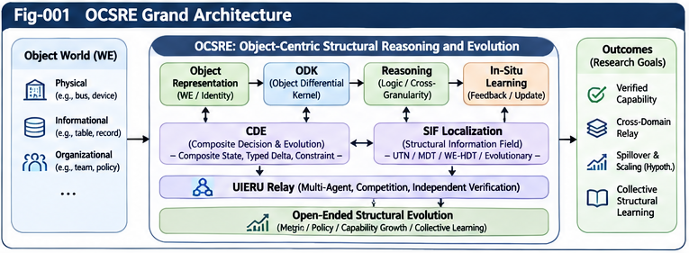
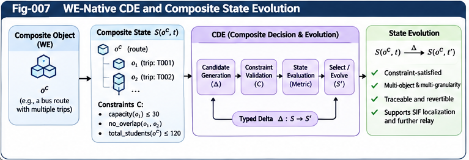

# START HERE — Object-Centric Structural Reasoning and Evolution (OCSRE)

**A guided entry to the research framework, proposed contracts, worked synthetic cases, and validation program**

**Repository:** `Object-Centric-Structural-Reasoning-and-Evolution`  
**Target release:** v1.0.0 — Research Framework and Contracts  
**Authors (proposed):** Sizhe Tan & GPT-Obot  
**License:** Apache-2.0  
**Research maturity:** Conceptual framework, proposed specifications, synthetic cases, and test designs. **No claim of a certified runtime, completed empirical evaluation, or established scaling law.**

> **Read this first:** OCSRE asks whether typed, perspective-aware, versioned Object/World Entity (WE) interfaces can help connect computation, formal reasoning, evidence, in-situ feedback, constrained state evolution, and capability relay—**without collapsing their distinct semantics**.



## 1. The five-minute orientation

A real-world entity can be represented as a database row, a logical term, a graph node, an optimization variable, a software artifact, or an agent's belief. Transitions among these representations can accidentally discard essential information: identity, time, unit, granularity, perspective, provenance, or permission. OCSRE proposes a **shared, contract-governed Object interface** that makes these boundaries explicit.

The research progression is:

```text
WE / Object representation
        ↓
Typed metric projection: Object[metricIndices]
        ↓
Object Differential Kernel (ODK) + domain Object Plugins
        ↓
Structural reasoning + epistemic separation
        ↓
In-situ observation, feedback, and learning
        ↓
WE-native CDE: candidate Typed Deltas on single/composite State-Containers
        ↓
SIF localization + validated UIERU / multi-agent capability relay
        ↓
Hypotheses about spillover, collective learning, and open-ended growth
```

This is a **research architecture**, not an assertion that all arrows have been implemented or validated. ODK compares compatible metrics; CDE proposes and evaluates state transitions. Deductive proof, evidence support, metric similarity, feasibility, and authorization must remain separate.

### The four distinctions worth remembering

| Do not confuse | Why the boundary matters |
|---|---|
| **WE identity** with a SQL primary key, graph label, or similarity score | A record address or matching feature does not establish real-world identity. |
| **Deductive entailment** with evidence-weighted hypothesis support | A valid proof in a specified fragment is not the same as an uncertain real-world attribution. |
| **ODK Differential** with **CDE Typed Delta** | Measuring a difference does not authorize or perform a state change. |
| **Candidate / agent consensus** with **validated and authorized action** | Multiple agreeing agents can share the same error; passing one test is not deployment approval. |

## 2. Choose your reading path

You do **not** need to read all 29 research papers in order. Select a path that matches your interest; follow the linked specifications when a claim needs precise semantics.

### Path A — New to Structural Intelligence (30–60 minutes)

1. [README.md](README.md) — project motivation and architecture.
2. [OCSRE-001 — The Object-Centric Structural Intelligence Thesis](docs/OCSRE-001-The-Object-Centric-Structural-Intelligence-Thesis.md) — the central proposal.
3. [OCSRE-002 — From Classical Syllogism to Object-Centric Structural Reasoning](docs/OCSRE-002-From-Classical-Syllogism-to-Object-Centric-Structural-Reasoning.md) — continuity with classical deduction.
4. [CASE-001 — Person and Classical Reasoning](cases/CASE-001-Person-and-Classical-Reasoning.md) — a small, inspectable example.
5. [EXT-001 — Object-Centric Reasoning and the History of Logic](extensions/EXT-001-Object-Centric-Reasoning-and-the-History-of-Logic.md) — historical positioning and limits.

**Question to carry forward:** Which statements are proven, which are merely supported by evidence, and which remain proposed?

### Path B — AI / software engineers: interfaces and governance (60–90 minutes)

1. [OCSRE-004 — Object Differential Kernel and Generic Operators](docs/OCSRE-004-Object-Differential-Kernel-and-Generic-Operators.md).
2. [OCSRE-005 — Object Plugins and Composable Intelligence Capabilities](docs/OCSRE-005-Object-Plugins-and-Composable-Intelligence-Capabilities.md).
3. [SPEC-001 — Object Identity, Perspective and State Contract](specs/SPEC-001-Object-Identity-Perspective-and-State-Contract.md).
4. [SPEC-002 — Object Differential Kernel and Comparator Contract](specs/SPEC-002-Object-Differential-Kernel-and-Comparator-Contract.md) and [SPEC-004 — Object Plugin and Capability Composition Contract](specs/SPEC-004-Object-Plugin-and-Capability-Composition-Contract.md).
5. [CASE-006 — AI-Generated Code Governance Through Calling Graphs and CDE](cases/CASE-006-AI-Generated-Code-Governance-Through-Calling-Graphs-and-CDE.md).

**Question:** Can impact localization improve without treating an unchanged calling graph as proof of unchanged program semantics?

### Path C — Database and data engineering (45–75 minutes)

1. [OCSRE-006 — SQL-to-Object Attribute Transformation and Semantic Alignment](docs/OCSRE-006-SQL-to-Object-Attribute-Transformation-and-Semantic-Alignment.md).
2. [CASE-002 — SQL-Native Object Adaptation](cases/CASE-002-SQL-Native-Object-Adaptation.md).
3. [SPEC-001](specs/SPEC-001-Object-Identity-Perspective-and-State-Contract.md) and [SPEC-002](specs/SPEC-002-Object-Differential-Kernel-and-Comparator-Contract.md).
4. [CASE-005 — Cross-Domain Object Plugin Relay](cases/CASE-005-Cross-Domain-Object-Plugin-Relay.md).

**Question:** Which SQL semantics (NULL and three-valued logic, join multiplicity, aggregation grain, snapshots, row-level security) must survive an Object adaptation?

### Path D — Optimization, planning, and CDE (60–90 minutes)

1. [OCSRE-008 — WE-Native CDE and Composite State Evolution](docs/OCSRE-008-WE-Native-CDE-and-Composite-State-Evolution.md).
2. [SPEC-006 — WE-Native CDE, Composite State and Relay Contract](specs/SPEC-006-WE-Native-CDE-Composite-State-and-Relay-Contract.md).
3. [CASE-003 — School-Bus Scheduling and Composite WE State](cases/CASE-003-School-Bus-Scheduling-and-Composite-WE-State.md).
4. [EXT-002 — Object-Centric SIF Localization and Addressing](extensions/EXT-002-Object-Centric-SIF-Localization-and-Addressing.md).
5. [CASE-004 — Transaction and Compositional Identity](cases/CASE-004-Transaction-and-Compositional-Identity.md).

**Question:** How can a local Typed Delta be checked against constraints on the *entire* composite state, including path memory and loop-back rules?

### Path E — Logic, epistemology, and evidence (45–75 minutes)

1. [OCSRE-002](docs/OCSRE-002-From-Classical-Syllogism-to-Object-Centric-Structural-Reasoning.md) and [OCSRE-003 — Dynamic, Relational and Multi-Granular Reasoning](docs/OCSRE-003-Dynamic-Relational-and-Multi-Granular-Reasoning.md).
2. [SPEC-003 — Classical Reasoning Preservation and Granularity Contract](specs/SPEC-003-Classical-Reasoning-Preservation-and-Granularity-Contract.md).
3. [OCSRE-009 — Epistemic Separation and Object-Centric Evidence Governance](docs/OCSRE-009-Epistemic-Separation-and-Object-Centric-Evidence-Governance.md).
4. [CASE-001](cases/CASE-001-Person-and-Classical-Reasoning.md) and [CASE-004](cases/CASE-004-Transaction-and-Compositional-Identity.md).
5. [EXT-001](extensions/EXT-001-Object-Centric-Reasoning-and-the-History-of-Logic.md).

**Question:** When does a change in time, perspective, granularity, or evidence invalidate an inference that was previously acceptable?

### Path F — Multi-agent systems, collective learning, and scaling research (60–90 minutes)

1. [OCSRE-011 — Object Capability Spillover, Relay and Collective Structural Learning](docs/OCSRE-011-Object-Capability-Spillover-Relay-and-Collective-Structural-Learning.md).
2. [EXT-003 — Multi-Agent Object Intelligence and Relay](extensions/EXT-003-Multi-Agent-Object-Intelligence-and-Relay.md).
3. [EXT-004 — Open-Ended Metric, Plugin, and Policy Evolution](extensions/EXT-004-Open-Ended-Metric-Plugin-and-Policy-Evolution.md).
4. [EXT-005 — Structural Capability Spillover and Scaling Hypotheses](extensions/EXT-005-Structural-Capability-Spillover-and-Scaling-Hypotheses.md).
5. [HYPOTHESIS-REGISTRY](research-trace/HYPOTHESIS-REGISTRY.md) and [UNRESOLVED-RESIDUALS](research-trace/UNRESOLVED-RESIDUALS.md).

**Question:** Can validated gains on *untargeted*, frozen evaluation tasks survive negative-transfer accounting and compute/verification costs?

## 3. A compact guided example: from a row to a governed action

Consider a **synthetic** school-transport dataset with a trip, a bus, a planned passenger count, and a schedule.

**Stage 1 — Bind identity and context.** A SQL trip identifier refers to a record, but its WE/Object binding needs an explicit identity rule. Record the relevant perspective, time window, provenance, and permissions. See [CASE-002](cases/CASE-002-SQL-Native-Object-Adaptation.md).

**Stage 2 — Compare compatible metrics.** A planned-load ratio may be represented as a typed metric projection. ODK can compare two ratios after alignment; the resulting numerical difference is **not** itself a safety finding or a vehicle reassignment. See [SPEC-002](specs/SPEC-002-Object-Differential-Kernel-and-Comparator-Contract.md).

**Stage 3 — Build a composite state.** A candidate schedule includes buses, trips, students, routes, times, and global constraints. A CDE Typed Delta might propose moving a trip to a different bus; the entire candidate must be revalidated. See [CASE-003](cases/CASE-003-School-Bus-Scheduling-and-Composite-WE-State.md).

**Stage 4 — Challenge and authorize.** Agents may propose alternatives, but independent checks must test capacity, temporal feasibility, driver requirements where modeled, provenance, and authorization. A feasible *candidate* is not automatically a committed plan. See [SPEC-006](specs/SPEC-006-WE-Native-CDE-Composite-State-and-Relay-Contract.md).

**Stage 5 — Attempt a controlled relay.** The generic constraint-search machinery might be adapted to equipment allocation, but domain rules must be rebound and independently tested. A successful transfer is not evidence of a universal scaling law. See [CASE-005](cases/CASE-005-Cross-Domain-Object-Plugin-Relay.md).



## 4. Where to find the contracts

| Specification | What it governs | A typical failure to test |
|---|---|---|
| [SPEC-001](specs/SPEC-001-Object-Identity-Perspective-and-State-Contract.md) | Identity, perspective, time, state, provenance, access | Equating two people or WEs because labels match |
| [SPEC-002](specs/SPEC-002-Object-Differential-Kernel-and-Comparator-Contract.md) | Typed metric comparison and differential semantics | Comparing incompatible units or perspectives |
| [SPEC-003](specs/SPEC-003-Classical-Reasoning-Preservation-and-Granularity-Contract.md) | Restricted deductive preservation and cross-granularity reasoning | Treating a group property as an individual property |
| [SPEC-004](specs/SPEC-004-Object-Plugin-and-Capability-Composition-Contract.md) | Plugin dependencies, compatibility and composition | Assuming adapters are semantically interchangeable |
| [SPEC-005](specs/SPEC-005-In-Situ-Learning-Feedback-and-Epistemic-Governance-Contract.md) | Feedback, evidence, learning and decision boundaries | Turning weak evidence into proof or authorization |
| [SPEC-006](specs/SPEC-006-WE-Native-CDE-Composite-State-and-Relay-Contract.md) | Candidate transitions, global constraints, relay | Committing an unvalidated composite-state change |

**Important:** These are *proposed research contracts*. They define what a conforming implementation should eventually demonstrate; publication of the documents is not conformance certification.

## 5. The complete research sequence

The 29 substantive research documents form four complementary series:

| Series | Count | Role |
|---|---:|---|
| [OCSRE-001–012](CONTENTS.md#core-research-papers) | 12 | Foundational thesis and mechanisms |
| [SPEC-001–006](CONTENTS.md#specifications) | 6 | Proposed interface and behavior contracts |
| [CASE-001–006](CONTENTS.md#application-cases) | 6 | Synthetic application scenarios and negative tests |
| [EXT-001–005](CONTENTS.md#theoretical-extensions) | 5 | Historical, architectural, multi-agent and growth research |

For a full filename-by-filename navigation, use [CONTENTS.md](CONTENTS.md) once it is present in the repository.

### Eight architecture figures

- [Fig-001 — OCSRE Grand Architecture](figures/Fig-001-OCSRE-Grand-Architecture.png)
- [Fig-002 — From Classical Syllogism to Object-Centric Reasoning](figures/Fig-002-From-Classical-Syllogism-to-Object-Centric-Reasoning.png)
- [Fig-003 — Object, Metric, Perspective and State](figures/Fig-003-Object-Metric-Perspective-and-State.png)
- [Fig-004 — Object Differential Kernel and Plugin Interfaces](figures/Fig-004-Object-Differential-Kernel-and-Plugin-Interfaces.png)
- [Fig-005 — SQL-to-WE Attribute Transformation](figures/Fig-005-SQL-to-WE-Attribute-Transformation.png)
- [Fig-006 — In-Situ Object Intelligence Loop](figures/Fig-006-In-Situ-Object-Intelligence-Loop.png)
- [Fig-007 — WE-Native CDE and Composite State Evolution](figures/Fig-007-WE-Native-CDE-and-Composite-State-Evolution.png)
- [Fig-008 — Object Capability Spillover, Relay and Collective Learning](figures/Fig-008-Object-Capability-Spillover-Relay-and-Collective-Learning.png)

The figures are conceptual illustrations. The text of the specifications takes precedence if a diagram abbreviates or omits a semantic boundary.

## 6. Read the evidence status correctly

The eleven top-level hypotheses **OCSH-001–OCSH-011** are currently registered as **E0 — Proposed**. Their domains include classical deductive preservation, ODK reuse, plugin adaptation cost, in-situ feedback, WE-native CDE, granularity contracts, SQL semantics, validated relay, untargeted spillover, sustained scaling, and AI code governance.

The following are **not equivalent**:

1. A mathematical example illustrates a definition.
2. A synthetic case describes expected behavior.
3. A conformance test is implemented and passes.
4. A benchmark shows a measurable improvement over a baseline.
5. An independent team reproduces the improvement.
6. A longitudinal study supports a qualified scaling relationship.

This repository currently documents primarily **(1) and (2)**, together with specifications and proposed test protocols. It does not claim the higher evidence levels have been achieved. Refer to [HYPOTHESIS-REGISTRY.md](research-trace/HYPOTHESIS-REGISTRY.md) for the canonical evidence ladder and hypothesis-specific falsifiers.

## 7. Research-trace: the five governance registries

A useful entry point for reviewers is the `research-trace/` directory:

| Registry | Reader's question |
|---|---|
| [HYPOTHESIS-REGISTRY](research-trace/HYPOTHESIS-REGISTRY.md) | What exactly is being claimed, and what would disconfirm it? |
| [DEFINITION-REGISTRY](research-trace/DEFINITION-REGISTRY.md) | Which concepts are defined, and which similar terms are not equivalent? |
| [COUNTEREXAMPLE-REGISTRY](research-trace/COUNTEREXAMPLE-REGISTRY.md) | What adversarial cases should the framework reject or survive? |
| [DECISION-LOG](research-trace/DECISION-LOG.md) | Why was an architectural choice made, and when should it be revisited? |
| [UNRESOLVED-RESIDUALS](research-trace/UNRESOLVED-RESIDUALS.md) | What remains open, and what evidence would close it? |

**Explicit Leftover is a feature, not an embarrassment.** An unresolved boundary should be visible, assigned a verification condition, and available to future work. Failed transfer and negative results are also relayable research artifacts.

## 8. How to evaluate or contribute a proposed implementation

A research prototype should be reviewed in the following order:

1. **Specify the claim.** Identify the relevant OCSH hypothesis, application scope, and baseline.
2. **Bind semantics.** Define Object/WE identity, types, perspectives, metric units, time/state scope, evidence, provenance and authorization.
3. **Select contracts.** Cite the relevant SPEC files and declare any extensions or incompatibilities.
4. **Build conformance fixtures.** Include positive, negative, adversarial, and cross-granularity examples before optimizing runtime behavior.
5. **Keep execution boundaries.** Separate proposal, constraint checking, independent verification, approval, commit and deployment.
6. **Measure fairly.** Report held-out tasks, compute and validation budgets, adaptation effort, false positives, negative transfer and failures.
7. **Record residuals.** Update the relevant hypothesis, counterexample, decision and unresolved-residual records; preserve the evidence trail.

A useful contribution can be a precise counterexample, a reproducible failed experiment, a narrower theorem, a better contract, or an independent replication—not only a successful implementation.

## 9. Relationship to other Structural Intelligence research

OCSRE is designed as a possible **integration interface**, not as a replacement for neighboring research programs:

- **WE-SIO:** World Entity semantics and object-oriented structural representation.
- **UTN / MDT / WE-HDT:** Complementary naming, structural typing, indexing, localization and addressing methods.
- **SIF:** Problem–capability mapping, localization, node intelligence and control-plane governance; CDE is investigated as an additional *evolutionary localization* method.
- **CDE:** Constrained Delta Evolution over typed single/composite State-Containers.
- **UIERU / SSICR:** Multi-agent relay, competitive candidate generation, validation and collective structural learning.
- **ISGFTR:** Hypotheses about intelligence spillover, generalization, fluidity, transfer and relay.

Sharing a reference interface does **not** prove that these frameworks are algorithmically equivalent or that cross-domain transfer will succeed.

## 10. What to read next

- For the shortest overview, return to [README.md](README.md).
- For exact file navigation, use [CONTENTS.md](CONTENTS.md) when available.
- For precise terminology, use [DEFINITION-REGISTRY.md](research-trace/DEFINITION-REGISTRY.md), followed by [GLOSSARY.md](GLOSSARY.md) when available.
- For open problems and proposed tests, start with [UNRESOLVED-RESIDUALS.md](research-trace/UNRESOLVED-RESIDUALS.md) and [HYPOTHESIS-REGISTRY.md](research-trace/HYPOTHESIS-REGISTRY.md).
- For the release's research limitations, consult [VALIDATION-ROADMAP.md](VALIDATION-ROADMAP.md) when published.

---

**Guiding principle:** *Specifications/Contracts First. Conformance Before Runtime. Explicit Leftover. Validated Relay Rather Than Assumed Equivalence.*

**Status note:** This guide describes the target v1.0.0 repository structure. Relative links require the corresponding files to be committed in their designated directories. Navigation and release assets may be completed incrementally.
