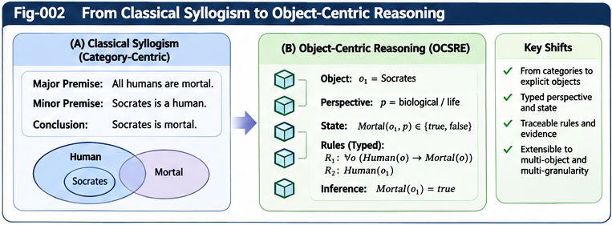

# CASE-001 — Person and Classical Reasoning

**Project:** Object-Centric Structural Reasoning and Evolution (OCSRE)  
**Release target:** v1.0.0 — Research Framework and Contracts  
**Status:** Proposed reference case and executable-test design; no runtime conformance or empirical validation claimed  
**Authors (proposed):** Sizhe Tan & GPT-Obot  
**License:** Apache-2.0  
**Primary papers:** OCSRE-001, OCSRE-002, OCSRE-003, OCSRE-009  
**Primary specifications:** SPEC-001, SPEC-002, SPEC-003, SPEC-005  
**Primary hypotheses:** OCSH-001, OCSH-006

## Abstract

This reference case tests the smallest intellectually important bridge in Object-Centric Structural Reasoning and Evolution (OCSRE): preserving a valid classical syllogism when predicates and individuals are represented through typed, identity-bearing World Entity (WE) interfaces. A familiar Person example is used to separate **deductive entailment** from entity resolution, evidence quality, temporal scope, perspective, metric similarity, and action authorization. The case specifies a restricted first-order fragment, a mapping to object-centric assertions, positive and negative test fixtures, expected outcomes, proof-trace obligations, and cross-granularity counterexamples. It then demonstrates why dynamic changes, disputed identity, or group statistics require explicit semantic contracts rather than silent inheritance. This document is a **test design and research case**, not a proof of general conservative extension and not an executed implementation report.

**Keywords:** syllogism; first-order logic; person; world entity; object identity; proof trace; temporal reasoning; granularity; epistemic separation; conformance.

---



*Figure 2. Classical deductive validity is retained within a restricted logical fragment while object-centric reasoning introduces qualified identity, state, perspective, and relation interfaces.*

---

## 1. Case objective and research questions

The reference syllogism is deliberately simple:

> All humans are mortal. Socrates is human. Therefore Socrates is mortal.

Under ordinary first-order semantics, the conclusion follows from the premises. The OCSRE research question is not whether this inference is newly discovered; it is whether a richer Object/WE interface can **preserve this established validity without confusing it with other computations**.

The case addresses five questions:

1. Can a restricted OCSRE reasoning profile represent and discharge the classical inference with an auditable derivation?
2. Can it distinguish a logical constant from a WE identity and from a record key or display name?
3. Can it prevent metric similarity, weak evidence, or an object plugin from being mislabeled as deductive proof?
4. Can it reject unsupported inferences across time, perspectives, and granularity?
5. Can it preserve the proof's provenance and invalidate dependent results when their premises or mappings change?

**Scope:** a controlled logical model with explicitly declared premises. This case does **not** empirically establish that any particular historical person is mortal, prove a broad metaphysical claim, or authorize actions based on a proof.

## 2. Normative dependencies and boundary of responsibility

- **SPEC-001** governs `IdentityRef`, `StateRef`, `PerspectiveRef`, identity mapping, and permissions.
- **SPEC-002** governs `Object[metricIndices]`, typed comparators, alignment, and qualified differential results. A comparator result is not a proof.
- **SPEC-003** governs the restricted classical fragment F0, translation and derivation obligations, and granularity bridges.
- **SPEC-005** governs evidence classes, learning revisions, and the separation of recommendation, authorization, and action.
- **OCSRE-002** provides the classical-to-object reasoning thesis; **OCSRE-003** provides dynamic, relational, and multi-granular extensions; **OCSRE-009** provides epistemic governance.

This case defines fixtures and expected results, not new normative definitions that override those specifications. A test runner MUST use the exact normative rule versions selected for the tested profile.

## 3. Classical reference semantics: F0-Person

For this case, take a nonempty first-order domain `D`, a constant `s` interpreted as an element of `D`, and unary predicates `Human` and `Mortal`. Define:

```text
P1: ∀x (Human(x) → Mortal(x))
P2: Human(s)
C : Mortal(s)
```

**Reference derivation:**

```text
1. ∀x (Human(x) → Mortal(x))    premise P1
2. Human(s)                    premise P2
3. Human(s) → Mortal(s)        universal instantiation, 1
4. Mortal(s)                   modus ponens, 2 and 3
```

The entailment `{P1, P2} ⊨ C` holds in every first-order model satisfying the premises. It does **not** establish that P1 or P2 were empirically verified. Soundness of the specific classical inference is a mathematical reference property; soundness of an OCSRE translation or implementation is a separate obligation.

**No existential import by default:** `∀x (Human(x) → Mortal(x))` does not imply `∃x Human(x)`. P2 supplies an instance for this example. If a profile implements traditional categorical logic with existential import, it MUST declare the changed semantics and test it separately.

## 4. Minimal object-centric fixtures

The following pseudo-records are **illustrative contracts**, not a prescribed wire schema or deployed runtime format.

```yaml
world_entity:
  identity_ref: "we:person:socrates:fixture-001"
  entity_type: "Person"
  display_label: "Socrates"
  state_ref: "state:fixture-001:v1"
  perspective_ref: "perspective:formal-reference"
  source_record_keys: []

predicate_registry:
  Human:
    arity: 1
    argument_types: [Person]
    semantics_version: "f0-person-v1"
  Mortal:
    arity: 1
    argument_types: [Person]
    semantics_version: "f0-person-v1"

logical_binding:
  constant: "s"
  identity_ref: "we:person:socrates:fixture-001"
  binding_scope: "F0-Person-v1"
  status: "stipulated-for-test"
```

The binding between `s` and the WE identity is explicit and fixture-local. The label `Socrates` is **not** the identity key; two identical labels do not entail identity. The example uses a Person type to support typed assertions; the fact that a record has `entity_type: Person` does not by itself entail `Human(s)` unless a declared bridge rule licenses that inference.

## 5. Assertion and proof envelopes

The system SHOULD expose the following logical and governance metadata:

```yaml
assertion:
  assertion_id: "a:P2"
  proposition: "Human(s)"
  identity_binding: "we:person:socrates:fixture-001"
  logical_scope: "F0-Person-v1"
  state_ref: "state:fixture-001:v1"
  temporal_scope: "timeless-within-test-model"
  perspective_ref: "perspective:formal-reference"
  epistemic_class: "stipulated-premise"
  provenance: ["fixture:P2"]
  permission_scope: "test-only"

proof:
  conclusion: "Mortal(s)"
  proof_status: "entailed-under-stipulated-premises"
  derivation_steps:
    - {rule: "universal-instantiation", inputs: ["P1"], output: "Human(s) -> Mortal(s)"}
    - {rule: "modus-ponens", inputs: ["P2", "step-1"], output: "Mortal(s)"}
  rule_set_version: "F0-Person-v1"
  premise_refs: ["P1", "P2"]
  external_action_authorized: false
```

The proof status is deliberately qualified. A formally entailed conclusion may still depend on unverified or synthetic premises. The proof trace MUST retain the identity binding, applicable rule versions, and dependencies necessary to audit or invalidate the result.

## 6. Reference execution pipeline

```text
Declare F0-Person semantics and rule versions
    ↓
Resolve logical constant ↔ WE IdentityRef
    ↓
Validate predicate signatures, premise scope and access
    ↓
Translate typed assertions into F0 formulas
    ↓
Apply allowed inference rules / independent reference checker
    ↓
Produce proof trace + epistemic qualification
    ↓
Return entailed / not-entailed / blocked / indeterminate
    ↓
Record residuals; never promote to action automatically
```

`not-entailed` means the conclusion does not follow from the premises in the declared semantics; it does not automatically mean the conclusion is false. `blocked` means a required semantic, identity, permission, or scope check failed. `indeterminate` is appropriate when the selected solver or available evidence cannot establish an answer, and MUST NOT be reported as a proof of non-entailment.

## 7. Positive reference tests

| Test | Premises / condition | Query | Expected result | Required explanation |
|---|---|---|---|---|
| POS-001 | P1 and P2 | `Mortal(s)` | Entailed | Universal instantiation + modus ponens |
| POS-002 | `∀x(A(x)→B(x))`, `∀x(B(x)→C(x))`, `A(s)` | `C(s)` | Entailed | Two explicit rule applications |
| POS-003 | P1 and `Human(t)` with a distinct bound identity | `Mortal(t)` | Entailed | Correct binding to `t` |
| POS-004 | P1, P2, irrelevant comparator score | `Mortal(s)` | Entailed | Proof independent of score |
| POS-005 | P1, P2, same premises under another permitted display label | `Mortal(s)` | Entailed | Display-label change has no semantic effect |
| POS-006 | P1, P2, versioned proof registry | `Mortal(s)` | Entailed | Trace retains exact premise and rule versions |

For POS-003, `t` is a separately bound logical constant. No inference of `s=t` is permitted without an explicit equality premise or validated identity equivalence.

## 8. Negative and counterexample tests

| Test | Input / mutation | Forbidden inference | Expected behavior |
|---|---|---|---|
| NEG-001 | P1 only | `Mortal(s)` | Not entailed; missing instance premise |
| NEG-002 | P2 only | `Mortal(s)` | Not entailed; missing universal rule |
| NEG-003 | `Mortal(s)` only | `Human(s)` | Not entailed; affirming the consequent |
| NEG-004 | `Human(s)` and `Human(t)` | `s=t` | Not entailed; shared predicate is not identity |
| NEG-005 | Two records labeled “Socrates” | Same WE identity | Block or keep distinct until resolved |
| NEG-006 | `similarity(s,t)=0.99` | `s=t` or `Human(t)` | Reject proof laundering |
| NEG-007 | `Person(s)` only, no bridge | `Human(s)` | Not entailed |
| NEG-008 | `Human(s)` from an inaccessible source | Authorized disclosure of `Human(s)` | Block output / redact according to policy |
| NEG-009 | Premise at `t1`, query at `t2`, no persistence rule | Same-time inference at `t2` | Block or qualify temporal mismatch |
| NEG-010 | P1 under perspective A, P2 under B | Unqualified objective conclusion | Block or require explicit reconciliation |
| NEG-011 | `80% of class members are Human` | `Human(s)` for an arbitrary member | Not entailed |
| NEG-012 | Group has average age 40 | Each member has age 40 | Not entailed |
| NEG-013 | Candidate CDE state says `Human(s)` | Claim as observed committed state | Reject status promotion |
| NEG-014 | Retracted P2 | Retain previously certified proof without warning | Invalidate or mark stale |
| NEG-015 | Contradictory `Human(s)` and `¬Human(s)` | Unqualified arbitrary conclusion | Require declared inconsistency policy; do not silently claim safe reasoning |
| NEG-016 | Missing, redacted, or NULL value | `¬Human(s)` | Do not infer negation from absence |
| NEG-017 | Plugin emits “proved” without derivation | Certified `Mortal(s)` | Reject or downgrade to unverified claim |
| NEG-018 | Valid conclusion, no action grant | External mutation | Deny authorization |

**Important:** Under unrestricted classical logic, an inconsistent premise set entails every formula (explosion). NEG-015 does not assert that classical logic itself is non-explosive. It requires a conforming OCSRE deployment to declare its inconsistency policy and avoid presenting an unqualified result as reliable when its premises are inconsistent. A paraconsistent profile would require a separate formal semantics and tests.

## 9. Granularity bridge: Person → Group

Let `Member(s,g)` mean person `s` belongs to group `g`. Group membership alone is insufficient to transfer every property of `g` to `s`, or every property of `s` to `g`.

**Valid under an explicit bridge:**

```text
∀x (Member(x,g) → Human(x))
Member(s,g)
----------------------------
Human(s)
```

**Invalid without additional premises:**

```text
AverageAge(g) = 40
Member(s,g)
----------------------------
Age(s) = 40     [NOT ENTAILED]
```

A bridge contract SHOULD specify its source and destination granularity, predicate interpretation, membership validity interval, aggregation semantics, possible information loss, and proof or evidence obligations. A bridge from `AllMembersHaveProperty(g,P)` to `P(s)` can be valid only if `s` is an eligible member in the same declared scope and the group predicate genuinely denotes a universal statement rather than an aggregate score.

## 10. Temporal and state-sensitive variants

The static syllogism is evaluated in one declared logical scope. In a dynamic WE system, an assertion may refer to a versioned state or interval. Consider:

```text
∀x (EnrolledAt(x, school, t1) → EligibleForProgram(x, t1))
EnrolledAt(s, school, t1)
```

The premises support `EligibleForProgram(s,t1)`, not automatically `EligibleForProgram(s,t2)`. A transition from `t1` to `t2` requires persistence, event, or state-transition rules. Likewise, a hypothetical CDE candidate state must not be substituted for a committed snapshot. Valid-time and observation-time corrections should be distinguishable in proof dependencies.

This example is about temporal qualification, not about actual school eligibility policy.

## 11. Perspective and epistemic separation

A perspective may control which assertions are visible, how evidence is evaluated, or which policy is applied. It must not silently alter the formal inference rules of an F0 profile. If a premise is supplied only as a disputed claim under perspective A, the conclusion should be reported as **entailed conditional on that premise**, not as an independently established objective fact.

Recommended status vocabulary:

- **Entailed under stipulated premises:** formal validity within the selected reference model.
- **Evidence-supported:** empirical or statistical support, not deductive entailment.
- **Hypothesized:** candidate assertion awaiting validation.
- **Disputed:** contradictory or contested inputs requiring explicit policy.
- **Blocked:** identity, scope, permissions, or typing obligations not satisfied.
- **Action-authorized:** separate governance decision; never inferred solely from truth status.

These statuses must remain distinguishable in storage, display, and relay.

## 12. Differential Kernel boundary

A comparator may calculate a distance or similarity between `Object[metricIndices]` projections. For example, it may score two Person objects as similar on declared attributes. Such a score can be useful for **candidate retrieval** or **identity-resolution investigation** but does not entail that the persons are identical, belong to the same logical class, or satisfy the same predicates.

```text
ODK output: {score: 0.97, comparator: C, aligned_metrics: M, ...}
Reasoner output: {conclusion: Mortal(s), proof: [P1, P2, rules], ...}
```

The two outputs have different semantics. A plugin that proposes a predicate from a metric threshold must mark it as a hypothesis or evidence-supported classification unless a separately justified formal bridge rule applies. ODK results MUST NOT be promoted to classical proofs by renaming a status field.

## 13. Learning, revision, and proof invalidation

A new observation can change the evidential standing of P2 or the identity mapping for `s`. It cannot retroactively make an invalid rule valid. The system SHOULD maintain a dependency graph from conclusions to premises, mappings, rule versions, and state versions.

A proposed revision sequence:

1. Receive a new observation or correction.
2. Record its source, temporal scope, and epistemic class.
3. Identify dependent proofs through the provenance graph.
4. Re-evaluate identity bindings and applicable premises.
5. Re-run affected proof obligations.
6. Preserve the historical trace; label superseded conclusions as stale, withdrawn, or revalidated.
7. Relay only the revised, qualified result with its evidence envelope.

This is an **in-situ accountability** pattern: the computation may be remote, but the revision must be anchored to the relevant WE and reasoning context.

## 14. Optional CDE integration: no automatic state mutation

This case does not require CDE to prove the syllogism. A CDE experiment MAY use an object-centric state containing premises, mappings, rule versions, and proof statuses, then propose typed deltas such as `AddEvidence`, `ReviseBinding`, or `RecomputeProof`. Such changes remain candidates until validated and authorized under SPEC-006. A proposed `ReviseBinding` delta must not silently merge two WEs, and a proof update must not authorize an external action.

The distinction is:

```text
Proof derivation ≠ Evidence promotion ≠ State delta ≠ Authorized action
```

## 15. Conformance matrix

| ID | Obligation | Suggested test(s) | Priority |
|---|---|---|---|
| PCL-001 | Declare F0 syntax and semantics | POS-001, NEG-001 | P0 |
| PCL-002 | Preserve the valid reference syllogism | POS-001 | P0 |
| PCL-003 | Retain derivation steps and rule versions | POS-006, NEG-017 | P0 |
| PCL-004 | Separate logical constants and WE identities | POS-003, NEG-004/005 | P0 |
| PCL-005 | Enforce typed predicate signatures | NEG-007 | P0 |
| PCL-006 | Do not equate similarity with proof | POS-004, NEG-006 | P0 |
| PCL-007 | Distinguish missing evidence from negation | NEG-016 | P0 |
| PCL-008 | Respect temporal and state scope | NEG-009, NEG-013 | P0 |
| PCL-009 | Preserve perspective qualification | NEG-010 | P0 |
| PCL-010 | Require explicit granularity bridges | NEG-011/012 | P0 |
| PCL-011 | Separate epistemic conclusion from authority | NEG-018 | P0 |
| PCL-012 | Enforce access controls and provenance | NEG-008 | P0 |
| PCL-013 | Invalidate stale dependent proofs | NEG-014 | P0 |
| PCL-014 | Declare contradiction-handling policy | NEG-015 | P0 |
| PCL-015 | Provide independent reference checking | POS-001/002 | P1 |
| PCL-016 | Track translation and rule changes | POS-006 | P1 |
| PCL-017 | Preserve negative-test evidence | NEG-001–018 | P1 |
| PCL-018 | Report unresolved proof or identity residuals | NEG-005/009/010 | P1 |

The PCL identifiers are **case-local test obligations**, not replacements for the normative requirement IDs in SPEC-003. A future conformance report MUST map them to the precise SPEC-003 clauses and versions used.

## 16. Suggested test harness and oracle

A reference harness should accept a finite fixture manifest, a declared logical fragment, a versioned binding registry, a set of assertions, and a query. It should emit a machine-readable verdict, proof trace when entailed, and all blockers or residuals. For the finite reference tests, an independent model enumerator or trusted FOL checker can serve as a cross-check where applicable.

```text
run_case(fixture, query, profile):
    validate_schema_and_permissions(fixture)
    validate_identity_bindings(fixture)
    validate_temporal_perspective_granularity_scope(fixture)
    translated = translate_to_F0(fixture, profile)
    verdict, proof_or_countermodel = reference_check(translated, query)
    return qualified_report(verdict, proof_or_countermodel,
                            premise_versions, rule_versions,
                            provenance, residuals)
```

This pseudocode is a proposed evaluation procedure, not an implementation. Finite model checking cannot by itself establish arbitrary first-order validity; the checker and supported fragment must be declared.

## 17. Acceptance and reporting criteria

A candidate implementation should be considered **eligible for further evaluation**, not automatically certified, when it:

1. Returns the correct qualified verdict for every P0 fixture.
2. Supplies a derivation for positive deductive cases, with independent verification where specified.
3. Rejects or qualifies every negative inference without manufacturing facts.
4. Preserves premise, binding, rule, state, and perspective provenance.
5. Demonstrates proof invalidation after controlled premise retraction or binding change.
6. Separates proof status from authorization and external side effects.
7. Publishes a versioned conformance report including failures, skipped tests, assumptions, and unresolved residuals.

No test results are asserted in this manuscript. A checklist of intended tests is not an executed validation record.

## 18. Hypothesis traceability and measurement

| Hypothesis | Proposed observable | Comparator / baseline | Failure signal |
|---|---|---|---|
| **OCSH-001** Restricted classical preservation | Fraction of valid/invalid F0 reference cases correctly classified, with checkable proofs | Classical reference reasoner | False proof, missed valid entailment, or incorrect status |
| **OCSH-006** Cross-granularity contracts | Rate of invalid member/group inferences admitted | Unguarded aggregation or naive inheritance baseline | Aggregate-to-individual false conclusion |
| Supporting OCSH-002 | ODK scores do not contaminate proof status | Comparator-only candidate pipeline | Similarity mislabeled as entailment |
| Supporting OCSH-004 | Traceable proof revision after feedback | Non-versioned assertion store | Stale proof retained as current |

All are **proposed / E0** at project inception. The reference syllogism establishes a target property of classical logic, not experimental evidence for OCSRE's implementation or scaling.

## 19. Cross-project relay relevance

The Person case is intentionally minimal, but its interface boundaries recur elsewhere:

- **SQL-to-WE (CASE-002):** row keys and predicates must not be confused with WE identity or verified membership.
- **School bus (CASE-003):** student-level assertions and fleet aggregates need granularity bridges.
- **Transaction identity (CASE-004):** weak evidence of common control is not logical identity.
- **Object plugin relay (CASE-005):** a proof-producing plugin needs declared rule semantics and receiving-side validation.
- **AI-generated code governance (CASE-006):** calling-graph reachability is not proof of execution, safety, or change impact; UTN localization is not authorization.

This case therefore tests a reusable *discipline of semantic separation*, not a claim that these domains share one inference algorithm.

## 20. Explicit leftovers and open questions

1. Complete a machine-checkable denotational semantics for the F0-to-Object translation.
2. Prove translation soundness for the exact supported F0 profile.
3. Determine whether any completeness theorem is available under finite-domain restrictions.
4. Decide how equality and alias mappings interact with proof substitution.
5. Define robust identity merge/split handling without retroactive proof corruption.
6. Specify time-indexed universal rules and persistence conditions.
7. Reconcile valid-time corrections with observation-time evidence updates.
8. Define a principled treatment of contradictory premises without misrepresenting classical explosion.
9. Specify three-valued SQL-to-logical mappings where NULL is present.
10. Formalize provenance-aware quantification over incomplete or permission-filtered domains.
11. Build a machine-checkable granularity-bridge registry.
12. Characterize safe inheritance for composite and overlapping groups.
13. Measure proof invalidation cost under high-frequency state changes.
14. Define proof-carrying plugin and relay envelopes.
15. Assess privacy leakage from fine-grained proof traces.
16. Develop adversarial fixtures for identity spoofing and rule injection.
17. Compare theorem-prover, rule-engine, and constrained finite-model implementations.
18. Define how probabilistic classifiers can propose—but not certify—predicate assertions.
19. Evaluate multi-agent independent proof checking and disagreement handling.
20. Establish reproducible benchmark suites with public synthetic fixtures.
21. Test scalability to large object and relation graphs without changing semantics.
22. Decide whether and when an explicitly limited conservative-extension claim can be proved.

These are unresolved research items, not completed deliverables. Failed tests and repeated executions SHOULD remain available as relay evidence rather than being discarded or relabeled as success.

## 21. Proposed repository placement and figure reference

**Canonical path:** `cases/CASE-001-Person-and-Classical-Reasoning.md`.

The conceptual progression is illustrated by the `figures/Fig-002-From-Classical-Syllogism-to-Object-Centric-Reasoning.png` associated with OCSRE-002. 

## 22. Conclusion

The classical Person syllogism is a compact but demanding conformance target. Its validity must survive translation into an object-centric interface, while identity resolution, evidence provenance, temporal state, perspective, metric comparison, group aggregation, learning revision, and authorization remain semantically distinct. OCSRE's claim is not that an object graph automatically reasons correctly. Its research proposal is that **typed shared Object interfaces plus explicit proof and governance contracts can preserve established logical guarantees while making richer structural reasoning inspectable and testable**. The claim awaits formal translation proofs, implementation, negative testing, and independent conformance evidence.
