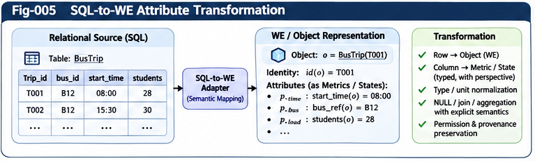

# CASE-002 — SQL-Native Object Adaptation

**Project:** Object-Centric Structural Reasoning and Evolution (OCSRE)  
**Artifact type:** Research case and proposed conformance suite  
**Target release:** v1.0.0 — Research Framework and Contracts  
**Authors:** Sizhe Tan & GPT-Obot  
**License:** Apache-2.0  
**Status:** Proposed design and illustrative fixtures; no runtime validation or empirical result is claimed.

## Abstract

This case examines a practical bridge between relational database systems and object-centric structural intelligence. Mature SQL systems already provide data definition, query optimization, joins, transactions, access control, and aggregation. OCSRE does not seek to replace these capabilities. Instead, it proposes a contract-governed adaptation layer through which selected relational data become typed World Entity (WE) attributes, metric projections, relations, and evidence suitable for Object Differential Kernel (ODK) operations, reasoning, in-situ learning, and constrained state evolution (CDE). The central claim is methodological: **SQL-to-object adaptation is semantic interpretation, not merely format conversion.**

A worked school-transport fixture illustrates source-row identity versus WE identity, aggregation grain, NULL handling, temporal alignment, permissions, and the transformations `Bucketize`, `Normalize`, `Combine`, `Encode`, and `Derive`. The case specifies executable-looking SQL examples, expected outcomes, negative tests, and evidence requirements. The proposed experiment is intended to test OCSH-007 and related portability hypotheses; no observed performance gain or cross-domain generality is asserted.

---



*Figure 5. Proposed SQL-to-WE adaptation: typed attribute transformations produce object-facing representations while preserving source semantics, provenance, and access constraints.*

---

## 1. Case purpose and scope

The case asks whether an adapter can preserve relational meaning and security while exposing reusable object-centric computations. Its immediate goals are to:

1. retain SQL's source semantics and transaction boundaries;
2. distinguish database keys, resolved WE identities, addresses, and perspectives;
3. expose typed `Object[metricIndices]` projections through explicit transformations;
4. compare objects using ODK only after semantic alignment;
5. carry lineage, missingness, uncertainty, and access restrictions forward;
6. distinguish analytic outputs from CDE state proposals and authorized actions; and
7. assess whether the same kernel and contract interface can be reused with a different domain adapter.

**Non-goals:** production database integration, a universal ontology, automatic identity resolution, query optimizer replacement, direct database writes, proof of transfer, or a claim that all SQL expressions have equivalent object interpretations.

## 2. Normative dependencies and research boundaries

The companion texts are:

- [`../docs/OCSRE-006-SQL-to-Object-Attribute-Transformation-and-Semantic-Alignment.md`](../docs/OCSRE-006-SQL-to-Object-Attribute-Transformation-and-Semantic-Alignment.md): transformation theory and SQL preservation obligations;
- [`../docs/OCSRE-004-Object-Differential-Kernel-and-Generic-Operators.md`](../docs/OCSRE-004-Object-Differential-Kernel-and-Generic-Operators.md): ODK computation discipline;
- [`../docs/OCSRE-009-Epistemic-Separation-and-Object-Centric-Evidence-Governance.md`](../docs/OCSRE-009-Epistemic-Separation-and-Object-Centric-Evidence-Governance.md): evidence qualification;
- [`../specs/SPEC-001-Object-Identity-Perspective-and-State-Contract.md`](../specs/SPEC-001-Object-Identity-Perspective-and-State-Contract.md): identity, perspective, and state;
- [`../specs/SPEC-002-Object-Differential-Kernel-and-Comparator-Contract.md`](../specs/SPEC-002-Object-Differential-Kernel-and-Comparator-Contract.md): metric and comparator interfaces;
- [`../specs/SPEC-004-Object-Plugin-and-Capability-Composition-Contract.md`](../specs/SPEC-004-Object-Plugin-and-Capability-Composition-Contract.md): adapter and plugin composition;
- [`../specs/SPEC-005-In-Situ-Learning-Feedback-and-Epistemic-Governance-Contract.md`](../specs/SPEC-005-In-Situ-Learning-Feedback-and-Epistemic-Governance-Contract.md): learning and evidence promotion;
- [`../specs/SPEC-006-WE-Native-CDE-Composite-State-and-Relay-Contract.md`](../specs/SPEC-006-WE-Native-CDE-Composite-State-and-Relay-Contract.md): state/delta validation and authority.

WE-SIO owns foundational WE semantics. SQL retains its own relational and access-control semantics. OCSRE specifies the adaptation interface; it does not claim that SQL keys, UTN locations, and WE identities are interchangeable.

## 3. Reference scenario: a school-transport database

Consider a district with buses, route assignments, and boarding observations. The following schema is **illustrative**, not a recommended production design. All values are synthetic.

```sql
CREATE TABLE buses (
  bus_id INTEGER PRIMARY KEY,
  capacity INTEGER NOT NULL CHECK (capacity > 0),
  active_from DATE NOT NULL,
  active_to DATE
);

CREATE TABLE route_assignments (
  assignment_id INTEGER PRIMARY KEY,
  route_id INTEGER NOT NULL,
  bus_id INTEGER NOT NULL REFERENCES buses(bus_id),
  service_date DATE NOT NULL,
  planned_riders INTEGER,
  CHECK (planned_riders IS NULL OR planned_riders >= 0)
);

CREATE TABLE boarding_observations (
  observation_id INTEGER PRIMARY KEY,
  assignment_id INTEGER NOT NULL REFERENCES route_assignments(assignment_id),
  observed_riders INTEGER,
  observed_at TIMESTAMP NOT NULL,
  CHECK (observed_riders IS NULL OR observed_riders >= 0)
);
```

Example fixtures:

| Bus | Capacity | Assignment | Service date | Planned riders | Observed riders |
|---|---:|---|---|---:|---:|
| 101 | 40 | A1 | 2026-10-01 | 30 | 28 |
| 102 | 20 | A2 | 2026-10-01 | 18 | NULL |
| 103 | 50 | A3 | 2026-10-01 | 25 | 27 |

For this example, each assignment has at most one *designated final* boarding observation. A real implementation must specify the selection policy when multiple observations exist; an unrestricted join would multiply rows.

The fixture has three distinct grains: **bus**, **assignment on a service date**, and **boarding observation**. A fleet-level aggregation introduces a fourth grain. The adapter must not silently exchange them.

## 4. From source rows to WE identity

A database primary key is scoped to its table and source system. The adapter proposes an explicit, versioned identity-resolution record:

```yaml
source_ref:
  system: district-transport-demo
  table: buses
  primary_key: 101
  snapshot: 2026-10-01T23:59:59Z
identity_resolution:
  proposed_we_id: we:district-demo:bus:101
  resolver_version: identity-map/0.1
  status: verified-by-fixture-mapping
  evidence_refs: [fixture:bus-101]
object_type: Bus
```

The `verified-by-fixture-mapping` label refers only to the synthetic case. In production, WE identity may require additional evidence, and the adapter must return **unresolved** or **ambiguous** rather than invent a unique identity. One SQL row may represent an event, an association, or a snapshot rather than a persistent entity. A composite object may reference many rows without becoming identical to any one of them.

### 4.1 Identity and state separation

- **WE identity:** durable referent under the declared resolver policy.
- **State:** effective-date and version-specific attributes or relations.
- **Address:** a route to retrieve or localize an object, not proof of identity.
- **Perspective:** declared evaluative or observational context.
- **Authority:** separate permission to read, infer, propose, or modify.

Changing `capacity` changes a state assertion, not necessarily the WE identity. Reassigning a route changes a relation; it does not merge the bus and route into one entity.

## 5. Typed adaptation envelope

A proposed projection contract is:

```yaml
projection_id: bus-pressure/v1
subject:
  we_id: we:district-demo:bus:101
  type: Bus
  state_version: snapshot-2026-10-01
perspective: district-route-planning/v1
metric:
  name: planned_load_ratio
  value: 0.75
  value_type: decimal
  unit: ratio
  direction: higher_means_more_pressure
  grain: assignment-day
  valid_time: 2026-10-01
  missingness: observed_value_present
provenance:
  source_refs: [fixture:bus-101, fixture:A1]
  transform_id: derive-planned-load/v1
  query_version: q-planned-load/v1
  snapshot_id: demo-snapshot-01
security:
  classification: internal-planning
  permitted_purposes: [route-planning]
epistemic_status: derived_from_planned_data
```

This object describes a **planned** ratio, not measured occupancy. The identity of the bus and the assignment-day grain of the metric coexist without being conflated. A production envelope must also specify principal, access decision, retention policy, and effective policy version.

## 6. Five SQL-to-object transformation families

Each operation below is a **typed semantic transformation**. Implementations must declare null behavior, units, fitting scope, grain, time, and security effects.

### 6.1 Derive: planned load ratio

```sql
SELECT a.assignment_id, a.bus_id, a.service_date,
       CAST(a.planned_riders AS DECIMAL(12,4))
       / NULLIF(b.capacity, 0) AS planned_load_ratio
FROM route_assignments AS a
JOIN buses AS b ON b.bus_id = a.bus_id
WHERE a.service_date = DATE '2026-10-01';
```

Expected synthetic results: A1 = 0.75, A2 = 0.90, A3 = 0.50. The ratio is valid only when capacity and assignment are effective for the same service date. The `NULLIF` guard is not a substitute for the schema constraint or temporal validity check. The SQL is intentionally portable-looking; exact date casts and decimal division behavior vary by database engine and must be tested.

### 6.2 Bucketize: pressure categories

```sql
WITH loads AS (
  SELECT a.assignment_id,
         CAST(a.planned_riders AS DECIMAL(12,4))
         / NULLIF(b.capacity, 0) AS ratio
  FROM route_assignments a JOIN buses b ON a.bus_id = b.bus_id
)
SELECT assignment_id,
       CASE WHEN ratio IS NULL THEN 'unknown'
            WHEN ratio < 0.60 THEN 'low'
            WHEN ratio < 0.85 THEN 'moderate'
            ELSE 'high' END AS pressure_bucket
FROM loads;
```

Expected: A1 = moderate, A2 = high, A3 = low. Thresholds are illustrative planning-policy parameters, not universal standards. They require explicit boundary conventions, versioning, and sensitivity analysis. The bucket is categorical; it must not be interpreted as a proof of safety or compliance.

### 6.3 Normalize: calibrated metric projection

For a declared fixed range `[0, 1]`, a bounded illustrative transform is `clip(ratio, 0, 1)`. If instead a min–max or z-score transform is learned from data, the training population, fitting period, missing-value policy, and parameter version must be recorded. A ratio greater than 1 indicates over-capacity planning; clipping may hide that fact. Therefore a normalized display value must retain the raw ratio and an overflow flag.

```yaml
normalization:
  method: fixed-range-clamp
  bounds: [0, 1]
  preserve_raw: true
  overflow_flag: true
  version: clamp-v1
```

No normalization parameter may be fitted using held-out evaluation records unless the protocol explicitly permits transductive evaluation.

### 6.4 Encode: categorical features

`pressure_bucket` may be encoded as `low`, `moderate`, `high`, `unknown` with a one-hot representation or a declared ordered category. Integer codes such as 1, 2, 3 are **not** automatically interval-scale measurements. Unknown and withheld are distinct states; neither is an ordinary category zero.

### 6.5 Combine: composite pressure indicators

Suppose a planning perspective combines load pressure with route-duration pressure:

$$
S_{\mathrm{plan}} = w_L L + w_T T, \qquad w_L,w_T\geq 0,\quad w_L+w_T=1.
$$

Here `L` and `T` must be independently normalized and semantically aligned; weights are perspective-specific and versioned. This is a *decision-support score*, not a deductive conclusion or authorization to change routes. If duration is missing or restricted, the combination must follow a declared abstention or partial-evaluation policy rather than silently reweighting.

## 7. SQL semantics preservation matrix

| SQL concern | Adaptation obligation | Typical failure |
|---|---|---|
| NULL and three-valued logic | Preserve unknown, absent, withheld, and not-applicable distinctions where available | `NULL = 0` or `UNKNOWN = FALSE` |
| Bag semantics | Record duplicate-sensitive joins and cardinality | Repeated observation inflates fleet totals |
| Join grain | Assert key/cardinality expectations before aggregation | Bus count multiplied by assignment count |
| Aggregation | State group keys, denominator, and effective population | Fleet mean inherited by every bus |
| Time | Align event time, valid time, and snapshot/transaction time | Capacity from a different service date |
| Transactions | Preserve snapshot and isolation assumptions | Mixed-version object state |
| Ordering | Require explicit `ORDER BY` for ranked output | Unstable top-k or false tie-break |
| Numeric behavior | Specify rounding, precision, overflow, and units | Integer division or incompatible units |
| Filtering | Preserve filter order and SQL predicate semantics | Filter-before-group confused with `HAVING` |
| Authorization | Enforce source permissions and downstream non-disclosure | Derived feature reveals restricted row |

The adapter should be tested against a reference SQL engine for the supported dialect and operations. Equivalent-looking SQL rewrites require dialect- and schema-specific justification; the case does not assume universal query equivalence.

## 8. Reference adaptation pipeline

```text
Authorized SQL source + declared snapshot
  -> source schema and policy inspection
  -> typed extraction at declared grain
  -> identity resolution / unresolved identity handling
  -> semantic transformations with lineage
  -> WE state and metric projection envelopes
  -> ODK Resolve -> Project -> Align -> Evaluate -> Qualify -> Trace
  -> evidence-qualified object reasoning / decision support
  -> optional CDE candidate proposal
  -> independent validation + authorization gate
  -> optional controlled commit and monitoring
```

At every stage, a failure should produce a typed rejection or explicit residual rather than a fabricated default. ODK computation does not grant database write authority. A CDE candidate does not constitute a committed SQL transaction.

## 9. Object Differential Kernel reference comparison

Consider A1 (0.75) and A2 (0.90). Under the **same** service date, metric definition, grain, and planning perspective, a simple signed comparator may compute:

$$
\Delta_{A2,A1}=0.90-0.75=+0.15.
$$

The output is a 0.15 increase in *planned load ratio* (15 percentage points), not 15 additional riders, nor a probability of overload. The comparator must include its direction convention, provenance, and uncertainty qualification. Comparing A1's planned ratio with A2's observed ratio is rejected unless a transformation explicitly justifies the comparison and preserves the distinct evidence status.

An ODK result might be:

```yaml
comparison_id: cmp:A2-vs-A1:planned-load/v1
metric: planned_load_ratio
left: {assignment: A1, value: 0.75}
right: {assignment: A2, value: 0.90}
delta_right_minus_left: 0.15
unit: ratio
scope: {service_date: 2026-10-01, grain: assignment-day}
qualification: comparable_under_declared_fixture
inference_status: arithmetic_comparison_only
```

## 10. Composite WE and CDE boundary

A proposed `FleetDayState` references buses, assignments, capacities, routes, and constraints. It is not identical to a single SQL row. A candidate Delta might move A2 to another bus or adjust an assignment. The proposed action must declare:

- read/write sets and snapshot versions;
- capacity, uniqueness, service-time, accessibility, and route constraints;
- impact on every affected WE and relation;
- authorization and permission checks;
- rollback/compensation plan and external-action boundaries.

A lower composite score cannot override a violated global constraint. A database transaction can atomically commit rows within its scope, but cannot by itself undo a bus already dispatched or a notification already delivered. These boundaries are governed by SPEC-006 and developed in [`CASE-003-School-Bus-Scheduling-and-Composite-WE-State.md`](CASE-003-School-Bus-Scheduling-and-Composite-WE-State.md).

## 11. Evidence, security, and privacy controls

The adapter must not treat access to an aggregate as unconditional access to its source rows, or vice versa. Row-level security, column masking, purpose restrictions, and policy versions must be respected both during extraction and during downstream publication. Derived metrics can leak protected information through small groups, differencing, repeated queries, or joins; authorization checks on source columns alone may be insufficient.

A proposed evidence record includes: source query fingerprint, principal/purpose, source snapshot, row-set lineage or privacy-preserving equivalent, transformation and plugin versions, metric semantics, uncertainty/missingness, policy decision, and downstream recipients. Lineage itself may be sensitive and require redaction. An audit trace should preserve the existence and reason for a denial without revealing the protected value.

**Epistemic labels must remain distinct:** planned riders, observed boardings, inferred future demand, and approved route changes are different claim classes. No confidence score upgrades one class into another without an explicit promotion procedure.

## 12. Plugin contracts and portability

A SQL adapter can be modeled as a versioned Object Plugin with capabilities for extraction, identity mapping, semantic transformation, and evidence packaging. A portable interface should specify:

```yaml
plugin_id: sql-we-adapter/demo-v1
inputs: [authorized_query_context, schema_contract, snapshot_ref]
outputs: [typed_we_projection, provenance_envelope, residuals]
required_permissions: [read_authorized_source]
side_effects: none
kernel_changes_required: false
conformance_profiles: [identity, sql-semantics, od-kernel, security]
```

A second domain (e.g., inventory) should reuse the **same ODK core** while replacing source schema mappings, identity policies, metrics, and domain-specific constraints. Reuse must be demonstrated by unchanged kernel code plus passing recipient-domain tests; identical plugin signatures alone do not establish portability.

## 13. Positive reference tests

| Test | Fixture/action | Expected result |
|---|---|---|
| SQLWE-P-001 | Derive A1 planned ratio | 0.75, `planned` provenance |
| SQLWE-P-002 | Derive A2 planned ratio | 0.90, same date and grain |
| SQLWE-P-003 | Bucketize A1/A2/A3 | moderate/high/low |
| SQLWE-P-004 | Compare A2 against A1 | +0.15 ratio, signed direction declared |
| SQLWE-P-005 | Resolve bus 101 with fixture mapping | Stable fixture WE ID, source key retained separately |
| SQLWE-P-006 | Unknown observed riders for A2 | Missing observation, not zero |
| SQLWE-P-007 | Change planning perspective weights | New perspective-versioned score, unchanged raw source |
| SQLWE-P-008 | Aggregate at fleet-day grain | Fleet metric labeled as aggregate, no individual inheritance |
| SQLWE-P-009 | Replay same authorized snapshot and plugin version | Deterministic projection under declared assumptions |
| SQLWE-P-010 | Propose a route reassignment | Candidate Delta only; no database write |

These are **expected results**, not records of executed tests.

## 14. Negative and adversarial tests

| Test | Invalid condition | Required response |
|---|---|---|
| SQLWE-N-001 | Same `bus_id` across two unrelated districts | Reject identity collision |
| SQLWE-N-002 | Treat assignment key as bus WE identity | Reject type/identity confusion |
| SQLWE-N-003 | `NULL` observed count converted to 0 | Reject epistemic corruption |
| SQLWE-N-004 | Multiple observations joined without cardinality policy | Reject or qualify duplicated totals |
| SQLWE-N-005 | Normalize using held-out test distribution | Flag evaluation leakage |
| SQLWE-N-006 | Integer category used as interval-scale distance | Reject unsupported comparator |
| SQLWE-N-007 | Fleet mean asserted for each bus | Reject granularity inversion |
| SQLWE-N-008 | Capacity from wrong effective date | Reject temporal misalignment |
| SQLWE-N-009 | Derived metric reveals protected student presence | Deny or privacy-preserve output |
| SQLWE-N-010 | `WHERE`/`HAVING` rewrite changes population | Reject semantic equivalence claim |
| SQLWE-N-011 | Planned riders presented as observed riders | Reject evidence promotion |
| SQLWE-N-012 | High pressure score triggers direct route update | Reject unauthorized mutation |
| SQLWE-N-013 | Compare riders count with load ratio | Reject unit/type mismatch |
| SQLWE-N-014 | Two snapshot versions silently merged | Reject inconsistent state |
| SQLWE-N-015 | Truncated normalization hides ratio > 1 | Require raw value and overflow qualification |
| SQLWE-N-016 | Plugin requests undeclared write privileges | Reject capability/permission escalation |
| SQLWE-N-017 | Query lineage includes sensitive row IDs in public output | Redact or deny trace |
| SQLWE-N-018 | Candidate Delta passes local but violates fleet constraint | Reject composite promotion |
| SQLWE-N-019 | Plugin upgrade changes bucket thresholds without version | Reject unversioned semantic drift |
| SQLWE-N-020 | Missing identity evidence replaced by guessed WE ID | Preserve unresolved status |

## 15. Case conformance obligations

The following identifiers are **case-specific test obligations** and do not replace the normative identifiers in SPEC-001 through SPEC-006.

- **SNA-001:** Preserve source row keys separately from WE identities.
- **SNA-002:** Record identity resolver and resolution evidence/version.
- **SNA-003:** Preserve state, valid-time, and snapshot scope.
- **SNA-004:** Declare source and target aggregation grain.
- **SNA-005:** Preserve NULL and SQL three-valued semantics.
- **SNA-006:** Validate join cardinality and duplicate sensitivity.
- **SNA-007:** Type all metric units, ranges, and direction conventions.
- **SNA-008:** Version Bucketize thresholds and boundary rules.
- **SNA-009:** Version Normalize fitting population and parameters.
- **SNA-010:** Declare Combine weights, missingness policy, and perspective.
- **SNA-011:** Preserve Encode category semantics and unknown values.
- **SNA-012:** Distinguish Derive output from direct observation.
- **SNA-013:** Preserve authorized source query and downstream permission constraints.
- **SNA-014:** Carry provenance and evidence status through ODK.
- **SNA-015:** Reject incomparable metric projections unless explicitly aligned.
- **SNA-016:** Keep object comparison distinct from deductive proof.
- **SNA-017:** Keep analytic output distinct from CDE candidate Delta.
- **SNA-018:** Require independent composite constraint and authority validation before commit.
- **SNA-019:** Version plugin contracts and reject silent semantic drift.
- **SNA-020:** Record explicit residuals and negative-transfer outcomes.
- **SNA-021:** Demonstrate kernel invariance across domain adapters before claiming reuse.
- **SNA-022:** Report both successful and rejected cases with reproducible evidence.

## 16. Proposed test harness and oracle

A future harness should provision a disposable SQL engine, seed the synthetic fixture, and capture a stable database snapshot. For each test it should:

1. execute a parameterized reference SQL query under a declared principal;
2. capture result cardinality, values, NULL status, and query/snapshot metadata;
3. run the adapter and validate its typed WE projection schema;
4. check identity and provenance consistency;
5. invoke ODK only for permitted aligned comparisons;
6. compare outputs to independent SQL and semantic-policy oracles;
7. exercise negative tests and verify denial/abstention behavior; and
8. emit a conformance report with implementation version, dialect, policy version, failures, and residuals.

Reference SQL outputs are an oracle for **relational computation**, not by themselves an oracle for WE identity, inference validity, or permissions. Those require independent fixture assertions and policy tests. Test harness implementation and execution remain future work.

## 17. Hypotheses and measurement plan

**Primary hypothesis — OCSH-007:** SQL-to-WE transformations support reusable capabilities while preserving SQL semantics and security.

Proposed measurements include: semantic agreement rate, identity resolution precision/abstention, missingness preservation, denied-access leakage rate, lineage completeness, adapter development effort, ODK kernel modifications, and regression failures after plugin updates. Tests must include adversarial joins, temporal mismatches, and restricted data.

**Related hypotheses:** OCSH-002 (unchanged differential kernel across domains), OCSH-003 (lower adaptation costs through contracts), OCSH-006 (cross-granularity validity), OCSH-008 (validated relay), and OCSH-011 (code-governance transfer, only as a separate downstream test). A fair baseline should compare the adapter with a domain-specific SQL-to-analysis pipeline performing the same task under equivalent security constraints. Cost measurements should include integration, validation, maintenance, and failed transfers—not merely lines of adapter code.

**Status:** All listed hypotheses are proposed / E0 at the inception of this case. No measured improvement is claimed.

## 18. Cross-domain relay experiment

After the transport fixture passes conformance, create an inventory fixture with products, warehouses, stock movements, and replenishment policies. Reuse the same ODK execution stages and comparator interface while implementing inventory-specific identity resolution, metric definitions, and source transformations. A candidate transferable capability might be a typed `Normalize + Compare + Qualify` chain. A successful relay requires recipient-domain validation, preserved permissions, no undisclosed kernel changes, and a net-benefit comparison against the baseline. Failed transfer and increased maintenance cost must be recorded rather than discarded.

This experiment connects to [`CASE-005-Cross-Domain-Object-Plugin-Relay.md`](CASE-005-Cross-Domain-Object-Plugin-Relay.md), [`../extensions/EXT-005-Structural-Capability-Spillover-and-Scaling-Hypotheses.md`](../extensions/EXT-005-Structural-Capability-Spillover-and-Scaling-Hypotheses.md), and UIERU/ISGFTR research. It does not establish a scaling law.

## 19. Acceptance criteria and reporting

A proposed minimum acceptance gate for this case is:

- all P0 semantic and permission tests pass, including denial/abstention behavior;
- positive arithmetic fixtures match the reference oracle within declared numeric precision;
- no planned/observed, row/WE, or aggregate/individual confusion is detected;
- each accepted metric has type, grain, time, provenance, and permission metadata;
- no test causes an unauthorized write or irreversible external action;
- plugin versions and kernel changes are reported transparently; and
- all unresolved discrepancies are published as Explicit Leftovers.

These criteria define a future validation target, not current conformance certification. P1 portability claims require a separate recipient-domain experiment; P2 runtime optimization is optional.

## 20. Explicit leftovers

1. Production-grade WE identity resolution from inconsistent source systems.
2. Formal treatment of event rows, relation rows, and durable entities.
3. SQL dialect differences in numeric, NULL, date, and collation semantics.
4. Provenance granularity for large joins and aggregates.
5. Privacy-preserving lineage under restricted access.
6. Noninterference tests for inference through repeated aggregate queries.
7. Temporal bitemporality and late-arriving data.
8. Isolation-level requirements for composite WE snapshots.
9. Incremental updates and invalidation of derived metrics.
10. Dynamic schema migrations and plugin contract evolution.
11. Calibration of Bucketize thresholds across populations.
12. Evaluation leakage detection for learned Normalize parameters.
13. Safe missingness behavior for composite scores.
14. Formal semantics for Encode categories and comparator compatibility.
15. Robust treatment of outliers and ratio overflow.
16. Multi-source identity ambiguity and conflict reconciliation.
17. Query-plan optimization without semantic or security drift.
18. Cross-domain transfer baselines and negative-transfer accounting.
19. Composite state transactions spanning databases and external systems.
20. Distinguishing evidence revision from real-world state mutation.
21. Human-review workload and governance costs.
22. Portable conformance harnesses for heterogeneous SQL engines.
23. Formal proof obligations for selected transformation equivalences.
24. Longitudinal study of adapter maintenance and net capability spillover.

## 21. Repository placement and figure

**Path:** `cases/CASE-002-SQL-Native-Object-Adaptation.md`.

The primary SQL transformation diagram is in [`../figures/Fig-005-SQL-to-WE-Attribute-Transformation.png`](../figures/Fig-005-SQL-to-WE-Attribute-Transformation.png), originally assigned to OCSRE-006. 

## 22. Conclusion

SQL-native object adaptation is a plausible bridge between relational data infrastructure and OCSRE's object-centric computation and reasoning. The bridge is credible only if identity, source grain, temporal semantics, transformation meaning, provenance, and permissions remain explicit. `Bucketize`, `Normalize`, `Combine`, `Encode`, and `Derive` are useful reusable operations precisely because their semantics can be contracted and challenged. ODK can then compare qualified metric projections without claiming to replace SQL or to authorize state mutation. The research next step is conformance-first implementation and independent, cross-domain evaluation—not premature assertions of validated portability or structural scaling.
