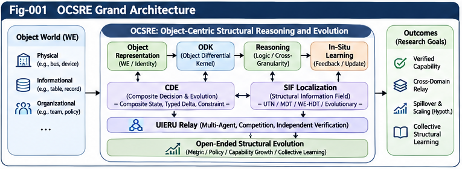

# OCSRE-001 — The Object-Centric Structural Intelligence Thesis

**Project:** Object-Centric Structural Reasoning and Evolution (OCSRE)  
**Release track:** v1.0.0 — Research Framework and Contracts  
**Authors (proposed):** Sizhe Tan & GPT-Obot  
**Status:** Foundational research thesis; proposed architecture and hypotheses, not an empirically validated implementation  
**License:** Apache-2.0

## Abstract

This paper proposes **Object-Centric Structural Reasoning and Evolution (OCSRE)** as a reusable structural-intelligence relay piece. Its central thesis is that a world entity (WE), or a contractually defined composite of entities, can serve as a shared semantic anchor for representation, differential computation, reasoning, situated feedback, and constrained evolution. Rather than treating objects as passive records consumed by unrelated algorithms, OCSRE investigates whether stable identity, perspective-qualified metrics, typed relations, provenance, and state-transition contracts can make diverse intelligence capabilities interoperable.

The proposed progression is **Object-Centric Representation → Computation → Reasoning → In-Situ Learning → Constrained Evolution**. A common Object Differential Kernel, typed Object Plugins, and `Object[metricIndices]` access patterns form candidate interfaces. Classical deduction is retained as a restricted target for formal embedding and preservation tests; richer reasoning adds time, perspective, granularity, uncertainty, and relational change without silently inheriting classical validity. WE-native Constrained Delta Evolution (CDE) extends the same object semantics to state containers and composite transitions. Cross-domain reuse and structural capability spillover are research hypotheses requiring controlled evaluation, not established scaling laws.

## 1. Problem and motivation

Many computational systems describe the same underlying entity in disconnected forms: a database row, a graph vertex, a program object, a rule predicate, an optimization state, or an agent's belief. Each form may be effective locally, but translation between forms can lose identity, perspective, evidence, permissions, or temporal meaning. The resulting fragmentation complicates reasoning, reuse, learning, and evolution.

OCSRE asks a narrower and testable question than whether every intelligence problem is reducible to objects:

> Can a common, explicitly governed object interface preserve enough meaning across multiple computational and reasoning capabilities to reduce adaptation costs and support validated structural evolution?

The thesis is **interface unification, not algorithmic equivalence**. A common object interface need not imply that SQL queries, deductive proofs, differential search, and CDE use the same algorithms.

### 1.1 Research objectives

1. Define the minimum object semantics necessary for safe cross-capability interaction.
2. Expose differential operations and domain-specific capabilities through typed, testable contracts.
3. Embed a restricted fragment of classical deduction and test preservation of validity.
4. Support dynamic, multi-granular, multi-perspective reasoning without unsound inheritance.
5. Bind in-situ feedback to the correct object, state, perspective, evidence, and version.
6. Model constrained evolution over single WEs and composite WE state containers.
7. Measure reuse, relay, positive transfer, negative transfer, and unexpected capability spillover.

## 2. The object as a semantic anchor

OCSRE uses the term **Object** for a contractually addressable semantic unit, not merely an instance of an object-oriented programming class. A WE is a candidate object with identity, representation, metrics, perspectives, evidence, and operations governed by the existing WE-SIO research. OCSRE consumes these definitions; it does not claim to replace their authoritative specification.

A conceptual object view is:

```text
ObjectView = (
    identityRef, typeRef, perspectiveRef, stateRef, timeScope,
    metricBindings, relationBindings, evidenceRefs,
    capabilityRefs, policyRefs, provenanceRefs
)
```

This is a **proposed interface sketch**, not a canonical serialized schema. Each reference must have a declared resolution and authorization contract. Missing values are not automatically false values; unresolved identity is not automatically a new identity; and a database primary key is not automatically a WE identity.

### 2.1 `Object[metricIndices]`

`Object[metricIndices]` denotes a candidate metric-selection interface: a typed projection of one or more metrics under an explicit perspective, state, and evaluation context. It is **not** an assertion that all metrics are interchangeable numerical array elements.

A metric binding may require a metric identifier, unit or value domain, comparator semantics, temporal scope, source provenance, confidence or uncertainty representation, and permission context. An index must resolve through a registry or contract. The same apparent metric name can denote incompatible meanings across domains or perspectives.

### 2.2 Identity, state, and perspective must remain separate

An entity may retain identity while its state changes; multiple perspectives may disagree about a metric without creating multiple underlying entities; and two records may refer to the same entity without proving identity equivalence. OCSRE therefore separates identity resolution, state versioning, perspective qualification, and evidence assessment. See `SPEC-001-Object-Identity-Perspective-and-State-Contract.md`.

## 3. A five-stage structural intelligence progression

### Stage A — Object-centric representation

Identify WEs or composite objects; attach typed attributes, relations, perspectives, evidence, and provenance. Declare what is known, assumed, derived, disputed, or unavailable. Representation provides the substrate but does not itself establish reasoning or learning.

### Stage B — Object-centric computation

Use a candidate **Object Differential Kernel** to compute typed comparisons, deltas, alignments, projections, and compatibility checks. A generic kernel should reject unsupported operations rather than silently coerce incompatible units or semantics. Domain-specific Object Plugins provide adapters, comparators, transformations, and evaluators while preserving kernel contracts.

### Stage C — Object-centric reasoning

Reason over predicates and relations grounded in objects, with explicit rule scope and evidence. Classical syllogistic deduction is an important restricted baseline. Dynamic reasoning must additionally qualify time, granularity, perspective, relation direction, and uncertainty. A derived conclusion must retain the premises, inference rule, and scope that justify it.

### Stage D — In-situ object learning

Attach observations, decisions, outcomes, and corrections to the relevant object state and perspective. Learning may update a metric estimator, relation hypothesis, plugin policy, or confidence assessment; it must not rewrite observations into facts or promote hypotheses without validation. Feedback is an evidence-bearing event, not proof of general improvement.

### Stage E — Constrained object evolution

Treat a single WE or a composite of WEs, relations, resources, and constraints as a CDE State-Container. Apply typed candidate deltas, validate preconditions and invariants, evaluate results, and promote only permitted transitions. Rollback and irreversible external actions require different contracts. Evolution can include capability and policy changes, but such changes require separate validation.

The five stages are **capability layers**, not a mandatory linear runtime pipeline. A system may implement a safe subset; a feedback loop may revisit earlier stages.

## 4. Proposed architecture

```text
  Source systems / SQL / graphs / code / observations
                        |
            Semantic adapters + provenance
                        v
         WE / Object identity and state views
         | metrics | relations | perspectives |
                        |
          Object Differential Kernel
             | typed operations |
                        |
           Contracted Object Plugins
        / reasoning / search / evaluation \
                        |
       In-situ evidence, feedback and learning
                        |
      WE-native CDE State-Container + typed Delta
                        |
      Conformance / validation / promotion gates
                        |
      Relay / collective learning / spillover tests
```



*Figure 1. Proposed OCSRE architecture: shared object interfaces connect representation, differential computation, reasoning, feedback, constrained evolution, localization, and structural capability relay.*

## 5. From classical deduction to structural reasoning

Consider the classical pattern: all members of class A have property B; object x is in A; therefore x has B. In a restricted OCSRE subsystem, predicates and quantifiers can be interpreted over object identities under fixed domains and rule semantics. A validity-preservation claim requires a formal translation, semantic assumptions, and proof or exhaustive bounded checks as appropriate.

Dynamic object reasoning introduces difficult cases: class membership changes over time; a property is true only under one perspective; a metric applies to a component but not its composite; an aggregate does not inherit each member's attributes; and a relation is directional. These cases are **not** licensed by the classical syllogism. OCSRE proposes explicit cross-granularity and cross-perspective rules, plus counterexamples, rather than default inheritance.

**Boundary:** OCSRE does not claim to be a conservative extension of classical logic without a formal proof. Detailed treatment belongs in `OCSRE-002`, `OCSRE-003`, and `SPEC-003`.

## 6. Differential kernel and Object Plugins

A reusable kernel should expose a small typed operator family, provisionally:

- `selectMetrics(objectRef, metricIndices, context)` — resolve authorized metric views.
- `compare(left, right, comparatorRef, context)` — produce a typed, provenance-bearing comparison.
- `differentiate(before, after, deltaType, context)` — construct or validate a typed delta.
- `align(sourceView, targetContract, context)` — report compatible mappings and explicit mismatches.
- `evaluate(candidate, evaluatorRef, context)` — return a scoped assessment, not an unqualified truth claim.

These are **illustrative signatures**, not final API definitions. A result should distinguish success, unsupported operation, unresolved evidence, contract violation, and denied permission. Plugin declarations must include supported types, preconditions, postconditions, side effects, provenance behavior, resource limits, version compatibility, and conformance tests. Cross-domain reuse is credible only if the core kernel remains unchanged and domain adaptation is measured.

See `OCSRE-004`, `OCSRE-005`, `SPEC-002`, and `SPEC-004`.

## 7. SQL-native adaptation is a semantic transformation problem

Relational tables provide useful source data, but primitive columns are not automatically object metrics. Candidate transformations include **Bucketize**, **Normalize**, **Combine**, **Encode**, and **Derive**. Each transformation must specify its domain, null handling, unit semantics, determinism, lineage, and reversibility where applicable. Combining columns may introduce a new derived metric whose meaning is not equivalent to either source column.

SQL semantics and security remain binding: query permissions, row/column access policies, joins, null behavior, and transaction consistency cannot be bypassed by materializing an object view. A row key identifies a row under a database contract; it does not by itself prove world-entity identity. See `OCSRE-006`, `SPEC-001`, and `CASE-002`.

## 8. WE-native CDE and composite states

OCSRE proposes a CDE State-Container whose members may include WEs, inter-object relations, resource allocations, temporal assignments, and constraints. A delta is typed relative to the container and its version. Its application requires ownership and authorization checks, preconditions, invariant checks, outcome evaluation, and explicit promotion rules.

For a school-bus scheduling example, a composite state can include buses, routes, students, assignments, pickup times, and capacity or ride-duration constraints. A delta may reassign students or reorder stops, but must be checked against the whole composite state rather than one isolated object. The objective of reducing vehicle count is distinct from hard safety and feasibility constraints. This is a candidate test case, not an asserted performance result.

For transaction analysis, compositional identity is a hypothesis supported by evidence and must not be conflated with verified identity. See `OCSRE-008`, `SPEC-006`, `CASE-003`, and `CASE-004`.

## 9. In-situ learning and epistemic governance

The framework distinguishes at least five epistemic categories: **observation**, **derived conclusion**, **hypothesis**, **decision**, and **validated outcome**. Each carries its own provenance and qualification. A learning update must identify which category it modifies, the feedback that supports it, and whether the update is local to an object, perspective, plugin, or policy.

A failed experiment should produce an explicit residual: the unresolved discrepancy, invalid assumption, missing metric, unsupported transfer, or unsafe delta. **Explicit Leftover** is a first-class research artifact. Failed conformance is not silently converted into a success case. See `OCSRE-007`, `OCSRE-009`, and `SPEC-005`.

## 10. Localization, relay, and capability spillover

OCSRE connects to related research through carefully bounded interfaces:

| Related research | OCSRE interface or boundary |
|---|---|
| WE-SIO | Reuse world-entity identity, metrics, perspectives, evidence, and operations |
| UTN / MDT / WE-HDT | Typed naming, differential localization, and addressing; no claim of algorithmic equivalence |
| SIF | Shared object interface as a candidate localization and structural-intelligence integration surface |
| CDE | Single-WE and composite State-Containers with constrained, typed deltas |
| MLIU | Candidate metric/local intelligence interfaces; exact compatibility requires separate contract mapping |
| UIERU | Candidate relay consumer and multi-trail capability integration; no mandatory runtime dependency |
| ISGFTR | Testable spillover and transfer hypotheses; no presumed scaling law |

A **capability relay** transfers a validated operation, policy, metric, or plugin between contexts under a receiving-domain contract. **Capability spillover** means a capability created for one task yields measurable value on another, not originally targeted task. It may be positive, neutral, or negative. Any claim of sustained or scaling-like gains requires held-out tasks, baselines, validation costs, regression accounting, and repeated trials.

The connection **Calling Graph → UTN → OCSRE** illustrates an important governance pathway for AI-generated code. Calling graphs expose one structural perspective on programs; UTN-like localization can address relevant nodes and dependencies; OCSRE can bind code entities, metrics, contracts, evidence, and candidate changes. However, calling graphs alone do not capture complete program semantics: data flow, control flow, side effects, security boundaries, change impact, and regression evidence remain necessary. See `CASE-006` and `OCSRE-010`–`OCSRE-012`.

## 11. Research hypotheses and falsifiable expectations

All identifiers below are **proposed, E0 / unvalidated** at project inception. They correspond to the repository hypothesis registry and must not be presented as established results.

| ID | Hypothesis | Indicative falsification or challenge |
|---|---|---|
| OCSH-001 | A restricted OCSRE subsystem preserves classical deductive validity | A translated valid inference becomes invalid under the declared restricted semantics |
| OCSH-002 | A common Object Differential Kernel is reusable without core changes | Domain adaptation repeatedly requires kernel modification |
| OCSH-003 | Contracted plugins reduce adaptation costs | Total integration and validation cost is not improved against baselines |
| OCSH-004 | In-situ learning improves feedback use or traceability | Controlled feedback tasks show no improvement or reduced auditability |
| OCSH-005 | WE-native CDE supports single and composite states under shared contracts | Required invariants cannot be represented or enforced consistently |
| OCSH-006 | Cross-granularity contracts reduce invalid inference | Invalid inheritance rates do not improve on adversarial cases |
| OCSH-007 | SQL-to-WE transformations preserve SQL semantics and security while enabling reuse | Null, permission, transaction, or lineage violations occur |
| OCSH-008 | Validated relay produces measurable cross-domain transfer | Receiving-domain performance or net cost fails to improve |
| OCSH-009 | New capabilities improve untargeted tasks | Held-out tasks show no positive marginal net gain |
| OCSH-010 | Controlled accumulation and relay can sustain validated new capabilities/questions | Gains saturate, regress, or fail independent validation; scaling remains unproven |
| OCSH-011 | Object-centric code governance improves impact localization and traceability | No improvement over graph-based or conventional governance baselines |

These are research questions with measurable failure conditions, not commitments that a positive result will occur.

## 12. Specifications first: conformance before runtime

OCSRE adopts **Specifications/Contracts First**, **Conformance Before Runtime**, and **Explicit Leftover** as release principles.

**P0 — Semantic safety.** Identity and perspective separation; typed metrics and comparators; provenance; SQL authorization preservation; restricted deductive validity; granularity safeguards; explicit uncertainty and residuals.

**P0 — Evolution safety.** State ownership, typed deltas, permission checks, constraints, promotion gates, rollback semantics, and irreversible external-action boundaries.

**P1 — Reuse and transfer.** Kernel invariance across plugins, cross-domain conformance, baseline comparisons, regression checks, and negative-transfer reporting.

**P1 — Spillover measurement.** Held-out tasks, reach, positive and negative spillover, integration and validation cost, and marginal net gain.

**P2 — Runtime exploration.** Implementations, agents, and optimization experiments may follow after interfaces and test criteria are sufficiently stable.

The six normative specification documents are `SPEC-001` through `SPEC-006`. This thesis motivates them but does not supersede their eventual precise definitions.

## 13. Evaluation design

A credible initial evaluation should include: (i) a restricted logic embedding and counterexample suite; (ii) metric compatibility and unit mismatch tests; (iii) SQL adaptation tests covering nulls, joins, permissions, and provenance; (iv) single and composite CDE transition tests; (v) object feedback traceability tests; (vi) kernel-unchanged cross-domain plugin trials; and (vii) code-change impact localization and regression targeting against conventional baselines.

For each experiment, preregister the input distribution, baseline, acceptance criteria, failure categories, validation cost, and residual recording format. Separate structural feasibility from measured runtime efficiency and from generalization. Negative results should be retained in `research-trace/COUNTEREXAMPLE-REGISTRY.md` and `research-trace/UNRESOLVED-RESIDUALS.md`.

## 14. Limitations and open problems

- No universal ontology or identity resolver is assumed.
- Object-centric modeling may be inappropriate or too costly for some tasks.
- Perspective conflicts and temporal drift can prevent reliable metric comparison.
- A plugin interface cannot guarantee safe composition without stronger effect and policy contracts.
- A formal classical-logic embedding is proposed, not proved here.
- CDE search can face combinatorial explosion; termination and rollback depend on explicit constraints.
- Transfer can be negative; accumulated capabilities may increase governance cost.
- A conceptual architecture does not demonstrate a scaling law, autonomous RSI, or production readiness.

## 15. Research roadmap and companion documents

The foundational sequence is `OCSRE-002` (classical reasoning), `OCSRE-003` (dynamic relations and granularity), and `OCSRE-004` (differential kernel), followed by `SPEC-001`–`SPEC-006`. Mechanisms then develop in `OCSRE-005`–`OCSRE-010`; relay and open-ended evolution in `OCSRE-011`–`OCSRE-012`; extensions in `EXT-001`–`EXT-005`; and conformance scenarios in `CASE-001`–`CASE-006`.

The central editorial constraint is consistency: a term introduced here remains provisional until defined in a normative specification or definition registry; an architectural arrow is not evidence of implementation; and an empirical hypothesis remains E0 until a documented validation changes its status.

## 16. Conclusion

OCSRE proposes an **object-centered interface layer for structural intelligence**, in which identity-qualified representation, typed differential computation, governed reasoning, in-situ feedback, and constrained evolution can cooperate without collapsing their distinct semantics. Its research value depends not on claiming that objects solve every problem, but on demonstrating safe reuse, traceable reasoning, controlled state transitions, and measurable cross-domain transfer. The intended outcome of v1.0.0 is a coherent, falsifiable research framework with contracts and conformance priorities—not a claim of completed validation.

---

**Research status:** Proposed / E0. **Primary figure:** Fig-001. **Next paper:** `OCSRE-002-From-Classical-Syllogism-to-Object-Centric-Structural-Reasoning.md`.
