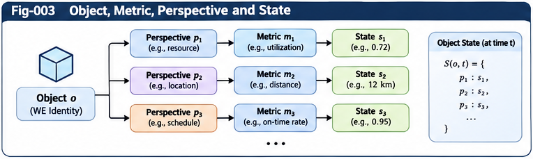
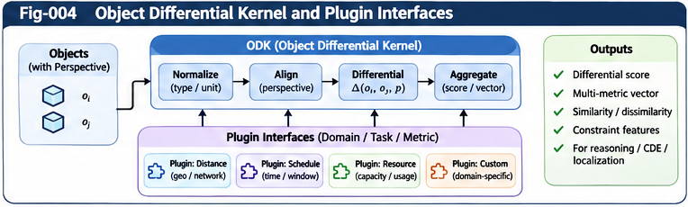

# OCSRE-004 — Object Differential Kernel and Generic Operators

**Project:** Object-Centric Structural Reasoning and Evolution (OCSRE)  
**Release track:** v1.0.0 — Research Framework and Contracts  
**Authors (proposed):** Sizhe Tan & GPT-Obot  
**Status:** Proposed architecture and conformance obligations; not an implemented or validated kernel  
**License:** Apache-2.0

## Abstract

A World Entity (WE) may carry identity, typed attributes, metric indices, relations, temporal state, perspective, and provenance. Yet a shared object representation does not, by itself, make computations reusable: comparing two objects requires compatible measurements, authorized observations, declared alignment, and interpretable results. This paper proposes the **Object Differential Kernel (ODK)** as a deliberately small, contract-governed computation interface for OCSRE. It separates metric selection, semantic alignment, differential evaluation, aggregation, qualification, and downstream decisions. Domain-specific knowledge enters through versioned Object Plugins, rather than being silently embedded in the kernel. The notation `Object[metricIndices]` identifies a typed metric projection, not an unqualified numeric array or a claim that every object shares a universal metric space. Generic operators include select, align, compare, differential, normalize, bucketize, combine, aggregate, rank, and explain; their applicability is constrained by types, units, granularity, temporal scope, perspective, permissions, and epistemic status. We formulate falsifiable reuse hypotheses, a candidate interface, safety invariants, counterexamples, and a staged conformance program. This is a specification-first research proposal, not a demonstrated universal algorithm.

**Keywords:** World Entity; object-centric computation; differential kernel; typed metric indices; comparator; semantic alignment; generic operators; plugins; provenance; conformance; relay.

## 1. Why a common object interface is not yet a common computation interface

OCSRE-001 proposes a five-stage progression:

`Object-Centric Representation → Computation → Reasoning → In-Situ Learning → Constrained Evolution`.

OCSRE-002 protects classical deduction within an explicitly restricted formal embedding. OCSRE-003 adds time, relations, perspectives, and cross-granularity safeguards. The present paper addresses the computational transition between *representing* an object and *reasoning over* it.

Consider a student, a school bus, a financial transaction, and a software function. All can be represented as WEs, but “difference” means different things: a student’s pickup-time difference, a bus’s remaining capacity, a transaction’s deviation from a historical pattern, or a function’s changed dependencies. Reusing a comparator requires more than making these values numeric. The kernel should expose a common execution discipline while leaving domain meaning to explicit adapters and contracts.

**Thesis.** A stable, typed Object Differential Kernel can support cross-domain operator reuse *if and only if* its semantic preconditions are checked and domain-specific interpretation remains explicit. Whether this produces lower adaptation cost or improved transfer is empirical, not established by architectural elegance.

## 2. Semantic foundations and boundaries

### 2.1 Object, metric projection, and state

Let an object reference be described schematically by

$$
O = (id, kind, stateVersion, temporalScope, perspective, attributes, relations, provenance, permissions).
$$

This is an interface sketch, not a replacement for WE-SIO's canonical identity or representation definitions. `id` denotes the entity reference; `stateVersion` identifies an observed or simulated state; and `perspective` qualifies an interpretation. The same WE can expose different projections under different authorizations or policies.

Write

$$
O[M] = \mathrm{Project}(O, M, C)
$$

where `M = metricIndices` is a typed list of metric selectors and `C` is a declared evaluation context. The result is a collection of *qualified metric values*, not merely a vector of real numbers. A metric value may carry:

- metric identifier and version;
- value and declared data type;
- unit, scale, and admissible range;
- observation interval and state version;
- source, provenance, and uncertainty;
- perspective and policy scope;
- aggregation level and missingness reason.

A metric selector is an address into a metric schema or registered derivation, not a promise that a metric is available or comparable for every object.

### 2.2 Four boundaries that must not collapse

1. **Identity versus similarity:** high similarity does not prove two WEs are identical.
2. **Measurement versus inference:** a measured delta is not a causal explanation, proof, or decision.
3. **Kernel versus plugin:** the kernel governs dispatch and contracts; plugins supply domain semantics and authorized transformations.
4. **Proposed versus committed state:** a computed candidate difference or delta does not itself mutate a real WE.

These boundaries are shared with OCSRE-002, OCSRE-003, and the planned epistemic and CDE papers.



*Figure 3. Object identity, metric indices, perspective, and state are distinct but composable coordinates of an object-centric reasoning context.*

## 3. A minimal Object Differential Kernel

A conceptual pipeline is:

```text
Object references + context + metricIndices
                |
        identity/state/access checks
                |
        metric selection and provenance
                |
        typed semantic alignment
                |
      generic operator / plugin dispatch
                |
       qualified differential result
                |
    explanation + residual + conformance trace
                |
   optional reasoning / learning / CDE consumer
```

The kernel is a **control and computation boundary**, not a monolithic world model. A useful minimal interface comprises six stages:

| Stage | Candidate operation | Required guarantee |
|---|---|---|
| Resolve | `resolve(objectRef, context)` | entity and state are not conflated; access checked |
| Project | `project(object, metricIndices)` | typed metric values or explicit missingness |
| Align | `align(left, right, policy)` | compatible meaning, unit, time, granularity, perspective |
| Evaluate | `evaluate(operator, alignedInputs)` | operator preconditions and deterministic contract where applicable |
| Qualify | `qualify(result, evidence, uncertainty)` | status, provenance, and scope retained |
| Trace | `emitTrace(result, residuals)` | reproducible versions and explicit unresolved conditions |

A domain may reject a request at any stage. A **typed rejection** is preferable to fabricating a plausible score.

## 4. Typed differential semantics

For aligned metric projections `A` and `B`, a differential is defined by an operator family, not by one universal subtraction:

$$
\Delta_{m,p}(A,B\mid C) = D_{m,p}(\mathrm{Align}_{m,p}(A,B\mid C)),
$$

where `m` identifies the metric, `p` the comparator policy, and `C` the evaluation context. `Align` may return a valid aligned pair, a qualified partial alignment, or a failure. Only valid alignments may enter operators whose contracts require full compatibility.

Examples of legitimate differential families include:

- **Numeric:** signed difference, absolute difference, ratio, bounded distance; only with valid units and denominator rules.
- **Categorical:** exact match, declared ordering, taxonomy distance; never infer an ordering from category labels.
- **Set/graph:** membership delta, edge additions/removals, path or neighborhood difference; graph meaning must be declared.
- **Temporal:** event-sequence deviation, lag, interval overlap; timestamps require clock and interval semantics.
- **Distributional:** divergence or transport-like comparison under a common sample and normalization contract.
- **Relational:** change in typed roles or links; relation composition is not automatically transitive.

The result should distinguish `value`, `status`, `validityScope`, `confidenceOrUncertainty`, `provenance`, and `residuals`. A score without its applicability conditions is not a portable computation result.

### 4.1 Metric similarity and differential trees

OCSRE can consume metric similarity, MDT/WE-HDT localization, and UTN addressing results through shared typed interfaces. This does **not** assert that metric similarity, differential trees, and object deltas are mathematically interchangeable. One may propose candidate addresses, another compare selected metrics, and another evaluate constrained state transitions. The kernel must preserve those role distinctions.

### 4.2 Direction and asymmetry

Some comparators are symmetric; many are not. For example, “candidate satisfies requirement” and “requirement satisfies candidate” are different relations. Contracts must declare whether `D(A,B) = D(B,A)`, whether triangle inequalities are relevant, and whether any ranking is total, partial, or context-dependent. A generic API must not silently advertise metric-space properties that an operator does not possess.

## 5. Generic operator catalog

| Operator | Purpose | Non-negotiable precondition | Output |
|---|---|---|---|
| `select` / `project` | choose registered attributes/metrics | authorized selector and version | qualified projection |
| `align` | reconcile compatible semantic dimensions | declared mapping, temporal and granularity policy | aligned operands or refusal |
| `compare` | test typed equivalence or ordering | comparator contract | qualified relation |
| `differential` | compute a directional or symmetric delta | valid alignment | typed difference |
| `normalize` | map scale into declared reference | population/baseline and transform version | transformed metric + lineage |
| `bucketize` | map values to named intervals/categories | explicit boundaries, inclusivity and null rules | typed bucket + lineage |
| `combine` | construct composite attributes | dimensional and semantic compatibility | derived attribute |
| `aggregate` | summarize a collection | membership, overlap and aggregation contract | group metric + caveats |
| `rank` | order comparable candidates | shared policy, tie/missingness handling | qualified ordering |
| `explain` | expose transformation and scoring path | trace availability and access rights | explanation artifact |

**Operator names are shared; operator meaning is not assumed universal.** For example, normalizing bus utilization and transaction anomaly scores may share dispatch machinery but require different reference populations, uncertainty models, and validation criteria.

### 5.1 SQL-native source attributes

SQL columns are not automatically OCSRE metrics. A row key may be a database identifier without being a WE identity. Before comparison, a plugin may declare transformations such as:

```text
source columns
  -> type and access checks
  -> bucketize / normalize / combine / encode / derive
  -> registered metric definitions
  -> qualified Object[metricIndices]
  -> align and compare
```

Transformations must preserve source lineage, row-level and column-level permissions, null semantics, units, and applicable SQL query semantics. A transformed score must not imply that two source records identify the same real-world entity. The detailed design belongs to OCSRE-006 and CASE-002.

### 5.2 Compositions are typed programs

A composition such as `rank(compare(normalize(project(O))))` is valid only if the output contract of each stage satisfies the next stage's input contract. This permits a reusable operator graph while forbidding an unsafe “anything in, score out” implementation. Intermediate artifacts should remain inspectable, and partial failure should not be silently converted to a zero.



*Figure 4. The Object Differential Kernel separates generic typed comparison from domain-specific Object Plugin semantics and conformance requirements.*

## 6. Object Plugins: the domain adaptation boundary

An Object Plugin is a versioned provider of one or more capabilities:

- metric schema and selector implementations;
- domain-specific aligners and comparators;
- unit conversions and derived-attribute operators;
- constraints, validity predicates, and policy bindings;
- evidence adapters and explanation templates;
- conformance tests, counterexamples, and compatibility metadata.

The plugin must not gain broader data access merely by registering a metric. Dispatch must check caller authorization and policy context at the point of use. Kernel-level contracts should remain stable across plugins; incompatible changes require explicit version negotiation.

A possible manifest is:

```yaml
plugin_id: example.school_bus.metrics
plugin_version: 0.1.0
object_kinds: [Bus, RouteAssignment]
metrics:
  - id: remaining_seats
    type: integer
    unit: seat
    granularity: bus_at_time
operators: [project, compare, differential]
required_context: [time_window, authorization, state_version]
conformance_suite: school_bus_metric_contract_v1
```

This is illustrative schema, **not** a published or implemented standard. OCSRE-005 and SPEC-004 will define the capability-composition contract more fully.

## 7. A worked example: school-bus capacity

Suppose a simulated bus WE has capacity 30 seats and 24 assigned students during a specified time interval. Under a declared occupancy rule, the derived metric `remaining_seats = 30 - 24 = 6`. A second candidate assignment increases the count to 28, yielding a **signed change of −4 remaining seats**.

This arithmetic is straightforward; the contracts are not. The result is valid only if:

1. the same bus identity and compatible state versions are referenced;
2. the assignment intervals overlap as specified;
3. students are not counted twice across overlapping routes;
4. capacity means usable seats under the applicable policy;
5. the candidate is a sandbox proposal, not a committed route change.

If an additional constraint limits ride duration or accessibility, a favorable seat differential alone cannot authorize the assignment. The CDE consumer must validate the *whole composite state* before promotion. CASE-003 and OCSRE-008 will develop this distinction.

## 8. A second example: software dependency change

A function WE may expose typed relations such as `DirectCall`, `MayCall`, `ReadsData`, and `WritesState`. Comparing two versioned calling graphs can identify added or removed edges. But a call-graph delta is not a complete impact analysis: dynamic dispatch, reflection, side effects, permissions, external dependencies, and tests can change the risk picture.

A governance plugin may use a call-graph differential to nominate affected UTN-addressed regions, then require control/dataflow checks, contract verification, and regression evidence before an AI-generated patch is accepted. The trace should report what was checked and what remains unverified. CASE-006 addresses this as a research case; no universal program-correctness guarantee is claimed.

## 9. Differential results as inputs to reasoning and learning

A qualified differential may feed:

- **Reasoning:** evidence-based hypotheses or guarded logical rules; scores do not become proofs.
- **In-situ learning:** feedback on comparator calibration, missing metrics, or alignment failures; learned changes require versioning and validation.
- **CDE:** candidate typed deltas over a single WE or composite State-Container; all constraints and authorization boundaries remain active.
- **SIF localization:** proposals for where to inspect or act, without equating addressability with truth.
- **UIERU / collective relay:** reusable plugin capabilities with their conformance records, applicability limits, and negative-transfer observations.

The kernel should be **side-effect free by default**. External actions, including irreversible real-world mutations, belong to separately authorized consumers. This separation makes rollback semantics meaningful: reverting a simulation is not the same as undoing an external event.

## 10. Epistemic and security governance

A useful result record is:

```text
DifferentialResult {
  leftRef, rightRef, stateVersions,
  metricId, metricVersion, operatorId, operatorVersion,
  alignmentPolicy, context, valueOrRelation,
  validityStatus, uncertainty, evidenceRefs,
  provenance, authorizationScope, residuals, traceId
}
```

At least four statuses should remain distinct: `VALID`, `PARTIAL`, `INCOMPARABLE`, and `REJECTED`. `PARTIAL` is not a license for an operator that requires complete alignment. The status taxonomy is provisional and must be reconciled in SPEC-002.

A trace must not leak sensitive inputs to unauthorized observers. Reproducibility should use authorized references or protected digests where raw data cannot be disclosed. Provenance is not proof of correctness, and a high confidence estimate is not a deductive guarantee. OCSRE-009 and SPEC-005 address these epistemic boundaries.

## 11. Contract-first invariants and conformance targets

The following **ODK** identifiers are proposed paper-level obligations, to be formalized in `SPEC-002-Object-Differential-Kernel-and-Comparator-Contract.md`.

| ID | Obligation | Minimum negative test |
|---|---|---|
| ODK-001 | identity and state-version separation | different WEs with similar metrics are not merged |
| ODK-002 | selector and metric schema validation | unknown or stale metric rejected |
| ODK-003 | unit and dimensional compatibility | meters not directly compared with seconds |
| ODK-004 | temporal alignment | non-overlapping windows not treated as same observation |
| ODK-005 | granularity contract | group mean not inherited by each member |
| ODK-006 | perspective and policy qualification | policy-A score not silently reused as policy-B score |
| ODK-007 | missingness and uncertainty retention | null not silently mapped to zero |
| ODK-008 | provenance and transformation lineage | derived metric trace includes source and transform |
| ODK-009 | authorization preservation | denied source column not exposed by derived metric |
| ODK-010 | comparator property declaration | asymmetric operator not treated as symmetric |
| ODK-011 | versioned plugin isolation | plugin replacement cannot silently change old results |
| ODK-012 | kernel side-effect boundary | comparison cannot mutate real WE state |
| ODK-013 | compositional operator typing | incompatible pipeline rejected before execution |
| ODK-014 | explicit residual reporting | unsupported comparison remains visible |
| ODK-015 | validated promotion boundary | favorable differential alone cannot commit CDE delta |
| ODK-016 | cross-domain regression | same kernel API survives at least two domain adapters |

**P0 semantic safety:** ODK-001 through ODK-010, ODK-012 through ODK-015. **P1 reuse:** ODK-011 and ODK-016, with negative transfer explicitly recorded. Runtime optimization is P2 and must not outrun conformance.

### 11.1 Suggested conformance sequence

1. Publish typed schemas, operator preconditions, and failure statuses.
2. Construct positive and adversarial fixtures for each invariant.
3. Test a restricted numeric domain with explicit units and time windows.
4. Add a graph/relational domain and test operator-property differences.
5. Introduce SQL transformations with permission and lineage tests.
6. Verify two domain plugins with the same unchanged kernel interface.
7. Measure integration cost, failures, negative transfer, and regression drift.
8. Only then test optional runtime, multi-agent dispatch, and CDE consumers.

A passing suite demonstrates compliance with the tested contract version, not universal semantic correctness.

## 12. Research hypotheses and measurement plan

This paper contributes primarily to the repository's existing hypothesis registry:

| Hypothesis | Kernel-specific operationalization | Suggested comparison |
|---|---|---|
| **OCSH-002** | unchanged kernel across multiple object domains | shared kernel vs separate bespoke comparators |
| **OCSH-003** | reduced plugin adaptation effort | contract-based plugin vs ad hoc integration |
| **OCSH-006** | fewer invalid cross-granularity conclusions | guarded alignment vs unguarded aggregation |
| **OCSH-007** | reusable SQL-derived metrics without security regressions | typed transforms vs raw-column comparison |
| **OCSH-008** | validated capability relay across domains | transfer with and without conformance evidence |
| **OCSH-009** | measurable gains on untargeted tasks | held-out tasks before and after new plugin |
| **OCSH-011** | improved code impact localization | calling-graph-only baseline vs multi-view governed pipeline |

Primary metrics should include conformance failure rate, semantic false-positive rate, rejected-invalid-comparison rate, plugin integration time, regression burden, provenance completeness, and held-out task performance. Report both benefit and cost, including negative transfer. No numeric effect size or scaling law is asserted here. At project inception these hypotheses remain **proposed / E0**.

## 13. Counterexamples and failure modes

**ODK-CE-001 — Unit illusion.** A distance of `5 km` and duration of `5 min` share a number but are not comparable quantities.

**ODK-CE-002 — Temporal mismatch.** Morning bus occupancy and afternoon occupancy cannot be differenced as a single simultaneous state without an explicit temporal operation.

**ODK-CE-003 — Category arithmetic.** Subtracting encoded categories `red=1` and `blue=2` does not establish a meaningful distance of one.

**ODK-CE-004 — Simpson-style aggregation reversal.** Group-level changes may reverse subgroup trends when composition shifts; aggregation context must be retained.

**ODK-CE-005 — Perspective laundering.** A risk score under one policy is displayed as an objective fact under another.

**ODK-CE-006 — Missing-as-zero.** A null SQL value is normalized to zero, producing a false anomaly.

**ODK-CE-007 — Permission laundering.** A derived attribute exposes information from a source column the caller cannot read.

**ODK-CE-008 — Graph semantics collapse.** `DirectCall(A,B)` plus `DirectCall(B,C)` is misreported as `DirectCall(A,C)`.

**ODK-CE-009 — Identity from proximity.** Two accounts with near-identical transaction profiles are merged as one person.

**ODK-CE-010 — Side-effect surprise.** A comparison plugin changes a real assignment while supposedly evaluating a sandbox candidate.

**ODK-CE-011 — Plugin version drift.** An updated normalizer changes historical scores without a recorded baseline revision.

**ODK-CE-012 — Favorable local delta, invalid global state.** A school-bus seat improvement violates a fleet-wide timing constraint.

These examples should later be recorded in `research-trace/COUNTEREXAMPLE-REGISTRY.md` and cross-linked to the applicable SPEC tests. They are illustrative failures, not empirical incident reports.

## 14. Structural capability spillover and relay

If the kernel is stable, a new metric plugin may enable previously unavailable comparisons in several consumers: localization, reasoning, optimization, feedback, and cross-agent relay. This is a candidate mechanism for **Structural Capability Spillover**, not a proof of automatic compounding. Transfer requires a matching semantic contract, authorization, conformance evidence, and task-level validation. A plugin that works for one domain may be irrelevant or harmful elsewhere.

A useful relay artifact includes the capability manifest, supported object kinds, metric definitions, operator assumptions, test fixtures, failure cases, performance envelope, and explicit leftovers. Such artifacts can be shared without claiming that the recipient inherits the original domain's truth conditions. OCSRE-011, EXT-005, and ISGFTR explore whether validated relay produces measurable gains beyond local reuse.

## 15. Explicit leftovers and open research problems

1. **Canonical formal semantics:** define a precise type system for projections, alignment, comparator effects, and qualified results.
2. **Metric ontology:** determine how independently authored metric schemas can be aligned without forced equivalence.
3. **Uncertainty calculus:** specify which uncertainty models can be combined and when composition must be refused.
4. **Partial comparability:** distinguish useful partial evidence from unsupported ranking or decision promotion.
5. **Granularity algebra:** establish domain-specific aggregation, disaggregation, and overlap rules.
6. **Identity and provenance:** reconcile uncertain entity resolution with immutable historical traces.
7. **Privacy and security:** formalize noninterference expectations for derived metrics and plugin outputs.
8. **Version migration:** govern metric, baseline, and plugin changes without erasing historical interpretability.
9. **Performance:** characterize costs of alignment, graph comparison, and multi-object evaluation on representative workloads.
10. **Distributed execution:** handle concurrent snapshots, retries, nondeterminism, and multi-agent trust boundaries.
11. **CDE integration:** specify when an evaluated differential becomes an authorized typed delta and how irreversible effects are isolated.
12. **Transfer measurement:** quantify net benefit, negative transfer, validation cost, and reach under held-out tasks.
13. **Code governance:** assess incomplete call graphs, dynamic behavior, data/control dependencies, and regression selection.
14. **Open-ended growth:** determine whether new plugins generate genuinely new questions or capabilities beyond curated benchmark gains.

None of these questions is resolved by introducing a generic operator name. They remain explicit research outputs.

## 16. Companion-document map

| Planned or companion file | Relationship |
|---|---|
| `OCSRE-001-The-Object-Centric-Structural-Intelligence-Thesis.md` | overarching object-centric progression and scope |
| `OCSRE-002-From-Classical-Syllogism-to-Object-Centric-Structural-Reasoning.md` | proof-preservation boundary |
| `OCSRE-003-Dynamic-Relational-and-Multi-Granular-Reasoning.md` | time, relations, granularity, and perspective requirements |
| `OCSRE-005-Object-Plugins-and-Composable-Intelligence-Capabilities.md` | plugin registration, capability composition, and reuse |
| `OCSRE-006-SQL-to-Object-Attribute-Transformation-and-Semantic-Alignment.md` | SQL transformations, lineage, and access control |
| `OCSRE-007-In-Situ-Object-Learning-Decision-and-Feedback.md` | feedback-driven metric adaptation |
| `OCSRE-008-WE-Native-CDE-and-Composite-State-Evolution.md` | typed state deltas and constrained promotion |
| `OCSRE-009-Epistemic-Separation-and-Object-Centric-Evidence-Governance.md` | evidence and proof status separation |
| `OCSRE-010-UTN-WE-HDT-and-SIF-Localization-Through-Shared-Object-Interfaces.md` | localization and addressing interfaces |
| `OCSRE-011-Object-Capability-Spillover-Relay-and-Collective-Structural-Learning.md` | validated capability transfer |
| `SPEC-001-Object-Identity-Perspective-and-State-Contract.md` | object identity/state/perspective prerequisites |
| `SPEC-002-Object-Differential-Kernel-and-Comparator-Contract.md` | canonical future home for ODK obligations |
| `SPEC-004-Object-Plugin-and-Capability-Composition-Contract.md` | plugin interoperability and safety |
| `SPEC-006-WE-Native-CDE-Composite-State-and-Relay-Contract.md` | evolution and relay boundaries |
| `CASE-002-SQL-Native-Object-Adaptation.md` | SQL-derived metrics |
| `CASE-003-School-Bus-Scheduling-and-Composite-WE-State.md` | composite constraint validation |
| `CASE-005-Cross-Domain-Object-Plugin-Relay.md` | cross-domain transfer evaluation |
| `CASE-006-AI-Generated-Code-Governance-Through-Calling-Graphs-and-CDE.md` | graph differential and code governance |
| `EXT-004-Open-Ended-Metric-Plugin-and-Policy-Evolution.md` | new metric and policy generation |
| `EXT-005-Structural-Capability-Spillover-and-Scaling-Hypotheses.md` | spillover and scaling tests |

**Planned figure:** `figures/Fig-004-Object-Differential-Kernel-and-Plugin-Interfaces.png`. Suggested insertion: immediately after Section 3 or Section 6 once the actual PNG exists. The figure is **not** included or claimed as completed here.

## 17. Conclusion

The Object Differential Kernel is proposed as a narrow, typed interface through which heterogeneous WEs can be projected, aligned, compared, and qualified without erasing the semantics that make those computations meaningful. Its most important design choice is **not** a universal distance function: it is the explicit separation of common operator discipline from domain-specific meaning, authorization, and validation. The resulting architecture could support reuse across SQL-derived metrics, relational reasoning, WE-native CDE, SIF/UTN localization, AI-generated-code governance, and collective relay. Whether it does so efficiently and safely must be established by contract conformance, adversarial counterexamples, unchanged-kernel cross-domain tests, and measured downstream outcomes.

---

**Research integrity note:** All architecture, manifests, interfaces, obligations, examples, and evaluation plans in this paper are proposals. No implemented kernel, formal proof, production deployment, validated transfer effect, or scaling law is claimed. Unresolved items remain explicit leftovers.
