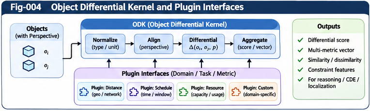

# OCSRE-005 — Object Plugins and Composable Intelligence Capabilities

**Project:** Object-Centric Structural Reasoning and Evolution (OCSRE)  
**Series:** OCSRE Core Research Papers  
**Version:** v1.0.0 — Research Framework and Contracts  
**Authors (proposed):** Sizhe Tan & GPT-Obot  
**License:** Apache-2.0  
**Status:** Research proposal; interfaces and examples are illustrative, not implemented or empirically validated.

## Abstract

A shared World Entity (WE) representation and Object Differential Kernel (ODK) do not automatically yield transferable intelligence. Domains disagree about what attributes mean, which transformations are lawful, which inferences are valid, and which actions are authorized. This paper proposes **Object Plugins** as versioned, contract-governed providers of typed capabilities that attach to object-centric interfaces without embedding domain semantics into the generic kernel. We distinguish an Object Plugin from an operator, a capability, a policy, and a runtime agent; specify discovery, compatibility, composition, evidence, permission, and lifecycle requirements; and outline a capability graph in which reusable components may be assembled into computation, reasoning, in-situ learning, and constrained evolution pipelines. We connect this design to WE-SIO, UTN/WE-HDT, SIF, CDE, UIERU, MLIU, and ISGFTR while avoiding claims of algorithmic equivalence. Proposed conformance tests and cross-domain experiments operationalize OCSH-003 and OCSH-008. The central thesis is conditional: **structural reuse becomes intelligence capability only when its semantic contracts, evidence, and outcomes survive transfer.**

**Keywords:** Object Plugin; composable capability; World Entity; Object Differential Kernel; typed interface; conformance; structural relay; capability spillover; collective learning.

## 1. Problem: representation reuse is not capability reuse

OCSRE-001 defines a progression from object representation to computation, reasoning, in-situ learning, and constrained evolution. OCSRE-004 proposes the ODK discipline: **Resolve → Project → Align → Evaluate → Qualify → Trace**. That discipline provides a stable place for computations to run, but does not itself define the semantics of a bus route, transaction, SQL record, software function, or scientific observation.

A domain adapter may translate units; a comparator may assess differences; a reasoning rule may infer a relation; a policy may decide whether a proposed state transition is acceptable. These are different capabilities. Combining them without explicit boundaries risks turning apparent interoperability into incorrect inference or unauthorized action.

The research question is therefore:

> Can independently developed, domain-aware object capabilities be discovered, checked, composed, tested, and relayed through a common interface while retaining their own semantic and governance constraints?

This paper proposes an architecture and test program, not an affirmative empirical answer.

## 2. Terminology and non-equivalence boundaries

| Term | Proposed meaning | Must not be confused with |
|---|---|---|
| **WE / Object** | Entity with identity, typed representation, state, perspective, provenance, and authorized interfaces | An arbitrary SQL row or anonymous feature vector |
| **Metric projection** | `Object[metricIndices]`: a typed selection of metrics in declared context | A universal numeric coordinate space |
| **Generic operator** | Kernel-level operation such as align, compare, bucketize, combine, or explain | A domain-specific proof of semantic correctness |
| **Object Plugin** | Versioned provider declaring capabilities, dependencies, contracts, and governance | Unrestricted executable code with implicit authority |
| **Capability** | Typed, testable transformation, inference, observation, evaluation, or proposed action | A guarantee of useful performance |
| **Capability composition** | Contract-checked connection of outputs to downstream inputs | Mere chaining of functions by matching field names |
| **Relay** | Transfer of a capability and its supporting contracts/evidence to another consumer or context | Automatic transfer of validity or benefit |
| **CDE Delta** | Typed candidate change to a state container, subject to constraints and promotion | An ODK differential score or an executed external action |

**Architectural boundary:** WE-SIO owns core world-entity semantics; ODK owns generic execution discipline; Object Plugins supply domain-specific semantics and capabilities; CDE governs constrained state/delta evolution; SIF and UIERU may consume and organize these capabilities. Shared interfaces do not make these systems identical.

## 3. Object Plugin model

### 3.1 Candidate definition

An Object Plugin is a tuple

`P = (pluginId, version, manifest, capabilities, dependencies, contracts, evidence, governance)`.

Each capability `c` is described by:

`c = (name, inputTypes, outputTypes, preconditions, semantics, effects, postconditions, provenanceRules, uncertaintyRules, permissions, tests)`.

A plugin may provide multiple capabilities. A capability may depend on other plugins, but dependency edges must be explicit and version-constrained. A plugin is not entitled to mutate a WE merely because it can read or compare that WE.

### 3.2 Illustrative manifest (non-normative)

```yaml
plugin_id: example.bus-capacity
version: 0.1.0
object_types: [Bus, RouteAssignment]
capabilities:
  - id: capacity.utilization
    kind: derived_metric
    inputs:
      - {name: assigned_passengers, type: integer, unit: person}
      - {name: seats, type: integer, unit: seat}
    output: {type: decimal, unit: ratio}
    preconditions: ["seats > 0", "counts refer to aligned route/time"]
    effects: read_only
    uncertainty: preserve
    provenance: required
    permission: route.metrics.read
    conformance_suite: capacity-utilization-v1
compatibility:
  odK_contract: SPEC-002
  object_contract: SPEC-001
  plugin_contract: SPEC-004
```

The capitalization and schema are illustrative; no stable machine-readable registry is claimed. A production schema must define canonical identifiers, validation rules, unit semantics, and version negotiation. The ratio is only meaningful after its count definitions and temporal scopes have been aligned.

## 4. A capability taxonomy

A useful taxonomy separates capability *role* from implementation technology:

1. **Representation adapters:** bind external sources to authorized WE attributes, identities, and perspectives.
2. **Metric transformers:** derive typed measurements through normalize, bucketize, encode, combine, or domain-specific transformations.
3. **Comparators and differential evaluators:** compute qualified similarities, distances, directional differences, or rankings.
4. **Reasoning providers:** emit typed assertions or candidate conclusions with explicit inference rules and evidence status.
5. **Learning providers:** update candidate models or policies from in-situ feedback, without silently rewriting authoritative facts.
6. **Constraint and evolution providers:** propose or validate typed CDE Deltas, including composite-state changes.
7. **Explanation and governance providers:** expose provenance, uncertainty, permission checks, validation evidence, and residuals.
8. **Relay providers:** package capabilities and conformance evidence for review in another domain or runtime.

A plugin may combine roles, but its manifest must declare each one separately. A model-generated conclusion is not promoted to a fact by virtue of being emitted by a reasoning provider.

## 5. Composition as a typed, governed capability graph

Let a capability graph be `G = (V, E)`, with vertices representing capabilities and edges representing data, evidence, control, or dependency connections. For an edge `c_i → c_j`, composition is provisionally admissible only if:

- output and input types, units, object identity scope, and granularity are compatible;
- temporal windows and perspectives are aligned or explicitly transformed;
- preconditions are satisfiable and declared effects are permitted;
- evidence and uncertainty qualifications are not discarded;
- downstream policy does not grant authority beyond upstream permissions;
- dependency versions and tests are pinned or compatibility-checked.

These conditions are **necessary but not sufficient** for semantic correctness. Domain-specific postconditions and counterexamples remain essential.

### 5.1 A candidate composition judgment

`Γ; Π; E ⊢ c1 ; c2 : A → B ! ε`

Here `Γ` is the typing and semantic environment, `Π` the authorization context, `E` the evidence/provenance context, and `ε` the declared effect set. This notation is a proposed contract language, not a proven calculus. Composition should fail closed when an essential condition is unknown; unsupported transformations must appear as explicit leftovers.

### 5.2 Capability lifecycle

`Proposed → Registered → Type-Checked → Conformance-Tested → Domain-Validated → Eligible-for-Relay → Monitored / Revised / Revoked`

Eligibility is scoped to a domain, object type, version, perspective, and policy context. Revocation must invalidate or requalify dependent results; it need not erase historical provenance.

## 6. Composition patterns

### 6.1 Sequential composition

A SQL source adapter produces a typed WE projection; a transformation plugin normalizes a metric; ODK aligns two projections; a comparator produces a qualified differential; a reasoning plugin derives a candidate conclusion. Each edge carries a trace and explicit uncertainty.

### 6.2 Parallel and multi-perspective composition

Multiple comparators may evaluate cost, safety, travel time, and service equity from different perspectives. A policy-aware aggregator may produce a decision recommendation only if the weights, missingness, conflicts, and authority are declared. There is no universal aggregator implied by a shared Object interface.

### 6.3 Conditional composition and alternatives

A policy may select between plugins based on object type, evidence quality, or task constraints. Alternatives should be compared against a common evaluation contract, not selected solely by the highest self-reported score. Failure paths remain part of the capability graph.

### 6.4 Recursive and evolving composition

CDE can generate candidate compositions or changes to capability graphs. Such proposals are **candidate states**, not automatically executable mutations. Recursive plugin generation requires bounded search, non-reuse/path constraints where applicable, cycle control, termination policy, and validation before promotion. These properties belong to explicit CDE and runtime contracts, not an informal assumption that composition is safe.

## 7. The Object Differential Kernel boundary

The ODK remains small: **Resolve → Project → Align → Evaluate → Qualify → Trace**. Plugins provide selectors, unit conversions, comparators, semantic transforms, and qualification rules under this discipline. The kernel should not silently acquire domain-specific branches for every new plugin.

This separation suggests a measurable hypothesis: a new domain can reuse the same kernel API and conformance harness while changing only plugins and declared schemas. To test it, compare adapter development time, kernel modifications, defect rates, and semantic failures against a domain-specific implementation baseline. A claim of *zero* kernel changes is an experimental target, not a guaranteed outcome.

**ODK integration invariants:** preserve ODK-001 through ODK-016 from OCSRE-004, especially identity/state separation, typed alignment, provenance, permission preservation, version isolation, read-only comparison, explicit residuals, and validated promotion.



*Figure 4. The Object Differential Kernel separates generic typed comparison from domain-specific Object Plugin semantics and conformance requirements.*

## 8. Worked case A: SQL-native adaptation

Consider a table containing `student_id`, `route_id`, `ride_minutes`, and `pickup_time`. A source row key does not by itself establish a WE identity. A source adapter must specify entity resolution and authorization. A transformation plugin might:

- **Bucketize** `ride_minutes` into declared, versioned service bands;
- **Normalize** duration using a published reference and compatible units;
- **Combine** ride time with other attributes only under a stated scoring perspective;
- **Derive** route-level summaries with explicit aggregation and temporal rules.

An invalid composition would join a student's private attributes into a public route metric and then claim that the output is safe because it is aggregated. Source permissions, disclosure risk, and row-level access restrictions must be preserved through the entire lineage. This case is developed in `OCSRE-006` and `CASE-002`; OCSH-007 remains unvalidated.

## 9. Worked case B: school-bus scheduling as composite WE state

A bus, student, stop, route, and fleet may each be modeled as WEs or typed relations. A scheduling state is a composite CDE State-Container, not merely one bus's attributes. Potential plugins include capacity validation, travel-time estimation, student ride-time policy, assignment feasibility, and route-change proposal.

A candidate composition is:

`Current Composite State → Proposal Plugin → Typed Delta → Constraint Validators → Differential Evaluation → Authorized Promotion or Rejection`.

A lower vehicle count does not establish feasibility if capacity, travel-time, safety, or service constraints are violated. ODK evaluation must not commit a state transition. `CASE-003` and `OCSRE-008` will specify the detailed state and delta contracts.

## 10. Worked case C: calling graphs and AI-generated code governance

A function or module may be represented as an object with typed relations to callers, callees, dependencies, contracts, and versions. A Calling Graph Plugin can locate candidate impact neighborhoods. Additional providers must account for data flow, control flow, dynamic dispatch, security boundaries, change history, test coverage, and regression evidence.

A possible pipeline is:

`Code Change → Calling-Graph Differential → UTN/WE-HDT Localization → Contract and Flow Analysis → Targeted Tests → Evidence-Qualified Governance Decision`.

The calling graph is **one perspective**, not complete program semantics. Plugin composition cannot prove the absence of runtime regressions without adequate analysis and evidence. `CASE-006` addresses this bounded use case; OCSH-011 is proposed rather than established.

## 11. Capability spillover and cross-domain relay

A capability developed for bus capacity might offer a reusable constrained-ratio operator to inventory planning. A software dependency differential might inspire relation-change analysis for transaction graphs. The shared component is a *contracted structure*, not a guarantee that source-domain semantics transfer.

A relay package should include:

- capability manifest and dependency graph;
- semantic assumptions and supported object/perspective scopes;
- conformance tests, counterexamples, and regression results;
- provenance, security requirements, and version history;
- target-domain adaptation notes and unresolved residuals;
- measured benefit and negative-transfer observations, when available.

**Relay success** requires target-domain validation and measurable net utility. ISGFTR's structural spillover hypothesis is compatible with this mechanism, but no general scaling law follows from the existence of reusable plugins. UIERU and collective learning may organize repeated evaluation, rejected transfers, and improvements as learning assets; a failed relay is still useful evidence.

## 12. Specifications first: candidate plugin contracts

The following obligations are proposed for formalization in `SPEC-004-Object-Plugin-and-Capability-Composition-Contract.md`.

| ID | Obligation | Negative conformance test |
|---|---|---|
| OPC-001 | Globally scoped plugin identity and immutable version reference | Same identifier resolves to changed semantics |
| OPC-002 | Declared input/output schemas and object-type scope | Wrong WE type accepted |
| OPC-003 | Unit, temporal, perspective, and granularity compatibility | Incompatible windows silently joined |
| OPC-004 | Preconditions, postconditions, and effect declarations | Read-only plugin mutates state |
| OPC-005 | Least-privilege permission propagation | Restricted source leaked downstream |
| OPC-006 | Provenance and transformation lineage preservation | Derived score has no source trace |
| OPC-007 | Missingness, uncertainty, and epistemic status retention | Unknown treated as zero or verified fact |
| OPC-008 | Dependency/version compatibility and reproducibility | Historical result changes silently after upgrade |
| OPC-009 | Composition graph validation and cycle policy | Unbounded recursive dependency accepted |
| OPC-010 | Conformance tests and counterexample coverage | Plugin accepted with only happy-path tests |
| OPC-011 | Explicit fallback, failure, and residual reporting | Failed adapter replaced with plausible fabricated value |
| OPC-012 | Separation of comparison, proposal, and authorized state mutation | Favorable score auto-commits a CDE Delta |
| OPC-013 | Target-domain validation before relay promotion | Source-domain test used as transfer proof |
| OPC-014 | Auditability, rollback/compensation policy, and revocation | Revoked plugin remains silently active |
| OPC-015 | Composition security against privilege escalation | Two individually authorized plugins jointly bypass policy |
| OPC-016 | Baseline-measured cross-domain reuse and negative transfer | Reuse claim made without control baseline |

**P0:** OPC-001 through OPC-012, OPC-014 and OPC-015 where applicable to safety and semantic correctness. **P1:** OPC-013 and OPC-016 for validated relay and reuse. **P2:** optimization, dynamic marketplace discovery, and autonomous composition after conformance stability. Formal contract syntax and runtime enforcement are future work.

## 13. Research hypotheses and evaluation

| Hypothesis | Proposed test | Evidence needed |
|---|---|---|
| **OCSH-002**: kernel reuse | Run unchanged ODK API against at least two independently specified domain adapters | Compatibility, correctness, kernel-change count |
| **OCSH-003**: plugins reduce adaptation cost | Compare plugin-based and bespoke implementations on matched tasks | Engineering time, validation effort, defect rate, maintenance cost |
| **OCSH-006**: cross-granularity contracts reduce invalid inferences | Inject member/group and time-scope counterexamples | False-inference rate and correct abstention |
| **OCSH-007**: SQL transformations preserve semantics/security | Compare against source SQL queries and permission policies | Equivalence where claimed, authorization and lineage tests |
| **OCSH-008**: validated relay transfers capability | Hold out target domains; compare against no-relay baseline | Target quality, integration cost, negative transfer |
| **OCSH-009**: new capability helps untargeted tasks | Register capabilities before evaluating held-out tasks | Incremental performance and net utility |
| **OCSH-010**: sustained capability accumulation | Longitudinal, versioned evaluation with independent validation | Validated growth, regressions, novelty, marginal cost |
| **OCSH-011**: code governance improves localization | Benchmark change-impact and regression targeting | Recall/precision, missed defects, cost, traceability |

All hypotheses have **E0 / proposed** status at repository inception. OCSH-005 is additionally relevant when plugin composition proposes composite CDE transitions; no validation is asserted here.

### 13.1 Experimental protocol

Pre-register tasks and baseline criteria. Freeze object schemas and plugin versions for each trial. Split source and target domains. Record invalid compositions, abstentions, security failures, and negative transfer, not only successes. Measure total costs of writing contracts and tests, not just runtime speed. Report confidence intervals where statistical design supports them. Repeat under plugin upgrades to test reproducibility and drift.

## 14. Counterexamples and failure modes

**OPC-CE-001 — Name-based type matching.** Two plugins use `capacity` for seats and kilograms; the composition engine connects them by string name.

**OPC-CE-002 — Invalid perspective transfer.** A low-cost ranking is used as a safety ranking without a policy contract.

**OPC-CE-003 — Time-window mismatch.** Morning route counts are combined with afternoon travel-time estimates as though simultaneous.

**OPC-CE-004 — Unauthorized SQL derivation.** A derived public metric reveals restricted source values.

**OPC-CE-005 — Missing evidence promotion.** A speculative reasoning output becomes an authoritative WE fact.

**OPC-CE-006 — Plugin upgrade drift.** A changed normalizer silently rewrites previously recorded comparisons.

**OPC-CE-007 — Cyclic composition.** Two plugins recursively call each other without a cycle or termination contract.

**OPC-CE-008 — Effect escalation.** A read-only comparator invokes a downstream action plugin that changes external state.

**OPC-CE-009 — Cross-granularity leakage.** A fleet average is attributed to each individual bus.

**OPC-CE-010 — Negative transfer.** A valid capacity plugin from transport produces misleading results for a different domain's stock constraints.

**OPC-CE-011 — Calling-graph blind spot.** Reflection or dynamic dispatch hides a runtime dependency; the graph is incomplete.

**OPC-CE-012 — Unvalidated CDE promotion.** A route-change proposal is committed because its objective score improved, despite violating student ride-time limits.

Each counterexample should eventually have a machine-checkable fixture, expected rejection/qualification behavior, and a regression identifier in the repository's counterexample registry.

## 15. Relationship to the wider Structural Intelligence ecosystem

| Research piece | Relationship to Object Plugins | Explicit boundary |
|---|---|---|
| **WE-SIO** | Entity identity, typed attributes, state, perspective, provenance | OCSRE reuses WE semantics rather than redefining identity |
| **UTN / MDT / WE-HDT** | Typed naming, differential localization, addressing | Common interface does not imply identical algorithms |
| **SIF** | Localization and control-plane consumers of registered capabilities | SIF is not reduced to a plugin registry |
| **CDE** | Candidate plugin-graph and composite WE-state evolution | Typed Delta, constraints, promotion, and rollback remain explicit |
| **MLIU** | Potential consumer/provider of object-level intelligence capabilities | Integration is exploratory; no mandatory implementation assumed |
| **UIERU** | Portfolio, relay, and collective evaluation of capabilities | Relay does not waive target-domain validation |
| **ISGFTR** | Hypotheses about spillover, transfer, and structural growth | Scaling and sustained gains remain empirical questions |

## 16. Figure and companion-document map

**Figure placement:** `Fig-004-Object-Differential-Kernel-and-Plugin-Interfaces.png` should accompany Sections 3–7 when the figure is produced. It should show the ODK boundary, plugin contracts, capability graph, and evidence/permission pathways. No figure asset is claimed to exist by this paper.

**Direct companion documents:**

- `OCSRE-001-The-Object-Centric-Structural-Intelligence-Thesis.md` — overarching progression.
- `OCSRE-003-Dynamic-Relational-and-Multi-Granular-Reasoning.md` — relational, temporal, and granularity semantics.
- `OCSRE-004-Object-Differential-Kernel-and-Generic-Operators.md` — kernel and operator contract foundation.
- `OCSRE-006-SQL-to-Object-Attribute-Transformation-and-Semantic-Alignment.md` — SQL source adapters and transformations.
- `OCSRE-007-In-Situ-Object-Learning-Decision-and-Feedback.md` — learning and feedback governance.
- `OCSRE-008-WE-Native-CDE-and-Composite-State-Evolution.md` — constrained state changes.
- `OCSRE-011-Object-Capability-Spillover-Relay-and-Collective-Structural-Learning.md` — transfer and collective learning.
- `SPEC-001-Object-Identity-Perspective-and-State-Contract.md` — object semantics.
- `SPEC-002-Object-Differential-Kernel-and-Comparator-Contract.md` — comparator and kernel semantics.
- `SPEC-004-Object-Plugin-and-Capability-Composition-Contract.md` — normative target for plugin contracts.
- `SPEC-006-WE-Native-CDE-Composite-State-and-Relay-Contract.md` — state promotion and relay constraints.
- `CASE-002-SQL-Native-Object-Adaptation.md`, `CASE-003-School-Bus-Scheduling-and-Composite-WE-State.md`, `CASE-005-Cross-Domain-Object-Plugin-Relay.md`, and `CASE-006-AI-Generated-Code-Governance-Through-Calling-Graphs-and-CDE.md` — evaluation cases.
- `EXT-003-Multi-Agent-Object-Intelligence-and-Relay.md`, `EXT-004-Open-Ended-Metric-Plugin-and-Policy-Evolution.md`, and `EXT-005-Structural-Capability-Spillover-and-Scaling-Hypotheses.md` — extensions.

## 17. Explicit leftovers and open research questions

1. Define a canonical manifest schema and semantic version-compatibility rules.
2. Formalize the capability composition judgment and its soundness assumptions.
3. Specify identity resolution across sources without conflating row keys and WEs.
4. Design robust unit ontologies, temporal alignment, and cross-granularity adapters.
5. Determine which uncertainty and epistemic qualifications are compositional.
6. Specify policy algebra for permission intersections, derived data, and disclosure risk.
7. Establish deterministic replay and migration for upgraded or revoked plugins.
8. Define safe termination and resource budgets for recursive capability graphs.
9. Separate reversible state deltas from irreversible external side effects.
10. Measure negative transfer and the net cost of adaptation and validation.
11. Test whether autonomous plugin generation can improve capabilities without reward hacking.
12. Determine when a capability is genuinely new rather than a renamed composition.
13. Identify SIF/UTN localization interfaces that remain stable under changing object granularity.
14. Define cross-agent accountability and conflicting-evidence reconciliation.
15. Determine whether repeated validated spillover produces sustained gains; no scaling law is assumed.

**Explicit leftover policy:** unresolved requirements are recorded as residuals with scope, owner (if assigned), blocking severity, and candidate tests. An unvalidated capability must not be relabeled as conformant because it produces plausible outputs.

## 18. Conclusion

Object Plugins offer a candidate mechanism for turning OCSRE's shared object interfaces into a reusable **capability ecosystem**. The proposed architecture keeps domain semantics inside explicit, versioned contracts; the ODK generic; CDE transitions constrained; and relay evidence-qualified. Composition becomes a governed capability graph rather than unrestricted function chaining. Whether this lowers adaptation cost, improves correctness, or creates measurable structural capability spillover is an empirical question addressed by the OCSH hypothesis program. The near-term priority is to formalize `SPEC-004`, build counterexample-first conformance fixtures, and evaluate controlled cross-domain transfer **before** claiming open-ended capability growth.

---

**Research integrity note:** This document presents proposed definitions, design contracts, illustrative examples, and falsifiable hypotheses. It does not report implemented plugins, experimental results, formal proofs, or validated scaling behavior.
