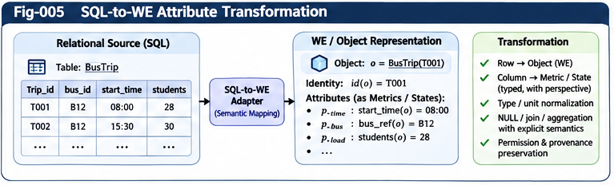

# OCSRE-006 — SQL-to-Object Attribute Transformation and Semantic Alignment

**Project:** Object-Centric Structural Reasoning and Evolution (OCSRE)  
**Series:** OCSRE Core Research Papers  
**Version:** v1.0.0 — Research Framework and Contracts  
**Authors (proposed):** Sizhe Tan & GPT-Obot  
**License:** Apache-2.0  
**Status:** Research proposal; contracts, examples, and evaluation plans are illustrative and not empirically validated.

## Abstract

Relational databases already contain extensive operational knowledge, but an SQL column is not automatically an object metric, a row key is not necessarily a World Entity (WE) identity, and a query result is not necessarily an authorized or semantically stable object view. This paper proposes a contract-governed bridge from SQL-native attributes to OCSRE object projections through typed **Bucketize, Normalize, Combine, Encode, and Derive** transformations. The bridge distinguishes source records, candidate entities, resolved WEs, perspectives, temporal scopes, and metric definitions; preserves SQL null and aggregation semantics; and carries authorization, lineage, uncertainty, and transformation versioning into Object Differential Kernel (ODK) evaluation. It proposes a compilation and validation discipline for relational-to-object mappings, including non-invertible transformations, security-sensitive aggregation, changing source schemas, and composite WE states. SQL remains a source and execution substrate, not a replacement for WE-SIO identity, ODK semantics, or CDE governance. The principal testable claim (OCSH-007) is that explicit semantic transformations enable reusable object capabilities without weakening SQL correctness or security. The paper specifies counterexamples, conformance obligations, baselines, and unresolved residuals rather than claiming this result has been demonstrated.

**Keywords:** SQL; World Entity; object-centric reasoning; semantic alignment; metric projection; bucketization; normalization; lineage; row-level security; Object Differential Kernel; typed transformation; conformance.

## 1. The integration problem

The OCSRE progression—**Representation → Computation → Reasoning → In-Situ Learning → Constrained Evolution**—requires objects to carry meaningful, inspectable attributes. Relational systems are attractive inputs: tables, joins, indexes, materialized views, and transactions already support mature data management. However, the apparent similarity between a database row and an object conceals several distinct questions:

1. What real-world or computational entity, if any, does this row represent?
2. Which columns are measurements, identifiers, categories, timestamps, evidence, or administrative metadata?
3. Which transformations make the columns comparable across sources or perspectives?
4. Under which permissions and time windows may a transformed value be used?
5. Which conclusions are supported by the transformation, and which remain unlicensed?

The proposed SQL-to-Object bridge answers these questions with explicit contracts rather than relying on field-name similarity or embedding-based resemblance alone. The research target is not an automatic universal ontology; it is a **conformance-checkable adaptation path** from a relational source to a typed object interface.

## 2. Architectural boundary and terminology

| Layer | Responsibility | Non-equivalence boundary |
|---|---|---|
| SQL source | Rows, columns, keys, views, transactions, query semantics, source access controls | A primary key is not necessarily WE identity |
| Source adapter | Schema inspection, typed extraction, source authorization, snapshot and lineage capture | Extraction does not certify semantic interpretation |
| Semantic transformation | Bucketize, Normalize, Combine, Encode, Derive with domain contracts | A numeric output is not automatically a valid metric |
| WE-SIO interface | Entity identity, representation, perspective, state, evidence and authorized operations | WE is not reducible to a table row |
| ODK | Resolve → Project → Align → Evaluate → Qualify → Trace | Comparison is not proof of identity or causality |
| Object Plugin | Versioned, contract-checked source and transformation capabilities | Executability does not imply permission or correctness |
| CDE | Candidate typed Delta, constraints, validation, state promotion | A computed difference is not a state mutation |
| SIF / UTN / WE-HDT | Localization, typing, addressing and structural consumption | Shared interfaces do not imply algorithmic equivalence |

The same source row can contribute evidence to several candidate WEs; several source rows can describe one WE; and some rows (such as audit events or association records) may describe relations rather than entities. Identity resolution therefore remains separate from attribute transformation.

## 3. A typed source-to-object mapping

Let a source record be `r ∈ R`, observed under source snapshot `s`, query context `q`, and authorization context `a`. A candidate mapping is:

`M(r, s, q, a) -> (candidateWE, attributes, evidence, qualifications)`.

A transformed attribute is modeled as:

`A = (name, value, valueType, unit, semanticType, grain, timeScope, perspective, sourceLineage, transformChain, uncertainty, authorization, validityStatus)`.

`validityStatus` distinguishes at least `validated`, `provisional`, `rejected`, and `unknown`. `unknown` is not silently coerced to `validated`. A mapping can yield `unresolvedIdentity` even when attributes have been computed correctly. Identity resolution requires a separate rule with supporting evidence, conflict policy, and auditable decisions.

A metric projection, `Object[metricIndices]`, selects **declared metric definitions**, not arbitrary column ordinals. A metric index is meaningful only relative to a metric registry/version and the associated type, grain, perspective, and validity constraints.

### 3.1 Minimal mapping contract

Each mapping declaration should specify:

- Source relation/query, schema version, snapshot or transaction-consistency policy.
- Source row grain, candidate WE type, and identity-resolution method.
- Input column types, nullability, units, timezone and encoding conventions.
- Transform chain, parameters, fitted statistics, output metric definitions and versions.
- Row, column, tenant and purpose-based access constraints, including derived-output policy.
- Provenance of each output, uncertainty propagation and permitted downstream operations.
- Conformance fixtures, counterexamples, performance budgets and rollback procedure.

A source adapter may reject a mapping before runtime if any mandatory field is missing or incompatible.

## 4. Primitive semantic transformations

The transformations below are **operator families**, not universally valid formulas. Each invocation must be parameterized by domain semantics and a declared contract.

### 4.1 Bucketize

`Bucketize(x; boundaries, closure, unit, missingPolicy, version) -> category` maps a typed value into named intervals or categories. For example, a route duration can be bucketized as `short`, `medium`, or `long` only if the boundaries, time unit, boundary inclusion rules, and target purpose are declared. Overlapping or incomplete intervals require explicit resolution; a missing duration is not assigned to the shortest bucket.

Bucketization is often lossy. The resulting category cannot be used to reconstruct the exact input or to assert equality between all values in the same bucket. Boundary stability under version changes is a conformance requirement.

### 4.2 Normalize

`Normalize(x; method, referencePopulation, fitWindow, unit, missingPolicy, version) -> normalizedMetric` may apply unit conversion, min–max scaling, z-scores, reference ratios, or other typed transformations. The reference population and fit window are part of the semantic contract. A z-score from one school district is not automatically comparable with a z-score from another. Normalization must handle zero denominators, constant populations, outliers, unseen ranges, and train/test leakage explicitly.

Normalization may be reversible under specified parameters, but not all normalization methods are. A normalized score must retain its original unit context and transform version in lineage.

### 4.3 Combine

`Combine(a1, ..., an; rule, weights, grain, missingPolicy) -> compositeAttribute` joins or aggregates attributes according to an explicit semantic rule. Combining student counts across bus routes requires checking whether riders are distinct and whether route assignments overlap. Combining a sum with a ratio or a rate with a count without a declared transformation is invalid. Weighting schemes require their own provenance and justification.

An output that merges several WEs may describe a **composite WE** or group-level perspective, not a new attribute of each member. Aggregation does not license downward inheritance.

### 4.4 Encode

`Encode(category; vocabulary, unknownPolicy, version) -> representation` converts categorical information to a typed representation. Numeric category codes must not imply ordinal distance unless the domain declares an order. An unseen category must not silently map to an existing class. Encoded representations may be useful for comparison but do not replace the source semantics.

### 4.5 Derive

`Derive(inputs; expression, assumptions, grain, validityWindow) -> derivedAttribute` creates a new measure from source attributes, such as `occupancyRatio = passengers / permittedCapacity`. The contract must define denominator constraints, capacity meaning, snapshot alignment, and whether the result is an observation, estimate, or policy score. Derivation can be deterministic while its inputs remain uncertain or incomplete.

## 5. SQL semantics that must survive adaptation

### 5.1 NULL and three-valued logic

SQL `NULL` is not zero, false, an empty string, or proof of absence. SQL predicates may evaluate to `UNKNOWN`; object adapters must not collapse this into a Boolean fact. Source-specific `NULL` conventions should be mapped to typed states such as `missing`, `notApplicable`, `withheld`, or `unknown` only when justified by metadata. SQL `COUNT(*)`, `COUNT(column)`, and `SUM(column)` have different null behavior; a transform must preserve or explicitly document any semantic change.

### 5.2 Bag semantics, joins, and aggregation grain

SQL commonly operates on bags (multisets), not mathematical sets. Joins can multiply rows, and `DISTINCT` can remove repeated observations that matter. Every join must declare expected cardinality and the entity or event grain before aggregation. A route-level average is not automatically the same as the average across all individual trips. Window functions and grouping sets may produce different perspectives or grains and should be labeled accordingly.

### 5.3 Time, transactions, and consistency

A multi-table extraction should specify snapshot consistency, transaction isolation assumptions, event-time versus ingestion-time interpretation, timezone and late-arrival handling. Comparing a current capacity row to last month's passenger assignments without temporal alignment can yield a plausible but false metric. Slowly changing dimensions, corrections, and backfills require source-version and effective-time tracking.

### 5.4 Query and optimization equivalence

Pushing a transformation into SQL may improve performance, but is permissible only when its semantics are preserved. Reordering filtering, grouping, windowing, and normalization can change results. Numeric precision, collation, rounding, overflow, and nondeterministic ordering can also change outputs. Any pushdown rewrite should be tested against a reference execution with specified tolerances and adversarial fixtures.

## 6. Identity, relation, and perspective alignment

A database row key identifies a record within a database contract; it does not establish a unique person, bus, account holder, software function, or other WE across sources. Proposed identity resolution returns a candidate match, supporting evidence, alternatives, and an uncertainty qualification. In particular, matching email addresses, device keys, transaction patterns, or names may be useful evidence but is not proof of a shared real-world identity.

Relational foreign keys encode database referential integrity, not every real-world relation. A `student_route` join table may record assignment rather than actual boarding. A temporal or observational perspective must accompany such relations. The adapter should preserve distinctions among **source assertion**, **observation**, **inference**, **evaluation**, and **authorized action**; this separation is developed further in OCSRE-009.

Cross-granularity transformations require explicit rules: an attribute of a fleet is not necessarily an attribute of a bus; a statistic of a class is not necessarily true of each student. These are semantic constraints, not mere representation details.

## 7. The SQL-to-WE transformation pipeline

A proposed pipeline is:

```text
Authorized SQL Source / Snapshot
             |
             v
Schema + Grain + Permission Inspection
             |
             v
Typed Extraction + Source Lineage
             |
             v
Identity / Relation Candidate Resolution
             |
             v
Semantic Transform Chain
  Bucketize | Normalize | Combine | Encode | Derive
             |
             v
WE Attribute / Metric Registry Validation
             |
             v
Object[metricIndices] Projection
             |
             v
ODK: Resolve -> Project -> Align -> Evaluate -> Qualify -> Trace
             |
             v
Evidence-qualified Reasoning / Learning / CDE Candidate
```

Each arrow represents a contract boundary with a possible `reject`, `defer`, or `qualified output` result. This is a logical architecture, not a claim that all stages must execute as separate physical services. An optimizer may fuse operations after proving or testing the relevant equivalence.



*Figure 5. Proposed SQL-to-WE adaptation: typed attribute transformations produce object-facing representations while preserving source semantics, provenance, and access constraints.*

## 8. Illustrative school-bus SQL adaptation

Consider a source with `Bus(bus_id, capacity, effective_from)`, `Route(route_id, service_date)`, and `Assignment(student_id, route_id, bus_id, service_date, status)`. These tables are illustrative, not a canonical schema.

An adapter might derive a bus-day occupancy ratio from the count of **distinct eligible assigned students** divided by the bus's authorized capacity effective on that date. Even this simple metric requires checking whether an assignment is active, whether a student has multiple records, whether capacity includes driver or accessibility constraints, and whether assignment represents actual occupancy. The source-derived ratio should be labeled `scheduledAssignmentUtilization`, not `observedOccupancy`, unless actual boarding data support the latter.

A bucketized `capacityPressure` label can then be compared across buses only if thresholds and date-specific policies align. A composite `FleetDay` WE may aggregate these attributes for scheduling evaluation, but no scheduling change is authorized by the metric itself. Any proposed route reassignment is a **typed CDE Delta**, subject to constraints, review, and promotion checks. CASE-002 should formalize the SQL adaptation fixture; CASE-003 should test the composite state and evolution boundary.

## 9. Object Plugins and capability composition

A SQL adapter is a candidate Object Plugin provider. It may expose capabilities such as `extractAuthorizedSnapshot`, `resolveCandidateIdentity`, `deriveUtilization`, `bucketizePressure`, and `projectMetric`. Each capability needs typed inputs/outputs, preconditions, effect declarations, versioned semantics, and tests. The ODK remains unchanged when a new database dialect or domain plugin is introduced; domain-specific logic stays behind plugin contracts.

Composition is valid only if upstream outputs satisfy downstream type, grain, time, perspective, permission, and uncertainty preconditions. A plugin that accepts a numeric `ratio` must not automatically accept every numeric ratio. Compatibility is semantic, not merely syntactic. OCSRE-005 and SPEC-004 develop the plugin contract; this paper specializes it to SQL sources.

## 10. Security, privacy, and authorization preservation

The bridge must not use object projections to bypass SQL source controls. At minimum:

1. Enforce source row-level and column-level restrictions before or during extraction, using a declared execution identity and purpose.
2. Propagate sensitivity labels, source permissions, and lineage to derived attributes and downstream consumers.
3. Apply an explicit derived-output disclosure policy; aggregates and scores may reveal protected information even when raw rows are hidden.
4. Prohibit unauthorized joins, cross-tenant correlation, and identity inference based solely on a common identifier format.
5. Bind query parameters and validate identifiers; prohibit untrusted plugin-generated SQL from acquiring broader privileges.
6. Treat cached projections, logs, explanations, model-training inputs, and relay artifacts as governed outputs, not permission-free copies.
7. Revalidate access when source policy or plugin version changes; revocation may require invalidation of derived materializations.

Permission composition cannot be reduced safely to a simple set intersection in every environment: purpose limits, aggregation disclosure, consent, retention, and legal restrictions may require more expressive policy evaluation. Where a policy cannot be proven or checked, the default is to withhold the output and record the residual.

## 11. Lineage, uncertainty, and epistemic qualification

For every derived attribute, a trace should identify source relations and columns, row or aggregate lineage where authorized, snapshot/version, transformation IDs, fitted parameters, policy decisions, and quality warnings. Traces must themselves respect access controls; unrestricted row-level provenance can leak protected data.

Uncertainty may arise from missing records, measurement error, entity-resolution ambiguity, model-based imputation, stale snapshots, and policy-sensitive redaction. A deterministic SQL expression does not eliminate upstream uncertainty. The adapter must distinguish exact source computation from uncertain real-world interpretation. Comparators should return `incomparable` or `insufficientEvidence` rather than manufacturing a distance when units, grain, perspective, or time cannot be aligned.

## 12. Change management and in-situ feedback

SQL schemas evolve: columns are renamed, units change, categorical vocabularies grow, and views are redefined. Every material transformation should have a version and compatibility policy. A schema migration may invalidate prior metric values, learned thresholds, or cached evidence. A safe upgrade sequence is: detect change → run compatibility and negative tests → compare reference outputs → qualify or reject drift → revalidate downstream consumers → promote the new mapping version.

In-situ feedback can flag erroneous identity matches, incorrect buckets, or invalid assumptions. Such feedback is **evidence for revising a mapping**, not an automatic authorization to rewrite source facts or promote new CDE state. OCSRE-007 addresses the learning loop; OCSRE-008 addresses constrained state evolution.

## 13. Proposed conformance obligations

The following `SQLWE` identifiers are **paper-level proposed obligations**. They are not substitutes for the future normative SPEC files.

| ID | Obligation | Representative test |
|---|---|---|
| SQLWE-001 | Source row identity and WE identity are distinct | Two source IDs for one WE; same ID across tenants |
| SQLWE-002 | Input/output types and units are explicit | Reject minutes-versus-seconds comparison without conversion |
| SQLWE-003 | Transformation parameters and versions are recorded | Replay bucket boundaries across versions |
| SQLWE-004 | SQL NULL and three-valued semantics are preserved | `COUNT(*)` vs `COUNT(x)`; missing-as-zero rejection |
| SQLWE-005 | Join multiplicity and aggregation grain are checked | Duplicate assignments inflate totals |
| SQLWE-006 | Temporal and snapshot alignment is enforced | Stale capacity with current assignments |
| SQLWE-007 | Perspective and evidence status are retained | Assigned vs boarded passenger distinction |
| SQLWE-008 | Source and derived-output authorization is enforced | Unauthorized row inference via aggregate |
| SQLWE-009 | Provenance and uncertainty propagate | Ambiguous entity resolution remains qualified |
| SQLWE-010 | SQL pushdown preserves declared semantics | Compare reference and optimized execution |
| SQLWE-011 | Plugin composition validates semantic compatibility | Reject incompatible ratio/grain inputs |
| SQLWE-012 | Schema/transform changes trigger regression checks | Changed unit or categorical vocabulary |
| SQLWE-013 | ODK receives only validated or qualified projections | Invalid metric blocked before comparison |
| SQLWE-014 | CDE promotion remains a separate authorized step | Computed utilization cannot mutate route |
| SQLWE-015 | Cross-domain reuse leaves generic ODK unchanged | SQL and non-SQL adapters use same kernel contract |
| SQLWE-016 | Rejection, uncertainty, and residuals are explicit | Unresolved permission or identity recorded |

**Conformance priority:** P0: SQLWE-001–014 and 016 where semantic or security correctness is at stake; P1: SQLWE-015 and measured reuse; P2: optimizer and runtime-performance exploration after P0 conformance. This priority is provisional pending SPEC review.

## 14. Counterexample registry candidates

- **SQLWE-CE-001 — Row-key identity collision:** `id=42` from two tenants is merged into one WE.
- **SQLWE-CE-002 — Duplicate join:** One student assignment is duplicated by a many-to-many join and counted twice.
- **SQLWE-CE-003 — Missing-as-zero:** `NULL` capacity becomes zero, creating a false utilization signal.
- **SQLWE-CE-004 — Bucket boundary drift:** A threshold update changes historical categories without a version marker.
- **SQLWE-CE-005 — Population leakage:** Normalization parameters are fitted on held-out evaluation data.
- **SQLWE-CE-006 — Ordinal hallucination:** Encoded category `3` is treated as three times category `1`.
- **SQLWE-CE-007 — Grain inversion:** Fleet average utilization is asserted for every bus.
- **SQLWE-CE-008 — Temporal mismatch:** Route assignments and capacity are read from incompatible effective dates.
- **SQLWE-CE-009 — Authorization laundering:** A derived score reveals a restricted student's presence.
- **SQLWE-CE-010 — Predicate rewrite error:** Filtering after aggregation is treated as equivalent to filtering before aggregation.
- **SQLWE-CE-011 — Evidence promotion:** Scheduled passengers are presented as observed boarding counts.
- **SQLWE-CE-012 — Unlicensed mutation:** A high pressure score directly triggers an external route update without CDE validation.

Each counterexample should become a negative conformance fixture in `CASE-002-SQL-Native-Object-Adaptation.md` and be indexed in `research-trace/COUNTEREXAMPLE-REGISTRY.md` when those files are authored.

## 15. Hypotheses and evaluation program

| Hypothesis | SQL-specific evaluation | Falsification or failure signal |
|---|---|---|
| **OCSH-007** | Compare typed SQL-to-WE adapters against direct raw-column mapping on semantic correctness, access-control tests, and adaptation cost | No improvement, or any material security regression |
| **OCSH-002** | Reuse the unchanged ODK across SQL-derived and non-SQL object metrics | Kernel requires domain-specific modifications |
| **OCSH-003** | Compare contract-based plugins with ad hoc adapters on integration time, defects, and maintenance | Equal or greater total cost without compensating benefits |
| **OCSH-006** | Test grain-typed transformations against untyped aggregation | Invalid inheritance or aggregation persists |
| **OCSH-008** | Transfer a validated transformation capability to a held-out domain | Transfer fails conformance or produces negative net value |
| **OCSH-011** | Apply the same typed mapping discipline to program-graph data extracted from code repositories | No improvement in traceability or impact localization |

An evaluation should include at least two distinct SQL dialects or schemas, a non-SQL target domain for reuse, permission-negative fixtures, and held-out transformations. Metrics should report correctness, semantic rejection precision/recall, security violations, lineage completeness, latency, adaptation effort, validation cost, and net downstream benefit. **No empirical results are claimed here.** A lower runtime latency alone does not establish semantic alignment or intelligence gain.

## 16. Relationship to the broader research program

- **WE-SIO:** Owns WE identity, evidence, representation, state, perspective, and operations. SQL adapters populate declared interfaces; they do not redefine WE semantics.
- **OCSRE-002 / OCSRE-003:** Classical validity and relational/multi-granular reasoning constrain how transformed attributes may support inference.
- **OCSRE-004:** ODK receives aligned projections, not raw untyped SQL columns.
- **OCSRE-005:** Versioned Object Plugins provide SQL extraction and transformation capabilities.
- **OCSRE-007 / OCSRE-009:** Feedback and epistemic governance preserve the difference between computed facts, observations, and inferred claims.
- **OCSRE-008 / CDE:** A WE or composite WE may serve as a CDE State-Container, but source-derived scores do not authorize Delta promotion.
- **UTN / MDT / WE-HDT / SIF:** Shared typing, localization, and addressing interfaces may consume these metrics without requiring algorithmic equivalence.
- **MLIU / UIERU:** Potential downstream consumers and relay organizers; no mandatory runtime integration is assumed.
- **ISGFTR / OCSRE-011:** Cross-domain reuse and structural spillover are measurable hypotheses, not an established scaling law.
- **AI-generated-code governance:** Relational tables describing functions, call edges, and change events may feed object projections; calling graphs remain only one perspective among control/data flows, contracts, and security evidence.

## 17. Companion contracts, cases, and figure

**Primary future normative targets:**

- `../specs/SPEC-001-Object-Identity-Perspective-and-State-Contract.md`
- `../specs/SPEC-002-Object-Differential-Kernel-and-Comparator-Contract.md`
- `../specs/SPEC-004-Object-Plugin-and-Capability-Composition-Contract.md`
- `../specs/SPEC-005-In-Situ-Learning-Feedback-and-Epistemic-Governance-Contract.md`
- `../specs/SPEC-006-WE-Native-CDE-Composite-State-and-Relay-Contract.md`

**Primary planned evaluation case:** `../cases/CASE-002-SQL-Native-Object-Adaptation.md`. Related cases: `CASE-003-School-Bus-Scheduling-and-Composite-WE-State.md`, `CASE-005-Cross-Domain-Object-Plugin-Relay.md`, and `CASE-006-AI-Generated-Code-Governance-Through-Calling-Graphs-and-CDE.md`.

**Figure insertion point:** Place `Fig-005-SQL-to-WE-Attribute-Transformation.png` after Section 7 once created. No figure asset is asserted to exist yet.

These filenames are planned repository interfaces; their mention does not imply they have been authored or validated.

## 18. Explicit leftovers and open research questions

1. Define a canonical SQL-to-WE mapping DSL and machine-readable contract schema.
2. Establish formal semantic-preservation conditions for SQL pushdown and optimization.
3. Design identity resolution that handles uncertain, many-to-many, and changing identities.
4. Specify robust cross-dialect equivalence for nulls, collation, timestamps, and numeric precision.
5. Determine which lineage representations are both sufficiently precise and privacy-preserving.
6. Formalize policy composition for derived attributes, joins, aggregates, and relay.
7. Establish uncertainty algebra for transformed, imputed, and aggregated attributes.
8. Define safe grain-change contracts and compositional aggregation proofs.
9. Specify migration and rollback of metric definitions after source schema drift.
10. Determine when cached or materialized projections must be invalidated after revocation.
11. Test incremental transformations under streaming, late data, and changing snapshots.
12. Quantify transformation and conformance overhead versus measurable downstream benefits.
13. Explore whether automatic mapping suggestions can be safely reviewed and promoted.
14. Determine transfer boundaries for bucketization and normalization across populations.
15. Define audit requirements for cross-agent reuse of SQL-derived evidence.
16. Develop a systematic negative-transfer and disclosure-risk benchmark.

**Residual policy:** Each unresolved issue should be entered into `research-trace/UNRESOLVED-RESIDUALS.md` with an identifier, severity, scope, candidate validation, and owner when assigned. No unresolved P0 semantic or authorization issue may be silently converted into a passing result.

## 19. Conclusion

SQL-to-Object adaptation is not simply the conversion of columns into vectors or rows into entities. It is a governed transformation of source records into **typed, temporally scoped, perspective-aware, evidence-qualified object attributes**. Bucketize, Normalize, Combine, Encode, and Derive can support reusable Object Plugins and ODK comparisons only when their semantic contracts, lineage, authorization, and limitations remain visible. This provides a concrete research route from existing relational infrastructure to OCSRE's object-centric computation and reasoning, while preserving the separate roles of WE identity, ODK evaluation, in-situ learning, and CDE state evolution. The next step is counterexample-first specification and CASE-002 validation—not a claim of completed interoperability.

---

**Research integrity note:** All definitions, architecture diagrams, contracts, and examples in this paper are proposals. No production implementation, formal proof, empirical transfer result, or scaling-law validation is asserted.
