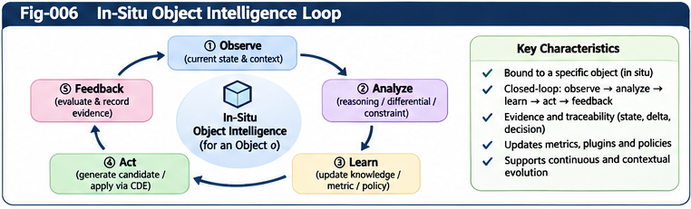

# OCSRE-007 — In-Situ Object Learning, Decision, and Feedback

**Project:** Object-Centric Structural Reasoning and Evolution (OCSRE)  
**Series:** OCSRE Core Research Papers  
**Version:** v1.0.0 — Research Framework and Contracts  
**Authors (proposed):** Sizhe Tan & GPT-Obot  
**License:** Apache-2.0  
**Status:** Research proposal. All mechanisms, contracts, examples, and evaluation protocols are proposed; no implementation, formal proof, or empirical benefit is claimed.

## Abstract

Object-centric intelligence requires more than a representation that can be queried and compared. An object-oriented system must also be able to use local observations and feedback to revise warranted beliefs, evaluate decisions, and propose changes while preserving identity, perspective, authorization, and evidence boundaries. This paper proposes **in-situ object learning** as a contract-governed loop in which a World Entity (WE), or an explicitly scoped composite WE state, serves as the semantic address for observations, predictions, decisions, outcomes, and learning records. Learning may update an object-associated model, metric calibration, confidence assessment, or candidate policy; it does not necessarily mutate the world entity or authorize an external action. We distinguish epistemic updates from operational state transitions and from changes to the underlying ontology. We connect Object Differential Kernel (ODK) comparisons, typed Object Plugins, SQL-derived evidence, multi-granular reasoning, WE-native Constrained Delta Evolution (CDE), and UIERU/MLIU relay through explicit contracts. We propose traceable feedback envelopes, promotion gates, negative-feedback handling, counterexamples, and controlled evaluation of the hypothesis that in-situ learning improves feedback use or knowledge traceability (OCSH-004). The result is a research architecture and validation agenda, not a demonstrated learning advantage.

**Keywords:** in-situ learning; World Entity; object-centric decision; feedback; epistemic governance; Object Differential Kernel; policy evaluation; Constrained Delta Evolution; traceability; collective learning.

## 1. Why learning belongs at the object interface

OCSRE develops a five-stage progression:

**Object-Centric Representation → Computation → Reasoning → In-Situ Learning → Constrained Evolution.**

The first three stages permit typed facts and measurements to be represented, compared, and used in qualified inference. Yet a static representation cannot by itself explain how an observation changes a future decision. Conversely, an unrestricted learning agent may alter scores, beliefs, and actions without a stable account of *which object* was affected, *which evidence* justified the change, or *which authority* allowed it.

The research problem is to place learning close to the object and its operating context without equating locality with ownership, autonomy, or permission. **In situ** denotes an addressable, context-preserving feedback loop, not necessarily code executing inside an entity or an entity possessing independent agency. The learning computation may be external; its claims and updates must remain attributable to a declared object scope.

Three requirements motivate this architecture:

1. **Local relevance:** observations and feedback must be connected to the identity, state version, temporal window, granularity, and perspective for which they are meaningful.
2. **Revisability:** evidence can revise estimates, models, or decision preferences without retroactively rewriting observed history.
3. **Governed effect:** proposed learning updates and actions must pass independent semantic, policy, and constraint checks before promotion.

## 2. Core definitions and boundaries

| Concept | Proposed role | Explicit non-equivalence |
|---|---|---|
| WE / Object | Identity-bearing semantic anchor with typed state, perspective, evidence, and operations | Not an arbitrary feature vector, SQL row, or autonomous agent |
| Observation | Time-scoped, source-qualified report about an object or relation | Not automatically ground truth |
| Belief / estimate | Revisable epistemic representation under a perspective | Not identical to operational state |
| Decision | Selection or recommendation among admissible candidates | Not authorization to execute |
| Feedback | Evidence about a prediction, action, decision, or environment | Not always a scalar reward or causal effect |
| Learning update | Proposed revision to model, calibration, confidence, or policy | Not automatically a WE state Delta |
| CDE Delta | Typed candidate state transition subject to constraints | Not an ODK differential score |
| Relay artifact | Versioned capability or evidence package for another scope | Not proof of cross-domain validity |

A **learning-bearing object** is an object with attached or associated learning records and interfaces. It need not contain a neural network, a mutable internal policy, or a physically co-located runtime.

## 3. A minimal object learning context

For object `o`, define a proposed learning context:

```text
LearningContext(o) = {
  objectRef, identityVersion, stateVersion,
  perspectiveRef, granularityRef, timeWindow,
  metricSchemaVersion, capabilityVersions,
  evidenceRefs, authorizationContext,
  learningObjective, evaluationProtocol
}
```

The context is a **logical envelope**, not a canonical implementation schema. A composite context may reference multiple WEs and relations with an explicit composition rule. Identity, state, perspective, and model versions are separate axes: changing a prediction model does not by itself change the identity or measured physical state of the bus, person, transaction, or code function.

A context is inadmissible if the object cannot be resolved at the requested scope, the metric semantics are incompatible, source permissions are absent, or the evidence cannot be attributed to an appropriate temporal window. Inadmissible contexts yield a qualified residual, not a fabricated training example.

## 4. The proposed in-situ intelligence loop

The conceptual loop is:

```text
Resolve Object + Perspective + State Version
             |
             v
Observe / Ingest -> Qualify Evidence -> Project Typed Metrics
             |                             |
             +-----------------------------v
                                 ODK Compare / Explain
                                          |
                                          v
                              Reason / Predict / Decide
                                          |
                                          v
                             Propose Candidate / Action
                                          |
                                          v
                             Policy and Safety Gate
                                          |
                           permitted? ----+---- denied/deferred
                              |                     |
                              v                     v
                       Execute or Simulate     Record Residual
                              |
                              v
                      Observe Outcome / Feedback
                              |
                              v
                       Attribute and Evaluate
                              |
                              v
                    Propose Learning Revision
                              |
                              v
                    Validate -> Promote / Reject
                              |
                              +----> Versioned Learning Record
```



*Figure 6. Proposed in-situ object intelligence loop with qualified observations, differential feedback, learning proposals, and governed decisions.*

The loop is not assumed to be synchronous. Delayed outcomes, missing feedback, human review, and irreversible external actions may interrupt it. An explicit pending or unresolved state is preferable to a forced positive/negative label.

## 5. The Object Differential Kernel as a feedback substrate

OCSRE-004 proposes the ODK discipline:

**Resolve → Project → Align → Evaluate → Qualify → Trace.**

For a learning step, let `P(o, m, p, t, v)` denote a typed metric projection for object `o`, metric selection `m`, perspective `p`, temporal scope `t`, and version `v`. Let `D` be a comparator whose admissibility is determined by a declared alignment contract. A conceptual residual is:

`r = D(P_observed, P_expected | alignmentContract)`.

The residual is a *qualified comparison output*. It is not necessarily a numerical error, a reward, a causal attribution, or a permissible update direction. Depending on metric type, `r` may be a categorical mismatch, interval discrepancy, constraint violation, missing-evidence marker, or structured explanation.

Learning algorithms may consume a residual only after checking comparator provenance, confidence, uncertainty, and compatibility with the declared objective. This prevents a seemingly universal metric difference from becoming an unlicensed universal training signal.

## 6. Observation, prediction, decision, and outcome must remain distinct

A feedback cycle may contain five different kinds of records:

1. **Observation record:** what a source reported, with event time and collection time.
2. **Prediction record:** what a particular model version expected under a specific context.
3. **Decision record:** what candidate was chosen or recommended, with alternatives and decision policy.
4. **Action record:** what was actually executed, by whom or what, under which authorization.
5. **Outcome record:** what later evidence indicates occurred, including incomplete or contradictory evidence.

Conflating these records creates false feedback. For example, a school-bus scheduling system may recommend a new route that is never dispatched; later arrival times cannot be attributed to that recommendation. Likewise, a software change proposal that never reaches production must not be treated as an executed intervention.

A decision may be evaluated against a *counterfactual baseline*, but counterfactual outcomes remain estimates unless supported by a valid experiment or causal identification design. This distinction is essential for policy learning and subsequent CDE proposals.

## 7. Feedback envelopes and attribution

A proposed feedback envelope is:

```yaml
feedback_id: FB-EXAMPLE-001
object_scope: [WE-or-composite-reference]
identity_version: [declared]
state_version: [declared]
perspective: [declared]
observation_window: [start, end]
prediction_ref: [optional]
decision_ref: [optional]
action_ref: [optional]
outcome_evidence_refs: [source-qualified]
metric_contract_ref: [typed-versioned]
comparator_ref: [typed-versioned]
attribution_status: observed | associated | causal_supported | unknown
uncertainty: [declared]
permission_context_ref: [declared]
provenance_ref: [declared]
residuals: [explicit unresolved issues]
```

This YAML is **illustrative**, not a finalized schema. The attribution status must not silently upgrade from association to causation. If a source is later revoked, the system must be able to identify dependent feedback and derived model updates for review or invalidation.

## 8. Learning update classes

Not every update has the same effect or risk. We propose at least five classes:

| Class | Example | Promotion requirement |
|---|---|---|
| Evidence attachment | Add a verified arrival observation | Source validity, provenance, authorization |
| Epistemic revision | Change estimated delay interval | Evidence and uncertainty checks, model-version trace |
| Metric calibration | Refit normalization or comparator thresholds | Holdout evaluation, semantic stability, regression |
| Policy revision | Change route-choice preference | Objective and safety constraints, off-policy or prospective validation |
| Capability revision | Add or replace an Object Plugin | Dependency, compatibility, security, and cross-domain conformance |

A sixth class, **operational state transition**, belongs to WE-native CDE or another authorized state-management mechanism. Learning may *propose* such a transition but cannot collapse model promotion and state mutation into one unchecked operation.

## 9. Decision-making with explicit objectives and authority

An object-associated decision problem can be represented as a scoped candidate set `A(o, s, p)` and a versioned objective or scoring policy `J`. The proposed decision is:

`a* ∈ admissible(A)`, selected according to `J` and the evidence available at decision time.

This expression does not imply that `J` is scalar, globally agreed, or stationary. UCPSF-style scoring perspectives may disagree; one stakeholder may prioritize bus fleet size while another prioritizes student ride time. The system must preserve perspective ownership, hard constraints, and any unresolved trade-offs rather than converting a convenient score into universal authority.

Decision records should include rejected candidates, constraint failures, policy versions, and whether the decision was advice, simulation, or execution. A high-scoring candidate is not necessarily safe, authorized, or causally beneficial.

## 10. Local learning versus collective learning

**Local learning** revises a model or evidence structure for a particular object scope. **Collective learning** transfers selected, validated lessons across objects, populations, or projects. The bridge between them is a governed **Relay artifact** containing:

- The originating object and task context, with privacy-preserving scope when needed.
- The capability, metric, comparator, or policy version being transferred.
- Preconditions, applicable granularities, and perspective constraints.
- Evidence and evaluation protocol supporting the claimed effect.
- Known failure cases, negative transfer, costs, and unresolved residuals.
- A receiving-domain conformance test and independent promotion decision.

A learned delay model from one bus route cannot be presumed valid for all routes. A code-calling-graph impact rule cannot be presumed valid for dynamic dispatch or reflection without additional evidence. **Relay means conditional transfer under contracts, not automatic inheritance.**

MLIU and UIERU may organize candidate capabilities, trials, and feedback portfolios; OCSRE supplies object-scoped interfaces and provenance. Neither integration nor a runtime implementation is assumed for this release.

## 11. WE-native CDE: separating learning from evolution

OCSRE-008 studies a WE or composite WE state as a CDE State-Container. The connection to in-situ learning is deliberately asymmetric:

```text
Feedback -> Learning Candidate -> Validation -> Model/Policy Promotion
                                      |
                                      +-> Optional CDE Delta Proposal
                                               |
                                  Constraint + Permission + State Checks
                                               |
                                  Simulate / Reject / Authorized Commit
```

An object-associated model update can change how future candidate Deltas are generated or ranked without changing the current operational state. A CDE Delta may affect several WEs and relations, requiring composite invariants and conflict resolution. Reversibility of an internal proposal does not imply reversibility of an external action: dispatching a bus, transferring funds, or deploying code can have irreversible consequences.

Every accepted state transition must identify its owner, pre-state, typed Delta, constraints, validation evidence, and post-state. This is a prospective contract, not a proof of termination or safety for arbitrary CDE search.

## 12. Multi-granular and multi-perspective feedback

Feedback can arrive at a different granularity from the decision it evaluates. A fleet-level improvement in vehicle count may coexist with worse ride times for individual students. An aggregate success rate may hide failure for a protected or operationally important subgroup. A codebase-level test pass may conceal a changed function's security regression.

We therefore require explicit **granularity bridges**: source grain, target grain, aggregation operator, loss of information, and permissible inference direction. A group outcome cannot automatically be inherited by each member; an individual outcome cannot automatically characterize a group. Perspective bridges likewise require declared comparability and conflict-resolution rules.

Learning must record the distinction between changes in the world and changes in observation coverage. An apparent improvement caused solely by missing difficult cases is not validated learning.

## 13. SQL and plugin integration

OCSRE-006 provides SQL-to-WE transformations (Bucketize, Normalize, Combine, Encode, Derive) subject to identity, grain, NULL, temporal, and authorization semantics. An in-situ learner may consume these derived projections only with the transformation version and lineage intact. A SQL query result does not establish a ground-truth label merely because it is reproducible.

OCSRE-005 Object Plugins may supply observation adapters, outcome matchers, metric calibrators, prediction models, evaluators, or policy candidates. Each plugin must declare input/output types, permitted effects, required evidence, resource limits, dependencies, and version compatibility. An execution-capable plugin does not inherit authority to mutate an object, reveal restricted data, or relay a learned capability.

## 14. Illustrative cases

### 14.1 School-bus scheduling: composite state and delayed feedback

A composite state includes buses, students, stops, routes, time windows, and constraints. The system compares predicted and observed ride times, records whether proposed routes were actually dispatched, and updates travel-time estimates. A candidate policy might reduce the fleet count, but it must be rejected if it violates maximum ride time, capacity, or other hard constraints. Evaluation must report both aggregate and student-level outcomes, not only a single score. This example connects to `CASE-003-School-Bus-Scheduling-and-Composite-WE-State.md`.

### 14.2 Transaction analysis: uncertainty and compositional identity

Transaction events may support hypotheses about clusters of actors, but association does not prove common ownership. Feedback may refine a model's ranking or uncertainty estimates without merging identities or authorizing punitive action. Source provenance, temporal scope, privacy, and false-positive cost must remain explicit. This connects to `CASE-004-Transaction-and-Compositional-Identity.md`.

### 14.3 AI-generated code governance: evidence before promotion

A function or module can be modeled as an object with calling-graph relations, contract references, versioned changes, and test evidence. A governance learner may observe which change-impact predictions were accurate and recalibrate a localization policy. The path **Calling Graph → UTN localization → OCSRE object interfaces** is a proposed structural integration, not complete program semantics. Data flow, control flow, dynamic dispatch, security policy, regression tests, and human review remain necessary. A learned test-selection policy may be promoted only after demonstrating that it does not silently omit critical regressions. This connects to `CASE-006-AI-Generated-Code-Governance-Through-Calling-Graphs-and-CDE.md`.

## 15. Proposed conformance obligations

The following **ISL-001–ISL-016** identifiers are paper-level proposed requirements. `SPEC-005` is the planned normative home; this paper does not assert that the specification already exists.

| ID | Obligation | Representative failing condition |
|---|---|---|
| ISL-001 | Resolve identity and version before attaching feedback | Outcome attached to a different WE |
| ISL-002 | Preserve observation/event/processing time distinctions | Late data treated as contemporaneous |
| ISL-003 | Declare perspective and objective ownership | One stakeholder's score treated as universal |
| ISL-004 | Enforce typed metric and comparator compatibility | Incompatible units used as training error |
| ISL-005 | Preserve source lineage and authorization | Restricted evidence enters shared learner |
| ISL-006 | Separate observation, prediction, decision, action, outcome | Unexecuted recommendation credited with outcome |
| ISL-007 | Qualify attribution and causal claims | Correlation marked as proven intervention effect |
| ISL-008 | Represent missing, contradictory, and negative feedback | Missing outcome converted to success |
| ISL-009 | Version models, metrics, policies, and plugins | Untraceable silent parameter replacement |
| ISL-010 | Gate epistemic and policy promotion independently | Unvalidated policy deployed after model fit |
| ISL-011 | Keep learning updates separate from CDE state commits | Metric residual directly mutates bus route |
| ISL-012 | Validate cross-granularity feedback bridges | Fleet gain asserted for every student |
| ISL-013 | Record rejected candidates and explicit residuals | Failed update disappears from audit trail |
| ISL-014 | Test rollback, invalidation, and revocation semantics | Revoked source remains in promoted model unexamined |
| ISL-015 | Require receiving-domain conformance for relay | Local policy copied across incompatible domains |
| ISL-016 | Check security, safety, and external action boundaries | Learner executes irreversible action without authority |

**P0** includes ISL-001–008, 010–012, 014, and 016 where semantic or safety consequences arise. **P1** includes reusable relay and traceable evaluation; **P2** includes optional runtime and multi-agent orchestration. Exact severity is context-dependent and must be declared in the future specification.

## 16. Counterexamples and failure modes

1. **Identity drift:** a renamed or merged source record is assigned feedback for a different WE.
2. **Delayed-label leakage:** a model is evaluated using outcomes not available at the decision time.
3. **Recommendation/action confusion:** a simulated route is credited with actual arrival performance.
4. **Proxy reward failure:** reduced fleet count is rewarded despite unacceptable student ride times.
5. **Aggregate masking:** fleet averages improve while a subgroup deteriorates.
6. **Perspective collapse:** an operator's cost objective overrides a student's safety constraint.
7. **Unlicensed causality:** observed correlation is interpreted as an intervention effect.
8. **Missing-as-success:** absent regression evidence is counted as a passing test.
9. **Plugin drift:** a new normalization version changes score meaning without recalibration.
10. **Permission laundering:** restricted SQL-derived attributes leak through feedback summaries.
11. **Unsafe promotion:** a newly learned code-impact policy omits security-critical paths.
12. **Negative transfer:** a route-delay predictor is relayed to a different city without validation.
13. **Irreversible-action confusion:** a rollback flag is treated as undoing an executed transfer.
14. **Feedback-loop amplification:** repeated self-generated labels are mistaken for independent evidence.

Each failure should become a negative conformance fixture with an expected reject, defer, quarantine, or qualified-output behavior. A test that merely records a warning while proceeding with an unsafe promotion is not sufficient for P0 failures.

## 17. Evaluation protocol and testable hypotheses

**Primary hypothesis — OCSH-004:** *In-situ object learning improves feedback use or knowledge traceability relative to suitable baselines.* This remains **proposed / E0**.

Suggested comparisons:

| Dimension | Baseline | OCSRE treatment | Measurements |
|---|---|---|---|
| Feedback linkage | Flat event log or generic learner | Object/version/perspective-linked envelopes | Correct attribution rate; orphaned evidence; audit reconstruction time |
| Model calibration | Static model or unscoped updates | Contract-gated object-scoped updates | Calibration error; held-out task performance; update latency |
| Decision quality | Unversioned policy | Versioned policy with constraint checks | Constraint violations; regret or domain-specific objective; safety incidents |
| Traceability | Ad hoc logs | Full provenance and decision/action separation | Reproducibility; lineage completeness; invalidation coverage |
| Transfer | Direct policy copying | Relay with receiving-domain conformance | Positive/negative transfer; validation cost; net gain |

Pre-register object populations, temporal splits, metrics, significance or uncertainty procedures, and stopping criteria. Compare at equal data availability and report compute, integration, annotation, and validation costs. Avoid leakage across objects sharing data or relationships; use grouped or time-aware holdouts as appropriate. Record failures and null results. No proposed benchmark result is represented here as observed.

Secondary links: **OCSH-002** (ODK reuse), **OCSH-003** (plugin adaptation), **OCSH-005** (WE-native CDE), **OCSH-006** (granularity contracts), **OCSH-007** (SQL transformations), **OCSH-008** (validated relay), **OCSH-009/010** (spillover and sustained growth), and **OCSH-011** (code governance). These are related hypotheses, not evidence that OCSH-004 is true.

## 18. Research interfaces and planned companion artifacts

- `OCSRE-001-The-Object-Centric-Structural-Intelligence-Thesis.md`: five-stage framing and scope.
- `OCSRE-002-From-Classical-Syllogism-to-Object-Centric-Structural-Reasoning.md`: deductive validity boundaries.
- `OCSRE-003-Dynamic-Relational-and-Multi-Granular-Reasoning.md`: temporal, relational, and granularity contracts.
- `OCSRE-004-Object-Differential-Kernel-and-Generic-Operators.md`: comparator and trace pipeline.
- `OCSRE-005-Object-Plugins-and-Composable-Intelligence-Capabilities.md`: versioned learning capabilities.
- `OCSRE-006-SQL-to-Object-Attribute-Transformation-and-Semantic-Alignment.md`: source transformation and security.
- `OCSRE-008-WE-Native-CDE-and-Composite-State-Evolution.md`: candidate state evolution and promotion (planned).
- `OCSRE-009-Epistemic-Separation-and-Object-Centric-Evidence-Governance.md`: evidence and belief boundaries (planned).
- `../specs/SPEC-001-Object-Identity-Perspective-and-State-Contract.md`: identity/state prerequisites (planned).
- `../specs/SPEC-002-Object-Differential-Kernel-and-Comparator-Contract.md`: typed comparison (planned).
- `../specs/SPEC-004-Object-Plugin-and-Capability-Composition-Contract.md`: capability boundaries (planned).
- `../specs/SPEC-005-In-Situ-Learning-Feedback-and-Epistemic-Governance-Contract.md`: principal normative target (planned).
- `../specs/SPEC-006-WE-Native-CDE-Composite-State-and-Relay-Contract.md`: evolution/relay boundaries (planned).
- `../cases/CASE-003-School-Bus-Scheduling-and-Composite-WE-State.md`, `../cases/CASE-004-Transaction-and-Compositional-Identity.md`, `../cases/CASE-006-AI-Generated-Code-Governance-Through-Calling-Graphs-and-CDE.md`: planned validation cases.
- `../extensions/EXT-003-Multi-Agent-Object-Intelligence-and-Relay.md`, `../extensions/EXT-004-Open-Ended-Metric-Plugin-and-Policy-Evolution.md`: planned extensions.

**Project boundaries:** WE-SIO owns object semantics; ODK owns generic comparison discipline; UTN/MDT/WE-HDT and SIF supply potential localization and addressing interfaces without claimed algorithmic equivalence; CDE governs constrained state/delta evolution; MLIU/UIERU may support learning and relay organization; ISGFTR motivates testable spillover questions, not a validated scaling law.

## 19. Explicit leftovers and open questions

1. Define a machine-readable `LearningContext` and `FeedbackEnvelope` schema with version migration rules.
2. Specify the formal semantics of object-local versus externally hosted learning state.
3. Establish identity continuity and feedback attribution under entity split/merge.
4. Develop uncertainty propagation across observations, comparator residuals, and model updates.
5. Formalize causal-attribution thresholds and distinguish association from intervention effects.
6. Design feedback de-duplication and independence checks for recursive self-generated labels.
7. Determine principled delayed-outcome and censoring handling.
8. Define conflicting-perspective negotiation without hidden score ownership changes.
9. Specify cross-granularity feedback mappings and aggregation safety proofs where feasible.
10. Establish revocation-aware lineage and practical unlearning or quarantine policies.
11. Determine how to validate learning under distribution drift and plugin/schema evolution.
12. Specify model/policy promotion, rollback, and safe fallback semantics.
13. Formalize the boundary between learning update, CDE Delta proposal, and external commit.
14. Develop privacy-preserving relay artifacts with verifiable receiving-domain conformance.
15. Measure net capability spillover after integration and governance costs.
16. Establish multi-agent conflict resolution and responsibility assignment for shared object scopes.
17. Design adversarial feedback tests, including reward hacking, poisoning, and prompt-driven policy bypass.
18. Identify domains where object-scoped learning adds overhead without measurable benefit.

Unresolved items belong in `research-trace/UNRESOLVED-RESIDUALS.md`, with scope, severity, proposed validation, and owner if assigned. A missing P0 guarantee must remain explicit and must block claims of validated safety or readiness.

## 20. Conclusion

In-situ object learning is proposed as a **traceable and governed feedback architecture**, not as an assertion that objects intrinsically learn or act. By preserving object identity, perspective, granularity, temporal scope, provenance, and permission across observations, decisions, actions, outcomes, and revisions, OCSRE creates a plausible bridge from structural reasoning to constrained evolution. The Object Differential Kernel supplies qualified comparisons; Object Plugins supply domain capabilities; CDE independently governs state transitions; and Relay can propagate only those learning artifacts that pass receiving-domain validation. The research claim remains conditional until counterexample-first conformance and controlled empirical evaluation establish benefits over simpler alternatives.

---

**Research integrity note:** This paper proposes terminology, architecture, contract obligations, and test plans. It does not claim an implemented system, formal safety proof, observed learning gain, or demonstrated scaling law.
