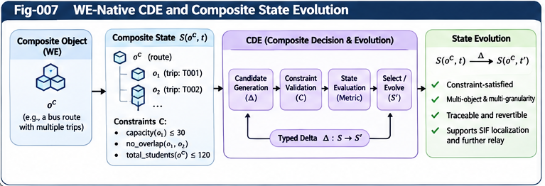

# OCSRE-008 — WE-Native CDE and Composite State Evolution

**Project:** Object-Centric Structural Reasoning and Evolution (OCSRE)  
**Release track:** v1.0.0 — Research Framework and Contracts  
**Authors (proposed):** Sizhe Tan & GPT-Obot  
**Status:** Research proposal; formal and empirical claims remain unvalidated (E0)  
**License:** Apache-2.0

## Abstract

This paper proposes an interface between World Entities (WEs) and Constrained Delta Evolution (CDE). A WE can anchor a CDE State-Container, while a composite container can span multiple WEs, typed relations, shared resources, and cross-object constraints. The central design is not to equate an object with its mutable state: identity, version, perspective, evidence, authority, and transition history must remain separately addressable. Candidate changes are typed Deltas with explicit preconditions, affected scopes, postconditions, and validation obligations. A disciplined pipeline generates, checks, scores, stages, and—only with appropriate authorization—promotes candidate states. Object Differential Kernel (ODK) comparisons inform this pipeline but do not themselves authorize mutation. The proposed approach accommodates school-bus scheduling, compositional-identity analysis, and AI-generated-code governance without asserting that these domains share identical search algorithms. We specify conformance obligations, counterexamples, evaluation plans, and explicit unresolved questions. No correctness, performance, or scaling result is claimed without further proof and testing.

**Keywords:** World Entity; CDE; State-Container; typed Delta; composite state; structural reasoning; constraint validation; rollback; object plugins; relay.

## 1. Motivation: the transition from learning to evolution

OCSRE-001 through OCSRE-007 develop a sequence: object-centric representation, differential computation, structural reasoning, in-situ learning, and governed feedback. The next question is operational: how can an object-centered system propose and evaluate changes without confusing an inferred improvement with an authorized change in the world?

CDE provides a candidate framework for constrained state evolution. WE-SIO provides the proposed identity and semantic anchors. Their connection is **WE-native CDE**: use WE references and relations as first-class constituents of state, but retain independent transition, governance, and evidence contracts. This paper develops that interface rather than re-specifying WE-SIO or claiming a universal CDE optimizer.

Three motivating cases illustrate the range: a bus route may be rearranged under capacity and time constraints; a transaction-analysis hypothesis may be revised without changing a ledger; and a software dependency graph may be updated in a proposed patch without deploying it. All involve typed state change, but their authority and reversibility differ fundamentally.

## 2. Terminology and ownership boundaries

| Term | Proposed meaning | Not equivalent to |
|---|---|---|
| WE | Identifiable world-entity anchor with typed attributes, perspectives and evidence | Database row, mutable snapshot, or autonomous agent by default |
| Object state | Versioned projection of attributes and relations at a declared time and scope | Permanent identity |
| State-Container | Bounded, addressable state representation with ownership, constraints and history | Unrestricted global world model |
| Composite State-Container | State over multiple WEs, relations, resources and invariants | Unchecked aggregation of objects |
| Typed Delta | Proposed transition operation with declared read/write scope and semantic effects | ODK differential score |
| Candidate | Uncommitted state proposal and its validation record | Approved action |
| Promotion | Authorized transition of a validated candidate into a designated state tier | Mere selection of a high score |
| External action | Effect on a real system, person, service or ledger | Necessarily reversible state update |
| Residual | Explicit unresolved mismatch, failed constraint, uncertainty or unexplained outcome | Automatically actionable error |

**Architectural ownership:** WE-SIO governs entity semantics; OCSRE defines shared object interfaces and integration hypotheses; CDE governs constrained Delta search and state evolution; ODK supplies qualified comparisons; UTN/MDT/WE-HDT and SIF may assist localization; MLIU/UIERU may organize multi-agent learning and relay. These are interfaces, not asserted algorithmic equivalences.

## 3. Minimal WE-native state model

Let a container be represented schematically as

\[
S = (I, V, T, P, O, R, A, C, E, H, G),
\]

where `I` denotes identity references; `V`, versions; `T`, temporal scope; `P`, perspectives; `O`, object attribute states; `R`, typed relations; `A`, resource/authority assignments; `C`, constraints; `E`, evidence and provenance; `H`, transition history; and `G`, governance metadata. This is an **interface schema**, not a claim that every implementation must materialize an eleven-field record.

A single-WE container may still refer to external constraints. A composite container must declare its membership and boundary rules: included WEs, referenced-but-not-owned WEs, relation edges, resource ownership, and whether state is a snapshot or a live view. The container's identity must not silently change when membership changes.

**Identity rule:** a WE identifier persists only under its governing identity policy; a state version identifies a particular representation. Reusing a database key, graph node label, or metric index is insufficient evidence of real-world identity.

## 4. Typed Delta: the unit of proposed evolution

A proposed Delta can be described as

\[
\delta = (k, owner, pre, reads, writes, effects, guards, evidence, undo, authority),
\]

with operation kind `k`, declared owner, pre-state reference, read/write sets, typed effects, guards, evidence requirements, compensating/undo semantics and authority requirements. A candidate transition is

\[
S' = Apply(S,\delta), \quad Valid(S,\delta,S') \in \{pass, fail, unknown\}.
\]

`unknown` must not be treated as `pass` for a safety-critical invariant. A Delta may alter an attribute, relation, composite membership, assignment, schedule, metric configuration, or policy proposal. Not all Delta kinds should be allowed in all containers.

### 4.1 Delta taxonomy

| Delta kind | Example | Required semantic checks |
|---|---|---|
| Attribute update | Change predicted arrival estimate | Unit, time, provenance, source-of-truth |
| Relation edit | Assign student to route | Membership, capacity, authorization |
| Composite restructuring | Split or merge bus routes | Resource conservation, identity, continuity |
| Temporal edit | Shift service time | Time-zone, precedence, temporal validity |
| Hypothesis revision | Reweight possible transaction linkage | Epistemic status; no ledger mutation |
| Policy/model revision | Replace route-ranking policy | Validation, versioning, promotion gate |
| Code-graph edit | Change call dependency | Build, security, dynamic behavior, regression evidence |

A change in `Object[metricIndices]` may update the measurement *view* without changing the WE's operational state. Metric projection, ODK comparison, learning update, and CDE Delta therefore require distinct event types and audit trails.

## 5. Evolution pipeline and authority gates

A proposed end-to-end pipeline is:

1. **Resolve** WE identities, state versions, ownership, and perspectives.
2. **Localize** relevant objects, relations, constraints, and impacted boundaries.
3. **Generate** typed candidate Deltas using domain plugins and search policy.
4. **Apply in sandbox** to a versioned candidate state, never directly to an external system.
5. **Validate** typing, preconditions, invariants, permission, temporal coherence, and evidence requirements.
6. **Evaluate** valid candidates using qualified ODK metrics and multi-objective scoring; retain uncertainty.
7. **Select and stage** a candidate with an explicit decision record, including rejected alternatives and residuals.
8. **Authorize** promotion by the appropriate control plane or human authority.
9. **Commit or execute** with conflict checks, idempotency controls and external-effect safeguards.
10. **Observe and learn** from outcomes, recording deviations and possible new proposals.

A score can rank admissible candidates but cannot convert an inadmissible candidate into a valid one. Hard constraints and permissions precede optimization. Where constraints are probabilistic, their confidence and acceptance policy must be declared rather than disguised as hard guarantees.

## 6. Composite State-Containers and cross-object invariants

Composite evolution is the distinctive challenge. Consider a school-bus schedule involving students, vehicles, drivers, stops, time windows, routes and a fleet-level objective. A route edit can improve one bus while violating another bus's capacity, a student's ride-time limit, or a driver shift boundary.

A composite container therefore needs:

- **Membership semantics:** which WEs are included, externally referenced or shared.
- **Typed relation semantics:** assignment, precedes, occupies, depends-on, and their permitted multiplicities.
- **Resource accounting:** exclusive and shared resources, conservation and availability constraints.
- **Cross-object invariants:** capacity, precedence, fairness, safety and legal/operational requirements.
- **Consistency model:** snapshot version, concurrent updates, conflict detection and commit protocol.
- **Granularity contracts:** what can be aggregated, inherited, decomposed or compared across levels.

A locally valid Delta is not necessarily globally valid. Validation must be evaluated over the Delta's *transitive impact scope*, or conservatively over the full relevant composite when impact localization is uncertain.



*Figure 7. WE-native constrained delta evolution over composite state containers: generate candidate transitions, evaluate global invariants, and promote only after validation and authorization.*

## 7. Search topology, path memory, and loop-back control

CDE research explores dynamic candidate generation, M-to-N branching, No-subtree decisions, path-dependent Delta restrictions, and loop-back control. WE-native CDE can carry these mechanisms as **configurable search policies**, not universal theorems.

A search node is a container version plus search metadata: path history, admissible Delta classes, residuals, budget and provenance. A candidate branch may be pruned because of a proven invariant violation, a safe dominance relation, or an explicitly heuristic rejection. These reasons must be distinguishable. A heuristic `No` branch must not be presented as a proof that no solution exists below it.

The previously proposed *same-path Delta non-reuse* rule requires a precise definition of equivalence: syntactically identical operations can have different effects under changed state, while semantically equivalent operations can have different encodings. A safe initial contract records `(Delta kind, target, parameters, pre-state/version, semantic fingerprint)` and makes reuse policy explicit. Some domains require revisiting a state; banning all repeated Delta kinds could exclude valid solutions. Loop-back controls should use canonical state fingerprints, monotonic budgets, cycle policies, and termination conditions appropriate to the problem. No general finite-step convergence claim is made.

## 8. Differential evaluation and multi-perspective scoring

The ODK can compare `Object[metricIndices]` projections before and after a candidate Delta, subject to metric typing, unit normalization, temporal alignment, granularity and perspective constraints. A schematic evaluation is

\[
Q(S,\delta,S') = Evaluate_{ODK}(Project(S), Project(S');\ M,P,E),
\]

where `M` is a metric specification, `P` a perspective policy, and `E` evidence/qualification. This is not a universal numeric utility function: different perspectives may produce incomparable or conflicting evaluations.

Hard constraints are evaluated separately. For feasible candidates, a control plane may use Pareto ranking, lexicographic objectives, bounded tradeoffs or perspective-aware scoring. A reduction in vehicle count should not automatically outweigh a safety constraint or an unacceptable increase in student ride time. Scoring rules and weights require versioning, provenance and governance.

## 9. In-situ learning is not state promotion

OCSRE-007 distinguishes evidence update, epistemic revision, metric calibration, policy revision, and capability revision from operational mutation. WE-native CDE preserves that separation:

```text
Observation / feedback
        |
        v
Evidence + model/policy revision proposal
        |                         \
        v                          v
Learning validation           Typed Delta generation
        |                          |
Model/policy promotion         Sandbox candidate state
                                   |
                          Constraint + authority checks
                                   |
                           Authorized state promotion
                                   |
                           Outcome observation / relay
```

A learning system can propose better Deltas without being permitted to execute them. Conversely, a state transition may be necessary even when no learning occurs. Observed outcomes should update the relevant evidence and feedback record, not retroactively convert a failed prediction into a success.

## 10. Concurrency, rollback and irreversible effects

Candidate state rollback is generally easier than reversing an external action. A schedule draft can be reverted; a bus already dispatched cannot be made never to have departed. A software patch can be rolled back in a repository, but a data leak or external side effect may persist. A transaction ledger may be immutable even when an analyst revises an attribution hypothesis.

Promotion contracts should therefore distinguish **logical undo**, **compensating action**, **replay**, and **irreversible effect**. A proposed commit protocol checks pre-state versions, validates that permissions and constraints still hold, logs an immutable decision record, and handles partial failure. Multi-object commits may require transactions, sagas, or other domain-specific coordination. The framework does not guarantee atomicity across arbitrary external systems.

## 11. Worked case A: school-bus scheduling

**State:** student WEs, vehicle WEs, stops, route assignments, time windows and fleet constraints. **Candidate Delta:** move a stop from route A to B, optionally re-sequence stops. **Local checks:** stop eligibility, vehicle capacity, travel-time feasibility and route continuity. **Composite checks:** no student dropped or duplicated, driver shifts valid, fleet constraints satisfied, service requirements preserved. **Objective:** reduce number of vehicles first where feasible, then optimize travel and ride-time costs under explicit policies.

**Negative example:** route A loses a vehicle and appears better, but a student is now assigned twice. The Delta must fail composite validation even if the ODK fleet score improves. **Residual:** uncertain travel-time estimate is carried forward with source and confidence rather than silently converted into a deterministic guarantee.

See `../cases/CASE-003-School-Bus-Scheduling-and-Composite-WE-State.md`.

## 12. Worked case B: transaction and compositional identity

**State:** transaction WEs, address/account references, observed temporal links and hypotheses about composite actors. **Candidate Delta:** add or revise a *hypothesis relation* between two clusters based on evidence. **Constraint:** the hypothesis cannot alter on-chain transactions or be promoted to established identity without appropriate evidence. The same wallet, public key, network endpoint, or device signal may have multiple interpretations; shared infrastructure and adversarial spoofing remain counterexamples.

**Evaluation:** evidence consistency, alternative explanations, temporal fit, provenance and calibration. **Negative example:** a shared IP address is treated as definitive common ownership; the proposed identity merge must be rejected or retained as explicitly uncertain. This is epistemic state evolution, not operational transfer of assets.

See `../cases/CASE-004-Transaction-and-Compositional-Identity.md`.

## 13. Worked case C: AI-generated-code governance

**State:** function/module objects, Calling Graph relations, data/control-flow evidence, contracts, versions, tests and deployment policies. **Candidate Delta:** AI-generated code change affecting a function and its dependencies. **Localization:** Calling Graph provides a useful initial neighborhood; UTN may help address and trace impacted objects, but calling edges do not exhaust dynamic dispatch, reflection, dataflow, authorization or runtime semantics.

**Validation:** type/build checks, static and dynamic analyses where appropriate, security constraints, contract checks, targeted and broad regression tests, and human approval for consequential changes. **Negative example:** all direct callers pass tests, but an indirect dataflow violates a security invariant; the candidate must not be promoted on Calling Graph evidence alone. A repository merge, deployment and irreversible external effect require separate authority gates.

See `../cases/CASE-006-AI-Generated-Code-Governance-Through-Calling-Graphs-and-CDE.md`.

## 14. Object Plugins and capability composition

Plugins may supply domain-specific Delta generators, validators, constraint solvers, metric projectors, and commit adapters. A plugin manifest should declare supported WE types, Delta kinds, read/write scopes, preconditions, output evidence, version, permissions and failure behavior. Plugins are not allowed to redefine identity or bypass core constraint gates merely because they share the same interface.

Cross-domain reuse is conditional. A generic assignment operator might serve fleet scheduling and computing-resource allocation, but only if resource semantics, capacities, exclusivity, time units and authority rules are explicitly mapped. **Interface compatibility is necessary but not sufficient for semantic transfer.** The ODK remains unchanged only to the extent the proposed generic-kernel hypothesis survives conformance testing.

## 15. Relay, collective learning and structural spillover

A validated Delta policy, constraint pattern or plugin can be packaged as a relay artifact with its assumptions, benchmark results, counterexamples, permissions and known failure modes. A receiving domain must re-run conformance and regression checks before adoption. Negative transfer and integration costs must be recorded alongside gains.

MLIU/UIERU may coordinate multi-agent proposal generation, competitive candidate evaluation, and collective feedback. No agent should be able to self-certify a policy for production merely by producing a high score. ISGFTR motivates investigation of capability spillover, but neither sustained scaling nor open-ended improvement follows from the existence of reusable plugins. Those are empirical questions for OCSH-008 through OCSH-010.

## 16. Proposed conformance obligations

The following IDs are local to this paper and are proposed for formalization in `../specs/SPEC-006-WE-Native-CDE-Composite-State-and-Relay-Contract.md`.

| ID | Obligation | Example failing test |
|---|---|---|
| WECDE-001 | Separate WE identity, state and version | Snapshot overwrite changes identity silently |
| WECDE-002 | Declare container membership and ownership | External WE mutated as if owned |
| WECDE-003 | Type every Delta and its read/write scope | Route edit changes unrelated ledger field |
| WECDE-004 | Enforce preconditions and version checks | Stale candidate overwrites newer schedule |
| WECDE-005 | Validate local and composite invariants | Bus over capacity after route merge |
| WECDE-006 | Preserve temporal and granularity semantics | Current observation applied to historical state |
| WECDE-007 | Separate ODK score from feasibility | Invalid candidate selected on high score |
| WECDE-008 | Keep epistemic/model updates distinct from operational Deltas | Confidence update triggers transfer |
| WECDE-009 | Distinguish proposal, staging, authorization and commit | Sandbox edit automatically deployed |
| WECDE-010 | Preserve permission and provenance constraints | Plugin accesses restricted attributes |
| WECDE-011 | Declare undo, compensation and irreversibility | Physical dispatch labeled fully reversible |
| WECDE-012 | Detect concurrent conflicts and partial failure | Two routes claim one exclusive vehicle |
| WECDE-013 | Record search path, pruning reason and residuals | Heuristic prune reported as proof |
| WECDE-014 | Bound loops or state explicit termination conditions | Search cycles indefinitely without budget |
| WECDE-015 | Validate plugin and relay artifacts in receiving domain | Transferred validator skips local safety rule |
| WECDE-016 | Retain rejected candidates and counterexamples | Only winning score retained |
| WECDE-017 | Separate external execution from state representation | Hypothesis merge changes live ledger |
| WECDE-018 | Track post-commit outcomes and feedback | Reported optimization lacks observed result |

**P0 semantic and evolution safety:** WECDE-001–012 and 017. **P1 reuse and auditability:** WECDE-013–016 and 018. Runtime optimizations remain P2 until these contracts are testable.

## 17. Counterexample-first validation suite

1. **Identity collision:** two database rows share a key across namespaces; WE identities must not merge.
2. **Stale Delta:** a candidate generated from version 12 is applied to version 14 without revalidation.
3. **Hidden resource coupling:** two otherwise valid route edits reserve the same bus.
4. **Metric gaming:** fewer vehicles achieved by violating student ride-time constraints.
5. **Granularity leak:** fleet-average capacity used as proof each bus is safe.
6. **Temporal mismatch:** yesterday's road closure used as today's invariant without qualification.
7. **Invalid inference promotion:** weak wallet-link evidence becomes confirmed identity.
8. **Unbounded loop-back:** move A→B then B→A repeatedly with no state/budget control.
9. **Over-pruning:** path Delta non-reuse blocks a necessary reversible intermediate move.
10. **Misleading rollback:** rollback of source code assumed to reverse an external API action.
11. **Plugin permission bypass:** imported metric generator reads unauthorized student records.
12. **Unqualified relay:** a fleet optimizer is reused for code deployment with no domain validation.
13. **Graph incompleteness:** calling graph misses reflection or indirect dataflow.
14. **Partial commit:** composite update succeeds for one WE and fails for another without reconciliation.

Each counterexample should produce a machine-checkable failure category, provenance record and explicit leftover; passing a happy-path demonstration is insufficient.

## 18. Evaluation design and research hypotheses

**Primary hypothesis — OCSH-005 (E0):** WE-native CDE can support single-object and composite transitions under shared contracts. A suitable test compares a common container/Delta interface across at least two materially different domains, measuring contract coverage, invariant violations, transition traceability and adaptation effort. A failed domain adapter or unresolved invariant is evidence against broad portability, not a detail to omit.

**Related hypotheses:** OCSH-002 (ODK reuse), OCSH-003 (plugin adaptation cost), OCSH-004 (feedback traceability), OCSH-006 (cross-granularity safety), OCSH-008 (validated relay), OCSH-009/010 (spillover and sustained capability growth), and OCSH-011 (code-governance localization). All remain proposed E0 hypotheses in this repository release.

Suggested baselines include domain-specific scheduling/search implementations, ordinary graph-based impact analysis, and non-object-centric versioned state management. Suggested measurements include hard-constraint violation rate, valid-candidate yield, optimization quality, computational cost, conflict/rollback success, provenance completeness, developer integration time, and held-out transfer performance. Separate offline sandbox results from authorized real-world outcomes. Use ablations for WE semantics, typed Delta contracts, composite validation and relay validation to test whether each architectural element adds value.

## 19. Relationship to the OCSRE corpus

- `OCSRE-001-The-Object-Centric-Structural-Intelligence-Thesis.md`: five-stage thesis and semantic anchor.
- `OCSRE-003-Dynamic-Relational-and-Multi-Granular-Reasoning.md`: dynamic relation and granularity constraints.
- `OCSRE-004-Object-Differential-Kernel-and-Generic-Operators.md`: comparison versus mutation boundary.
- `OCSRE-005-Object-Plugins-and-Composable-Intelligence-Capabilities.md`: typed capability composition.
- `OCSRE-006-SQL-to-Object-Attribute-Transformation-and-Semantic-Alignment.md`: SQL adapter semantics and security.
- `OCSRE-007-In-Situ-Object-Learning-Decision-and-Feedback.md`: learning/decision separation.
- `OCSRE-009-Epistemic-Separation-and-Object-Centric-Evidence-Governance.md`: evidence status and promotion governance.
- `OCSRE-010-UTN-WE-HDT-and-SIF-Localization-Through-Shared-Object-Interfaces.md`: localization interfaces.
- `OCSRE-011-Object-Capability-Spillover-Relay-and-Collective-Structural-Learning.md`: validated transfer.
- `../specs/SPEC-001-Object-Identity-Perspective-and-State-Contract.md` and `../specs/SPEC-006-WE-Native-CDE-Composite-State-and-Relay-Contract.md`: normative contract targets.
- `../cases/CASE-003-School-Bus-Scheduling-and-Composite-WE-State.md`, `../cases/CASE-004-Transaction-and-Compositional-Identity.md`, `../cases/CASE-006-AI-Generated-Code-Governance-Through-Calling-Graphs-and-CDE.md`: application tests.
- `../extensions/EXT-003-Multi-Agent-Object-Intelligence-and-Relay.md` and `../extensions/EXT-005-Structural-Capability-Spillover-and-Scaling-Hypotheses.md`: further exploration.


## 20. Explicit leftovers and open questions

1. What is the minimal interoperable WE-native container schema across domains?
2. How should container identity behave under split, merge and membership changes?
3. What formal semantics distinguish Delta equality, equivalence and reuse on a search path?
4. Under which assumptions is loop-back detection complete and termination provable?
5. How can local validation safely approximate global composite constraints?
6. What consistency model is required for distributed multi-WE commits?
7. How should irreversible external effects be represented in search and rollback plans?
8. Can hard, soft, probabilistic and contested constraints share a common policy interface?
9. How should perspective disagreement affect candidate feasibility versus ranking?
10. How are evidence uncertainty and adversarial observations propagated into state proposals?
11. When does plugin composition preserve semantic correctness?
12. What constitutes a safe and measurable negative-transfer test for relay?
13. How can code-governance impact localization capture dynamic and dataflow effects?
14. What empirical advantage remains after comparing against mature domain-specific solvers?
15. How should human oversight and delegated authority vary by operational risk?
16. Can search-path memory be compacted without discarding necessary distinctions?
17. How can multi-agent proposals be reconciled without self-certification or reward gaming?
18. What evidence would falsify claims of generic WE-native CDE reuse?

These are research obligations, not features silently assumed to exist.

## 21. Conclusion

WE-native CDE offers a precise architectural proposal: **world entities anchor the semantics of evolving state; typed Deltas describe candidate changes; composite contracts constrain their effects; independent authority gates determine whether changes may be committed.** This approach joins OCSRE's representation, computation, reasoning and in-situ learning stages without conflating prediction, scoring, learning and action. Its value depends on conformance, counterexamples and measurable transfer across domains—not on the breadth of its vocabulary. The immediate next step is to formalize SPEC-006, construct the CASE-003/004/006 validation fixtures, and report both successful transitions and explicit residuals before any claim of generality.
