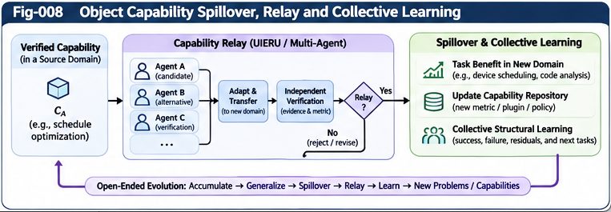

# OCSRE-011 — Object Capability Spillover, Relay, and Collective Structural Learning

**Project:** Object-Centric Structural Reasoning and Evolution (OCSRE)  
**Series:** OCSRE Core Research Papers  
**Version:** v1.0.0 — Research Framework and Contracts  
**Authors (proposed):** Sizhe Tan & GPT-Obot  
**Status:** Research proposal; conceptual mechanisms and testable hypotheses, not empirically validated results  
**License:** Apache-2.0

## Abstract

Object-centric structural intelligence becomes more consequential when capabilities developed for one object, problem, or domain can be reused, recomposed, and improved elsewhere. This paper proposes a contract-governed account of **Object Capability Spillover**, **Structural Relay**, and **Collective Structural Learning** within Object-Centric Structural Reasoning and Evolution (OCSRE). Its central claim is conditional: shared World Entity (WE) interfaces, a reusable Object Differential Kernel (ODK), typed Object Plugins, provenance-bearing feedback, and constrained state evolution may lower the cost of transferring capabilities across heterogeneous tasks. The possibility of reuse is not evidence of realized transfer, and observed transfer is not evidence of a universal scaling law.

We distinguish capability *availability*, *compatibility*, *successful integration*, *validated transfer*, *net positive spillover*, and *sustained structural growth*. We specify capability packages, relay transitions, governance gates, failure and negative-transfer records, and evaluation protocols against non-relay baselines. Examples span SQL-to-WE transformations, school-bus scheduling, transaction-identity analysis, and AI-generated-code governance. Connections to WE-SIO, UTN, SIF, CDE, MLIU, UIERU, and ISGFTR are framed as interoperable research interfaces rather than asserted algorithmic equivalences. The paper concludes with conformance obligations, falsifiable hypotheses, counterexamples, and explicit leftovers.

**Keywords:** Object-Centric Structural Intelligence; World Entity; Capability Spillover; Object Plugins; Differential Kernel; Relay; Collective Learning; Constrained Delta Evolution; Structural Scaling; Evidence Governance.

## 1. Research question and thesis

The previous OCSRE papers established a progression from object representation to differential computation, reasoning, in-situ learning, and constrained evolution. OCSRE-010 further connected object interfaces to localization and addressing. The next question is whether the resulting capabilities can **travel**: can an operator, metric, reasoning rule, feedback mechanism, or validated search policy developed in one setting improve performance in another without requiring a complete redesign?

The proposed thesis is:

> An object-centered, contract-governed capability ecosystem can make structural intelligence transferable and cumulatively improvable, provided that each transfer preserves semantic preconditions, authority boundaries, provenance, and independently evaluated outcomes.

This is a research hypothesis, not a demonstrated result. A transfer that merely runs, or yields an attractive score, does not meet the proposed standard. The thesis is narrower than a claim that all intelligence is object-based, that all domains share one metric, or that capability accumulation must exhibit a scaling law.

## 2. Scope and boundaries

This paper studies *capability movement and accumulation* across objects, tasks, agents, and domains. It does not introduce a new WE identity system, prove deductive validity, specify the entire ODK, or implement a production multi-agent runtime. These responsibilities remain with the companion papers and proposed specifications.

The principal boundaries are:

- **WE-SIO:** owns foundational entity identity, representation, perspectives, metrics, evidence, and operations; OCSRE consumes these semantics.
- **OCSRE-004 / ODK:** owns the generic comparison and differential execution discipline; a transferable plugin must not silently change the kernel contract.
- **OCSRE-005 / Object Plugins:** supplies versioned capability packaging and composition contracts.
- **OCSRE-007 / In-Situ Learning:** supplies contextual feedback and revision, not automatic cross-domain validity.
- **OCSRE-008 / CDE:** supplies typed, constrained candidate state evolution; transfer does not grant mutation authority.
- **OCSRE-009:** supplies epistemic separation and evidence promotion gates.
- **OCSRE-010 / UTN / MDT / WE-HDT / SIF:** supplies localization and addressing interfaces; location is neither identity proof nor authorization.
- **UIERU / MLIU:** prospective orchestration and collective-learning partners, not mandatory OCSRE runtime dependencies.
- **ISGFTR:** motivates hypotheses about spillover, generalization, fluidity, transfer, and relay; empirical scaling remains open.

## 3. What is an object capability?

A **capability** is a versioned, testable procedure or policy with declared input/output semantics, assumptions, authority, evidence requirements, and failure conditions. It may be implemented by code, a model, a reasoning procedure, an external service, or a hybrid composition. It is not synonymous with a plugin: a plugin is one packaging and invocation mechanism for capabilities.

A proposed capability record is:

```text
Capability = {
  capability_id, version, provider, implementation_ref,
  input_object_types, output_types, perspective_scope,
  metric_schema, granularity_contract, temporal_contract,
  preconditions, postconditions, invariants,
  required_permissions, side_effect_class,
  evidence_requirements, validation_suite,
  resource_budget, dependencies, provenance,
  known_failure_modes, residuals
}
```

A capability may be a representation adapter, transformation, comparator, inference rule, learning update, CDE candidate generator, validator, or governance tool. Capabilities can be *pure* (no state mutation), *propositional* (generate candidates), or *effectful* (perform authorized actions). These classes must not be conflated.

**Availability** means the capability is discoverable. **Compatibility** means its declared contracts match the target context. **Execution** means it ran. **Validation** means the output passed specified tests. **Transfer success** additionally requires measured value on a target task relative to an appropriate baseline.

## 4. Object-centered interfaces as a transfer substrate

The proposed shared interface uses an object reference, not a universal world model:

```text
ObjectContext = {
  we_ref, identity_evidence, state_version,
  perspective, temporal_scope, granularity,
  metric_indices, relation_scope,
  evidence_refs, authority_context
}
```

`Object[metricIndices]` denotes a typed metric projection in a declared context; it is not an unrestricted array lookup. Two domains can share a generic comparator while differing in identity semantics, units, measurement reliability, granularity, and permissible inference. A relay therefore requires explicit adapters and compatibility checks. Where semantic alignment is unavailable, the correct result is **not transferable**, not an invented equivalence.

Object-centric reuse has at least three distinct forms: **operator reuse** (same generic operator, different domain adapters), **schema/contract reuse** (same validation discipline, different implementations), and **policy/strategy transfer** (an adapted learned policy). The first two may be easier to establish than the third; all three require testing.

## 5. From structural reuse to capability spillover

We define **structural capability spillover** operationally as a measurable benefit on a target task attributable to a capability originally introduced for a different source task, after accounting for integration and validation costs. Spillover may be positive, neutral, or negative.

Let `B(T)` be target-task utility under a pre-registered baseline, `U(T,C)` be utility with capability `C`, and `K(T,C)` be the measured integration, adaptation, evaluation, and maintenance cost expressed in compatible units. A candidate net-gain measure is:

```text
NetSpillover(T,C) = U(T,C) - B(T) - K(T,C)
```

This expression is illustrative, not a universal metric. Utility and cost may be multidimensional and cannot always be collapsed into a scalar. A defensible evaluation reports accuracy or quality, safety violations, latency, resource consumption, human intervention, and uncertainty separately; any aggregate requires a declared scoring policy. Attribution also requires controls for additional training data, compute, prompts, human tuning, and task selection.

Spillover has several possible mechanisms:

1. **Metric spillover:** a validated metric transformation supports a new object type.
2. **Operator spillover:** a generic differential operator works with a new domain adapter.
3. **Reasoning spillover:** a type-checked inference pattern supports a new relation schema.
4. **Learning spillover:** feedback calibration improves an analogous decision process.
5. **Evolution spillover:** a candidate-generation or constraint-validation pattern transfers to a new CDE State-Container.
6. **Governance spillover:** evidence, impact-localization, or conformance procedures improve a different workflow.

These mechanisms must be assessed independently; a common label does not imply common causal behavior.

## 6. Structural Relay: the proposed transfer protocol

A **Relay** is a governed transition of capability, evidence, or validated learning from a source context to a target context. It is not simply a message, model checkpoint, or invocation. A minimal relay record is:

```text
RelayRecord = {
  relay_id, source_context, target_context,
  capability_ref, adapter_ref, contract_mapping,
  source_evidence, target_validation_plan,
  permission_scope, transfer_hypothesis,
  observed_outcomes, negative_results,
  promotion_decision, residuals
}
```

The proposed relay lifecycle is:

**Discover → Qualify Source → Map Semantics → Adapt → Sandbox → Evaluate → Challenge → Authorize → Promote or Reject → Monitor → Record Residuals.**

Each step has a distinct obligation. Source success does not establish target validity; a successful sandbox test does not authorize real-world action; promotion is version-specific and can be revoked. The relay must preserve failures, rejected mappings, negative results, and unresolved constraints, not only successful transfers.

Relay may be **horizontal** (between peer domains), **vertical** (between granularities), **recursive** (improved relay mechanisms become relayable capabilities), or **collective** (multiple agents contribute independent evidence). Recursive relay requires loop and dependency controls to avoid circular validation.

  

*Figure 8. Proposed object capability relay: governed transfer, independent validation, residual capture, and collective structural learning across domains.*

## 7. Capability composition and relay portfolios

Single capabilities may yield little benefit without compatible companions. A relay portfolio is a governed graph of capabilities, adapters, validators, and evidence links. Edges represent typed dataflow, control dependency, evidence dependency, or authorization—not an undifferentiated “related-to” link.

Composition is permitted only if required types, units, granularity, temporal scopes, side effects, and permissions align. A valid composition must preserve or explicitly re-establish each component's preconditions and invariants. Cycles may be useful for iterative learning but require termination, budget, and evidence-independence rules.

An important research distinction is **capability count versus effective capability coverage**. Adding ten plugins that duplicate the same operator may expand inventory without expanding the set of tasks solved. Conversely, a small interface improvement may unlock many existing capabilities. Portfolio evaluation should measure *marginal* and *complementary* gains, not merely registry size.

## 8. Collective Structural Learning: evidence before consensus

Collective learning occurs when multiple objects, agents, teams, or systems contribute observations, candidate capabilities, counterexamples, and validation results to a shared, governed learning process. It does not require a single centralized model, a single owner, or synchronized runtime.

A candidate loop is:

```text
Local object experience
  → provenance-bearing feedback
  → candidate principle / metric / plugin / policy
  → cross-context conformance testing
  → independent challenge and counterexamples
  → versioned relay portfolio
  → target-domain trials
  → validated promotion or explicit rejection
  → new local feedback and residuals
```

Collective learning must guard against duplicated evidence, correlated agent outputs, reputation laundering, majority-error amplification, data leakage, and silent distribution shifts. Ten agents citing the same underlying observation do not provide ten independent confirmations. Provenance graphs and evidence-dependence checks are therefore part of the learning architecture, not optional documentation.

The object-centered perspective provides a stable place to attach feedback and outcomes. It does **not** imply that learning computation physically occurs inside the object or that every object's local policy should be globally adopted.

## 9. The role of UIERU, MLIU, SIF, and ISGFTR

OCSRE proposes a transferable capability substrate; UIERU can be studied as a higher-level relay and evolution orchestrator. MLIU can be considered as a possible multi-level learning integration partner, subject to its own definitions and contracts. SIF supplies problem/capability maps, localization, node intelligence, and governance control planes. ISGFTR supplies a broader hypothesis space for fluidity, generalization, and structural spillover.

A possible division of responsibility is:

| Research interface | Primary concern in this paper | Non-claim |
|---|---|---|
| WE-SIO / OCSRE | Typed object semantics and capability contracts | Not a universal ontology |
| ODK / Object Plugins | Reusable operations and composable capabilities | Not domain-independent meaning |
| UTN / MDT / WE-HDT | Differential localization and addressing | Not algorithmic equivalence |
| CDE | Constrained state/delta evolution | Not permission to execute |
| SIF | Problem-to-capability localization and governance | Not a required implementation |
| UIERU / MLIU | Candidate collective-learning and relay orchestration | Not validated by this paper |
| ISGFTR | Spillover and scaling research hypotheses | Not an established scaling law |

This division is intentionally modular. A negative result for one relay strategy should not invalidate all object-centered computation; a successful ODK reuse experiment should not be advertised as proof of general intelligence.

## 10. Worked scenario A: SQL transformation capability relay

A SQL adapter for school transportation converts relational columns into typed WE attributes using `Bucketize`, `Normalize`, `Combine`, `Encode`, or `Derive` under explicit schemas. Suppose a similar adapter is proposed for warehouse inventory. The shared operator implementation may be reusable, but entity keys, NULL semantics, join multiplicity, aggregation grain, time windows, units, and access policies differ.

**Proposed relay:** reuse the transformation contract and operator, supply new domain-specific mappings, and test against SQL-native baseline queries. **Failure gate:** reject any mapping that changes row-level security, fabricates WE identity from a non-unique key, or aggregates across incompatible grains. **Potential spillover:** reduced adapter development and validation cost, measured without weakening SQL semantics. This illustrates OCSH-007 and OCSH-008; it does not validate them.

## 11. Worked scenario B: school-bus scheduling to composite-state search

A school-bus scheduling model uses a composite WE State-Container spanning students, vehicles, routes, capacity, time windows, and assignment constraints. Its CDE candidate generator proposes typed route and assignment deltas. A warehouse vehicle-dispatch problem may share search and constraint-checking patterns while differing in safety rules, objectives, and resource semantics.

**Proposed relay:** transfer the candidate-generation *pattern*, not a literal route policy. Rebind object types, invariants, constraints, and scoring; compare against a target-domain solver with matched compute budgets. **Failure gate:** a locally improving delta that violates a global assignment or resource constraint is rejected. **Potential spillover:** fewer search evaluations or better feasible solutions at comparable cost. Negative transfer—including slower search or higher violation rates—must be retained.

## 12. Worked scenario C: transaction identity and evidence relay

Transaction analysis may generate candidate compositional identities from behavioral traces, temporal patterns, and weak evidence. A capability for provenance-aware evidence comparison could transfer to another investigative or anomaly-detection workflow. However, a similarity score is not identity proof, and evidence from correlated sources must not be counted independently.

**Proposed relay:** transfer the evidence-envelope schema, comparison contract, and challenge workflow, while keeping domain-specific privacy, authority, and inference thresholds. **Failure gate:** no automatic promotion from candidate linkage to established identity; no unauthorized enrichment of personal data. **Potential spillover:** better traceability and calibrated uncertainty rather than stronger claims about persons.

## 13. Worked scenario D: AI-generated-code governance

A program can be represented through multiple object perspectives: functions, modules, call sites, calling graphs, data/control flows, contracts, permissions, tests, and deployment boundaries. The path **Calling Graph → UTN → OCSRE** proposes that graph-localized change impact can become an object-centered governance capability. Calling graphs alone are incomplete program semantics; reflection, dynamic dispatch, data dependencies, side effects, and external services require additional analysis.

**Proposed relay:** reuse a versioned impact-localization and evidence-validation capability across repositories, with repository-specific adapters and security rules. The system locates candidate affected objects, derives test obligations, gathers regression and security evidence, and presents a governed promotion decision. **Failure gate:** successful graph localization does not authorize merging or deployment. **Potential spillover:** improved impact recall, targeted test selection, and traceability at acceptable false-negative and runtime cost. This directly motivates OCSH-011 and CASE-006.

## 14. A proposed spillover measurement framework

Evaluation should separate **reach**, **quality**, **cost**, **safety**, and **persistence**:

| Dimension | Candidate measure | Required caution |
|---|---|---|
| Transfer reach | Number and diversity of previously held-out target tasks with validated transfer | Avoid counting trivial variants as independent domains |
| Utility gain | Task-specific performance difference against a pre-registered baseline | Report confidence intervals and uncertainty |
| Integration burden | Engineer time, adaptation code, validation effort | Account for hidden manual tuning |
| Kernel stability | Core ODK changes required per transferred capability | Do not reward unsafe generalization |
| Safety | Contract violations, unauthorized effects, regression failures | Hard constraints cannot be traded for aggregate score |
| Negative transfer | Fraction and severity of harmful transfers | Record rejected and failed trials |
| Persistence | Retained gains after distribution, version, and policy changes | Revalidate on change |
| Marginal gain | Additional benefit from the next validated capability | Control for capability selection and ordering |

A proposed experimental design uses source-domain development, target-domain holdouts, fixed adaptation budgets, ablations of the shared kernel and plugin contracts, and comparisons against independent per-domain engineering. Repeat with multiple transfer directions. Report all attempted transfers, including failures and noncomparable tasks.

## 15. From spillover to open-ended structural growth

The attraction of structural spillover is that new capabilities can change what other capabilities can do. A newly available metric may enable a comparator; that comparator may enable localization; localization may improve CDE candidate generation; feedback may reveal a missing plugin; the plugin may then be tested in further domains. This is a plausible **capability-composition growth mechanism**, not evidence that gains are unlimited or monotonic.

Three levels of claim must remain separate:

- **Level A — Local reuse:** a capability works in a second context under verified contracts.
- **Level B — Net spillover:** transfer yields measured incremental benefit after integration and validation costs.
- **Level C — Sustained structural scaling:** repeated capability additions and relay yield persistent, measurable improvements across increasingly diverse held-out tasks.

Level A does not imply B; B does not imply C. Saturation, incompatibility, negative transfer, evaluation cost, resource limits, and governance burden may dominate. A credible scaling hypothesis must define the growth variable, task distribution, time horizon, baseline, stopping conditions, and falsification criteria before analysis.

## 16. Proposed conformance obligations

The following **CSR-001–CSR-018** obligations are proposed for later refinement under `SPEC-004`, `SPEC-005`, and `SPEC-006`. They are not yet a finalized normative standard.

| ID | Obligation | Suggested conformance evidence |
|---|---|---|
| CSR-001 | Every relayed capability has a stable, versioned identity | Manifest and registry audit |
| CSR-002 | Source and target WE identity are not inferred from address or row key alone | Identity-collision tests |
| CSR-003 | Input/output object types and metric semantics are explicit | Schema/type tests |
| CSR-004 | Perspective, granularity, and temporal scopes are checked | Mismatch rejection tests |
| CSR-005 | Unit conversion and metric alignment are declared | Comparator conformance tests |
| CSR-006 | Preconditions, postconditions, and invariants survive composition | Contract composition tests |
| CSR-007 | Provenance and evidence-dependence information accompany relay | Lineage reconstruction |
| CSR-008 | Permissions are never broadened implicitly | Access-control negative tests |
| CSR-009 | Pure, candidate-generating, and effectful capabilities remain distinct | Side-effect boundary tests |
| CSR-010 | CDE candidates cannot bypass global constraints or promotion gates | Composite-state adversarial tests |
| CSR-011 | Target validation is independent of source success | Held-out target tests |
| CSR-012 | Negative transfer and failed trials are retained | Complete trial ledger |
| CSR-013 | Plugin and adapter versions are pinned and regression-tested | Version-change replay |
| CSR-014 | Collective evidence is checked for duplication and dependence | Correlated-source tests |
| CSR-015 | Capability composition has bounded recursion and resource budgets | Cycle and exhaustion tests |
| CSR-016 | Promotion, rollback, and irreversible-action boundaries are explicit | Failure-injection tests |
| CSR-017 | Spillover metrics include integration and validation cost | Auditable cost accounting |
| CSR-018 | Scaling claims require independent longitudinal evaluation | Pre-registration and replication |

**Priority:** CSR-002 through CSR-011 and CSR-014/016 are P0 where semantic, epistemic, or evolution safety is implicated; reuse measurement and transfer evaluation are P1; runtime orchestration is P2 until contract conformance is established.

## 17. Counterexamples and adversarial cases

The following are deliberately *negative* examples. A conformant design should detect, reject, or qualify them rather than conceal them.

1. **Same metric name, different units:** a distance comparator is transferred from kilometers to miles without conversion.
2. **False identity continuity:** two databases share a numeric primary key but refer to different entities.
3. **Cross-granularity leakage:** a fleet-average property is assigned to every vehicle.
4. **Temporal mismatch:** a current policy evaluates an archived object state as if it were live.
5. **Plugin compatibility by syntax only:** signatures match but domain preconditions conflict.
6. **Source success masquerading as target evidence:** no target-specific validation is performed.
7. **Permission amplification:** an adapter exposes attributes prohibited by the target SQL policy.
8. **Circular corroboration:** multiple agents repeat the same unverified source as independent evidence.
9. **Unbounded relay loop:** a capability recursively triggers itself through dependency aliases.
10. **Negative transfer hidden by averages:** a small average improvement masks catastrophic safety failures.
11. **Local CDE improvement, global invalidity:** a route delta improves travel time while duplicating student assignments.
12. **Unauthorized promotion:** a successful sandbox proposal directly triggers production changes.
13. **Code graph incompleteness:** dynamic dispatch causes affected code to be omitted from impact analysis.
14. **Overfitted transfer benchmark:** source and target tasks share leaked labels or test examples.
15. **Registry growth without capability growth:** duplicated plugins inflate inventory but add no coverage.
16. **False scaling inference:** a short, cherry-picked sequence of gains is presented as an open-ended law.

Each counterexample should be turned into an executable or reviewable test where possible, with expected failure classifications and preserved residuals.

## 18. Falsifiable research hypotheses and evaluation links

This paper emphasizes the following **proposed, E0-status** hypotheses from the repository blueprint:

- **OCSH-002:** A common ODK can be reused across domains without core changes. Test by pinning kernel versions while varying domain plugins and measuring failures and required patches.
- **OCSH-003:** Contract-based Object Plugins reduce domain adaptation costs. Test against matched ad hoc integrations, including validation and maintenance effort.
- **OCSH-008:** Validated capability relay yields measurable cross-domain transfer. Test on held-out targets with non-relay baselines and complete failure reporting.
- **OCSH-009:** New structural capabilities yield measurable gains on untargeted tasks. Pre-register untargeted task suites before introducing capabilities.
- **OCSH-010:** Controlled accumulation and relay can generate sustained, validated new capabilities/questions. Test longitudinally with fixed accounting and explicit saturation criteria; scaling remains unproven.
- **OCSH-011:** Object-centric code governance improves impact localization, validation targeting, and traceability. Test on versioned repositories with known changes and regression outcomes.

Supporting hypotheses include **OCSH-004** (in-situ feedback), **OCSH-005** (single/composite CDE), **OCSH-006** (cross-granularity contracts), and **OCSH-007** (SQL-to-WE adaptation). No result is asserted for any hypothesis in this document.

## 19. Proposed validation program

**Phase 0 — Contracts and fixtures.** Freeze minimal ObjectContext, Capability, RelayRecord, and Evidence Envelope schemas. Construct positive and adversarial fixtures for identity, temporal, unit, granularity, permission, and composite-state failures.

**Phase 1 — Kernel and plugin reuse.** Reuse the same ODK build with at least two independently specified domain adapters. Compare against domain-specific implementations. Record all kernel changes and contract exceptions.

**Phase 2 — Bidirectional transfer.** Transfer capabilities A→B and B→A where meaningful; compare with no-transfer and naive-copy baselines. Measure cost, quality, and failure rates.

**Phase 3 — Collective learning.** Introduce multiple agents or contributors with controlled shared versus independent evidence. Evaluate whether evidence-dependence governance improves calibration and decision quality.

**Phase 4 — Longitudinal accumulation.** Add capabilities in a predeclared sequence, periodically evaluate held-out tasks, and measure marginal net gain, saturation, negative transfer, and maintenance costs.

**Phase 5 — Governance-sensitive domains.** Evaluate SQL permission preservation, CDE promotion safety, and code-change impact analysis under realistic adversarial cases. No irreversible external action is needed to test the research framework.

All phases should specify datasets, seeds, budgets, baselines, thresholds, confidence intervals, and stopping rules before claims are made. A failed or inconclusive phase is an informative research outcome.

## 20. Relationship to companion repository assets

| Asset | Planned relationship |
|---|---|
| `docs/OCSRE-004-Object-Differential-Kernel-and-Generic-Operators.md` | Generic differential execution and metric alignment |
| `docs/OCSRE-005-Object-Plugins-and-Composable-Intelligence-Capabilities.md` | Capability packaging and composition |
| `docs/OCSRE-007-In-Situ-Object-Learning-Decision-and-Feedback.md` | Contextual feedback and learning revisions |
| `docs/OCSRE-008-WE-Native-CDE-and-Composite-State-Evolution.md` | Typed deltas, composite state, and promotion boundaries |
| `docs/OCSRE-009-Epistemic-Separation-and-Object-Centric-Evidence-Governance.md` | Evidence qualification and epistemic separation |
| `docs/OCSRE-010-UTN-WE-HDT-and-SIF-Localization-Through-Shared-Object-Interfaces.md` | Localization and target addressing |
| `docs/OCSRE-012-Open-Ended-Object-Centric-Structural-Intelligence.md` | Open-ended growth hypotheses and limits |
| `specs/SPEC-004-Object-Plugin-and-Capability-Composition-Contract.md` | Proposed plugin and composition conformance |
| `specs/SPEC-005-In-Situ-Learning-Feedback-and-Epistemic-Governance-Contract.md` | Feedback and evidence obligations |
| `specs/SPEC-006-WE-Native-CDE-Composite-State-and-Relay-Contract.md` | Relay and state evolution boundaries |
| `cases/CASE-005-Cross-Domain-Object-Plugin-Relay.md` | Primary cross-domain relay validation case |
| `cases/CASE-006-AI-Generated-Code-Governance-Through-Calling-Graphs-and-CDE.md` | Code-governance transfer case |
| `extensions/EXT-003-Multi-Agent-Object-Intelligence-and-Relay.md` | Multi-agent orchestration hypotheses |
| `extensions/EXT-004-Open-Ended-Metric-Plugin-and-Policy-Evolution.md` | Capability generation and portfolio growth |
| `extensions/EXT-005-Structural-Capability-Spillover-and-Scaling-Hypotheses.md` | Detailed scaling hypothesis and falsification |
| `research-trace/HYPOTHESIS-REGISTRY.md` | Canonical hypothesis status and results |
| `research-trace/COUNTEREXAMPLE-REGISTRY.md` | Negative cases and regression evidence |
| `research-trace/UNRESOLVED-RESIDUALS.md` | Open failures, uncertainty, and deferred work |

These paths are cross-references; the presence of a filename in this table does not assert that its companion asset has already been authored.

**Planned figure:** `figures/Fig-008-Object-Capability-Spillover-Relay-and-Collective-Learning.png` (not yet generated). Suggested placement: after Section 8, showing Object/ODK/Plugin sources, relay qualification gates, target-domain validation, feedback loops, and negative-transfer residuals. Distinguish *hypothesized spillover* from *validated transfer* visually.

## 21. Explicit leftovers and open questions

1. What minimal capability ontology permits useful discovery without imposing a universal ontology?
2. How should semantic compatibility be established when object types only partially overlap?
3. Which metric transformations preserve sufficient information for safe transfer?
4. How can relay cost be compared when utility is multidimensional or noncommensurate?
5. How can causal spillover be separated from extra data, compute, or human tuning?
6. How should negative transfer be weighted when failures are rare but severe?
7. What counts as an independent domain rather than a minor benchmark variant?
8. How should cross-granularity capability inheritance be constrained?
9. Can provenance and evidence-dependence checks scale across large agent collectives?
10. How should plugin version drift invalidate earlier relay certifications?
11. What is the appropriate trust and revocation model for third-party capability registries?
12. How should recursive capability-generation loops be bounded and audited?
13. Which parts of learned policies are portable across object state distributions?
14. How should the CDE constraint solver handle changing external state during validation?
15. What mechanisms prevent capability portfolios from accumulating redundant or obsolete components?
16. Can spillover reach be measured without rewarding unsafe or trivial generalization?
17. What longitudinal evidence would distinguish sustained structural growth from temporary gains?
18. Under what conditions does collective learning outperform strong independent local learners?
19. How can code-governance relay account for dynamic dispatch, generated code, and external side effects?
20. What evidence would falsify the claimed value of a common object interface itself?

These are **explicit leftovers**, not promises of implementation or solved problems. They should remain visible in the research-trace files and be revisited as conformance and experimental results accumulate.

## 22. Conclusion

OCSRE offers a plausible architecture in which object-centered representation, a differential kernel, typed plugins, contextual feedback, constrained evolution, and localization can support transferable intelligence capabilities. Its distinctive contribution is not a claim that all tasks are the same, but a proposal for making **differences between tasks explicit enough to test reuse safely**.

The practical unit of progress is therefore not the number of plugins or relay messages. It is a **validated, provenance-bearing capability transfer** that preserves semantic and authority boundaries and yields measurable target-domain benefit. Collective Structural Learning can then accumulate both successes and failures, allowing residuals and counterexamples to guide further capability generation.

The stronger possibility—that this mechanism supports sustained open-ended structural growth—remains a falsifiable hypothesis. The next paper, OCSRE-012, examines that possibility without promoting local spillover observations into an unproven scaling law.
