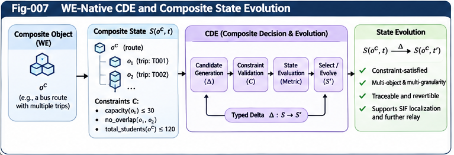

# EXT-002 — Object-Centric SIF Localization and Addressing

**Project:** Object-Centric Structural Reasoning and Evolution (OCSRE)  
**Repository:** `Object-Centric-Structural-Reasoning-and-Evolution`  
**Release target:** v1.0.0 — Research Framework and Contracts  
**Authors (proposed):** Sizhe Tan & GPT-Obot  
**Status:** E0 research extension; architectural contracts and test proposals, not validated performance claims  
**License:** Apache-2.0  
**Primary interfaces:** OCSRE-010; SPEC-001, SPEC-002, SPEC-004, SPEC-005, SPEC-006

## Abstract

Structural intelligence requires more than an accurate representation of objects. A system must locate the relevant problem, select or discover suitable capabilities, resolve the intended World Entity (WE) and its state, identify admissible evidence, and determine where an authorized change may occur. These operations are often all called *localization*, but they have different semantics and failure modes. This extension proposes an object-centric localization and addressing layer for the Structural Intelligence Framework (SIF), integrating problem–capability mapping, UTN-style typed addressing, MDT and WE-HDT differential localization, and Constrained Delta Evolution (CDE) over single or composite WE State-Containers. The common interface is not a universal algorithm: it is a typed, versioned, perspective-qualified resolution contract. Four synthetic cases—school-bus scheduling, SQL-native adaptation, compositional identity analysis, and AI-generated-code governance—illustrate why object identity, capability address, evidence provenance, state snapshot, and execution authority must remain separate. We specify twenty-two conformance obligations, reference tests, adversarial counterexamples, and falsifiable evaluation protocols. No implementation, formal equivalence, or empirical improvement is claimed.

**Keywords:** Structural Intelligence Framework; SIF; localization; addressing; World Entity; object identity; UTN; MDT; WE-HDT; CDE; differential localization; capability routing; composite state; provenance; conformance.

---



*Figure 7. WE-native constrained delta evolution over composite state containers: generate candidate transitions, evaluate global invariants, and promote only after validation and authorization.*

---

## 1. The localization problem in structural intelligence

A question such as “Can this school district operate with fewer buses?” does not uniquely identify an optimization target. The system must discover the affected fleet, trips, student assignments, constraints, and state snapshot; locate a suitable optimization capability; and decide whether a proposed reassignment is merely a candidate or a permissible operational change. Similarly, “What code will be affected by this change?” can refer to a function, a call edge, a policy, a deployment unit, or a runtime behavior. A name or graph node alone is not enough.

We distinguish six questions:

1. **Problem localization:** Which problem, residual, goal, or violated requirement is being addressed?
2. **Capability localization:** Which operator, plugin, evaluator, or relay artifact could address it?
3. **Object addressing:** Which WE identity and type does a reference designate?
4. **State localization:** Which versioned state, relation set, and granularity are relevant?
5. **Evidence localization:** Which observations, provenance, perspectives, and uncertainties justify the claim?
6. **Action localization:** Which constrained transition could be proposed, validated, authorized, and committed?

These questions interact, but answering one never automatically answers the others.

## 2. Scope and relationship to the research program

OCSRE is an integration and reasoning layer, not a replacement for adjacent research programs. The following ownership boundaries are proposed:

| Program | Primary contribution to this extension | Explicit non-claim |
|---|---|---|
| WE-SIO | WE identity, state, perspectives, evidence and object interfaces | OCSRE does not redefine identity ontology |
| SIF | Problem–capability dual maps, localization/addressing, node intelligence, control and governance | One locator does not solve all four SIF domains |
| UTN | Typed structural addressing and navigable references | UTN is not automatically equivalent to a metric or graph search |
| MDT | Differential structure and metric-sensitive localization | Similarity does not prove identity or logical entailment |
| WE-HDT | WE-oriented hierarchical/differential localization | Hierarchical proximity does not establish causal dependence |
| CDE | Constrained Delta evolution and candidate search over State-Containers | A high-scoring candidate is not a committed transition |
| OCSRE | Shared ObjectRef contracts, typed comparisons, plugins and reasoning interfaces | An interface contract is not an implemented runtime |
| UIERU / ISGFTR | Relay, collective learning, and capability spillover hypotheses | Sustained scaling remains unproven |

This extension elaborates OCSRE-010, and should be read alongside SPEC-001 and SPEC-006. It proposes interfaces that could be realized by multiple implementations, including implementations that use no particular graph database or vector index.

## 3. SIF's four functional domains and their coupling

The SIF research architecture distinguishes four broad functional domains:

- **Problem ↔ Capability dual mapping:** represent a problem, its residuals and the capabilities that may address it; permit reverse discovery from a capability to suitable problem classes.
- **Localization / Addressing:** identify the exact objects, structures, versions and execution contexts implicated by a problem or capability.
- **Per-node intelligence:** allow addressed nodes to evaluate, reason, learn and generate candidate actions through explicit contracts.
- **Control and governance:** constrain search, assess evidence, authorize operations and preserve accountability.

Localization is a connecting domain rather than a subordinate lookup service. A valid problem–capability match may fail because its object binding is ambiguous; a valid object binding may fail because a metric has the wrong units; a valid candidate may fail because the control plane prohibits the transition. The system must preserve these failures as explicit residuals.

## 4. An object-centric address is not an object identity

An **identity** designates a WE under an identity policy. An **address** is a route by which a system attempts to resolve an identity, state, or capability. The same identity may have several addresses, and an address may cease to resolve after a version change. A database row key, source-code symbol, graph vertex, public key, and display label are possible address components; none is automatically a WE identity.

A proposed canonical envelope is:

```yaml
ObjectAddressRequest:
  request_id: opaque-request-id
  address_scheme: utn-or-other-typed-scheme  # illustrative, not a literal standard
  address_expression: typed-selector
  expected_type: TypeRef
  identity_policy: IdentityPolicyRef
  snapshot: StateSnapshotRef
  perspective: PerspectiveRef
  granularity: GranularityRef
  evidence_policy: EvidencePolicyRef
  authority_context: AuthorityContextRef
  purpose: read | compare | reason | propose-delta
```

The illustrative scheme above is deliberately non-normative; concrete schemes must have their own versioned registry. A successful resolution returns an identity reference plus type, snapshot, provenance, qualification and authorization status. It does **not** silently return a mutable object with unrestricted permissions.

## 5. Proposed localization result contract

```yaml
LocalizationResult:
  status: resolved | ambiguous | stale | inaccessible | unsupported | unresolved
  object_refs: [IdentityRef]
  capability_refs: [CapabilityRef]
  state_refs: [StateSnapshotRef]
  relation_refs: [RelationRef]
  evidence_refs: [EvidenceRef]
  perspective_ref: PerspectiveRef
  granularity_ref: GranularityRef
  locator_trace: [TraceStep]
  confidence_annotation: optional-qualified-estimate
  residuals: [Residual]
  policy_decision: allow-read | deny | review-required
```

A confidence annotation may express uncertainty about resolution, but cannot turn a candidate identity into a verified one. A result may contain multiple candidate objects and remain **ambiguous**. The contract forbids coercing ambiguity into a single resolved identity without an explicit disambiguation rule and supporting evidence.

## 6. UTN as typed addressing and navigation

In this architecture UTN is treated as a typed address and navigation interface that can relate structural tokens, nodes, paths and target object references. It is useful when a problem is expressed at one level—for example, a policy or function—and the system must navigate to concrete implementation nodes or state objects. The proposed boundary is:

`ProblemRef → typed UTN query → candidate structural addresses → ObjectRef resolution → contract checks`.

UTN must expose address versioning, namespace, expected type, scope, and a trace of resolution. A UTN route is not a proof of the semantics of the object it reaches. In particular, a call-path location in code is not a proof that all data-flow or authorization effects have been found.

## 7. MDT and WE-HDT as differential localization methods

MDT-like methods can organize differences between observed and desired states, or between candidate objects under typed metrics. WE-HDT can organize WE-centric hierarchical and differential search. These are potentially complementary to UTN: an address can identify *where* to inspect, while differential search helps prioritize *what* differs and *where* a residual may originate.

A typed differential is meaningful only with compatible metric definitions, units, granularity, temporal scope, missing-value policy, and perspective. For example, comparing a bus's seat capacity with a district's total daily student count is not a meaningful direct differential. Similarly, two accounts with similar transaction patterns are not thereby the same actor.

No claim is made that UTN, MDT, WE-HDT and CDE implement identical algorithms or yield equivalent rankings.

## 8. CDE as a second SIF localization pillar

CDE is important not only for optimization after a target is found. Its **State-Container, typed Delta and constrained candidate search** can also locate promising regions of a structured solution space. This makes CDE a proposed second pillar of SIF Localization / Addressing alongside structural or metric-based addressing.

Two distinct localization modes follow:

- **Referential localization:** find the existing WE, state, relation, metric or capability implicated by a query.
- **Evolutionary localization:** search for a feasible candidate state or Delta path that addresses a residual under constraints.

The second mode cannot be reduced to the first: a feasible school-bus schedule is not simply an object already indexed in a database. It may have to be generated, compared, challenged, and validated. Conversely, generating a candidate schedule does not resolve a disputed student identity or an unauthorized source record.

The proposed flow is:

`Residual → State-Container binding → typed Delta generators → M→N candidate branches → independent constraint checks → qualified ranking → authorization gate`.

Path memory, no-reuse constraints, NoSubtree semantics and Loop-Back controls are CDE-specific contracts; they should not be presumed properties of UTN or MDT.

## 9. Two-way problem–capability localization

SIF's dual map supports two complementary directions:

**Problem-to-capability:** Given a residual, locate capability contracts whose declared input types, preconditions, evidence requirements and safety limits match the problem.

**Capability-to-problem:** Given a new ODK operator, plugin or CDE generator, discover problem classes for which its semantics might apply, then run receiver-side conformance tests before promoting the match.

A semantic match is not a keyword match. A generic “utilization” operator may be reused between bus seats and inventory storage only after units, aggregation grain, missingness, threshold policies and temporal windows are rebound and tested. This provides a controlled path to capability spillover without asserting universal transfer.

## 10. Localization across granularity boundaries

An object address must declare its granularity. A student, trip, bus duty, fleet and district are different units. A wallet, transaction cluster and hypothesized composite actor are also different units. Relations may connect them, but properties do not inherit automatically across these levels.

A valid cross-granularity step requires an explicit bridge contract specifying:

1. source and target types;
2. aggregation or decomposition rule;
3. temporal and perspective alignment;
4. loss of information and uncertainty;
5. admissible inference and forbidden inheritance;
6. evidence and policy requirements.

A route-level utilization ratio cannot be assigned to every student as an individual attribute. A composite actor hypothesis cannot be used to assert the legal identity of every member address. These are contract violations, not merely low-confidence estimates.

## 11. Perspective-aware and time-aware resolution

A WE may have distinct observed, planned, simulated, and authorized states. A localization result must distinguish them. For instance, the planned bus route at 07:00, the observed route at 07:15, and the candidate route for tomorrow may have different passengers, constraints and evidence. A comparison that silently combines them is invalid.

Perspective qualification similarly matters: a logistics operator may value fleet count; a parent may value ride time; a safety auditor may prioritize compliance. Their scoring policies may differ without changing the underlying identity. The system must record whose perspective is used and must not convert a perspective-specific ranking into a universal claim.

## 12. Localization, evidence and epistemic separation

Five outputs must remain distinguishable:

| Output | Example | What it does not establish |
|---|---|---|
| Resolved address | Function `authorize()` at commit X | Correctness of function behavior |
| Deductive conclusion | Formal entailment in a declared theory | Truth of unverified premises |
| Metric difference | Utilization differs by 0.15 | Causal explanation or policy permission |
| Evidence-supported hypothesis | Addresses may share control | Verified real-world identity |
| Authorized transition | Approved and committed Delta | Optimality in all future contexts |

SPEC-005 governs provenance, evidence status and feedback. Any promotion from hypothesis to fact or from candidate to action requires a distinct validation or authorization event.

## 13. Worked scenario A: school-bus scheduling

Consider CASE-003's simplified fleet of three buses and three fixed trips. A problem locator identifies a fleet-count residual; a WE address resolver binds the relevant trips, buses, drivers, assignments and state snapshot; a capability locator selects a scheduling plugin; and CDE generates a reassignment candidate.

A feasible candidate may reduce the number of required buses from three to two in the toy model, provided non-overlapping trip windows, travel feasibility, capacity and all declared constraints hold. This is **evolutionary localization**: the target is a candidate configuration discovered through constrained search. The object addresses are necessary to evaluate the candidate, but do not themselves produce it.

Negative case: a route reassignment that appears to reduce fleet count but violates a driver's duty limit must remain rejected regardless of its score. Real-world savings are not inferred from the synthetic case.

## 14. Worked scenario B: SQL-native adaptation

A database row may identify a stored record, not necessarily the WE it describes. In CASE-002, SQL-to-WE adaptation requires a mapping from source keys to identity policy, with explicit treatment of NULL, join multiplicity, aggregation grain, snapshots and row-level security.

The five transformation families—**Bucketize, Normalize, Combine, Encode, Derive**—produce candidate object attributes and metric projections. The locator must retain lineage to source tables, queries and policy scopes. A SQL `LEFT JOIN` producing missing values must not silently turn unknown into false; a many-to-many join must not double-count capacity or demand.

A successful SQL lookup can therefore fail WE identity conformance. Conversely, a properly typed WE identity can support multiple versioned SQL source addresses.

## 15. Worked scenario C: transactions and compositional identity

CASE-004 distinguishes observed transaction edges from a defeasible composite-actor hypothesis. A graph address locates accounts and transfers; an evidence locator retrieves time windows, provenance and potentially correlated weak indicators; a hypothesis capability proposes candidate groupings.

A candidate grouping is a research state, not a verified identity. CDE may split, merge or challenge candidate groupings, but cannot promote a real-world attribution without sufficient independent evidence and a separately authorized procedure. Similarity scores and transaction-flow connectivity are not identity proofs. The locator must support multiple competing hypotheses and explicit unresolved residuals.

## 16. Worked scenario D: AI-generated-code governance

CASE-006 provides a particularly useful SIF localization stress test. A proposed code change first identifies affected symbols and call edges. UTN-style addressing resolves those symbols in a versioned repository; differential localization finds changed contracts; additional graphs reveal data flow, control dependence, configuration, schema, policy, tests and deployment dependencies.

A Calling Graph can remain unchanged while a tenant-scoped authorization cache becomes unsafe. Thus calling-graph reachability is a **candidate impact locator**, not a complete semantic guarantee. CDE can generate alternative patches and tests; independent security and regression validators evaluate them; policy gates determine whether any patch may be merged or deployed.

A system must preserve the distinction between: *addressed impact*, *tested behavior*, *security review*, *approval*, *merge* and *deployment*.

## 17. Object plugins as addressable capabilities

An Object Plugin is a versioned capability with declared inputs, output types, metric semantics, side effects, evidence needs, and failure modes. A proposed capability address contains:

```yaml
CapabilityAddress:
  capability_ref: CapabilityRef
  version: immutable-version
  accepted_object_types: [TypeRef]
  required_perspectives: [PerspectiveRef]
  required_metric_contracts: [MetricContractRef]
  state_preconditions: [PredicateRef]
  side_effect_class: pure | proposal-only | state-changing
  validation_profile: ConformanceProfileRef
  authorization_policy: PolicyRef
```

Capability matching must be followed by receiver-side contract checking. The same plugin name does not guarantee identical behavior after a version change, and a plugin that was safe for read-only analysis may not be safe for state mutation.

## 18. Proposed resolution and evolution protocol

The following sequence is a **research protocol**, not a mandated implementation:

1. **Register the question:** assign `ProblemRef`, goal, perspective, constraints and residual.
2. **Locate candidate capabilities:** query SIF problem–capability mappings; retain alternatives and rejected matches.
3. **Resolve objects:** use UTN or other typed addressing, verify identity and type, and bind immutable snapshots.
4. **Locate evidence:** collect admissible provenance and qualify uncertainty.
5. **Construct differential projections:** use compatible ODK metric contracts where relevant.
6. **Select search mode:** referential resolution, evolutionary CDE localization, or a composed workflow.
7. **Generate candidates:** create typed Deltas in a sandbox, recording path memory and parent state.
8. **Validate independently:** check invariants, constraints, information flow and stale-state conflicts.
9. **Compare without conflation:** rank feasible candidates but preserve invalid and ambiguous results.
10. **Gate promotion:** require explicit authority, commit protocol and audit trail.
11. **Record feedback:** store outcomes, counterexamples, residuals and relay eligibility.

An implementation should be able to halt at any step and return a typed failure rather than fabricate a resolution.

## 19. Conformance obligations (SLA-001–SLA-022)

The following requirements are **proposed normative obligations**, not certified implementations.

| ID | Obligation |
|---|---|
| SLA-001 | Distinguish address expression from WE identity. |
| SLA-002 | Preserve identity-policy and type references. |
| SLA-003 | Bind every state-sensitive resolution to a versioned snapshot. |
| SLA-004 | Report ambiguity without silent first-match selection. |
| SLA-005 | Preserve perspective and granularity qualifiers. |
| SLA-006 | Record provenance and locator trace. |
| SLA-007 | Enforce read authorization before returning restricted object details. |
| SLA-008 | Reject stale or conflicting snapshot references. |
| SLA-009 | Distinguish problem address from capability address. |
| SLA-010 | Check capability input/output and side-effect contracts. |
| SLA-011 | Reject incompatible metric units or aggregation grains. |
| SLA-012 | Keep metric similarity separate from identity and entailment. |
| SLA-013 | Require explicit contracts for cross-granularity inference. |
| SLA-014 | Preserve SQL NULL and join-cardinality semantics during adaptation. |
| SLA-015 | Keep weak-evidence hypotheses defeasible and separately qualified. |
| SLA-016 | Distinguish referential localization from evolutionary search. |
| SLA-017 | Require typed Delta preconditions and State-Container invariants. |
| SLA-018 | Record path memory, NoSubtree and Loop-Back controls when applicable. |
| SLA-019 | Validate candidate transitions independently of ODK scoring. |
| SLA-020 | Separate proposal, validation, authorization and commit. |
| SLA-021 | Retain counterexamples and unresolved residuals across relay. |
| SLA-022 | Revalidate receiver-side capability bindings before promotion. |

## 20. Positive reference tests (SLP-001–SLP-012)

| Test | Synthetic input | Expected result |
|---|---|---|
| SLP-001 | Two addresses, same authorized WE and snapshot | One identity with two traceable address paths |
| SLP-002 | Same WE, different state versions | Identity preserved; snapshots distinct |
| SLP-003 | Exact typed UTN path | Resolved with namespace and version trace |
| SLP-004 | Compatible ODK metric pair | Qualified differential with units |
| SLP-005 | Bus trip reassignment satisfying toy constraints | Feasible *candidate*, not auto-commit |
| SLP-006 | SQL row with explicit identity mapping | WE resolution with source lineage |
| SLP-007 | Two perspective-specific fleet rankings | Both retained without forced universal ranking |
| SLP-008 | Composite-actor competing hypotheses | Ambiguous hypotheses retained |
| SLP-009 | Code symbol at immutable commit | Version-specific address resolution |
| SLP-010 | New plugin with matching declared contract | Eligible for receiver-side conformance trial |
| SLP-011 | Stale candidate refreshed to a new snapshot | Revalidation required before promotion |
| SLP-012 | Unresolved residual after failed search | Explicit residual and trace returned |

## 21. Negative and adversarial tests (SLN-001–SLN-020)

| Test | Failure injected | Required behavior |
|---|---|---|
| SLN-001 | Display label substituted for identity | Reject or return ambiguous |
| SLN-002 | Recycled database primary key | Detect identity-policy/version mismatch |
| SLN-003 | Missing state snapshot | Refuse state-sensitive mutation |
| SLN-004 | Cross-tenant address request | Deny without leaking restricted details |
| SLN-005 | Multiple candidate WEs, no tie-break evidence | Preserve ambiguity |
| SLN-006 | Metric compares seats with student-days | Reject incompatible units |
| SLN-007 | Route aggregate attributed to individual student | Reject invalid granularity inheritance |
| SLN-008 | Unknown SQL NULL converted to false | Fail semantic preservation |
| SLN-009 | Join duplicates demand rows | Detect cardinality distortion |
| SLN-010 | Transaction similarity treated as legal identity | Reject epistemic promotion |
| SLN-011 | Calling Graph unchanged, policy behavior changed | Require semantic/security analysis |
| SLN-012 | Plugin version silently changes output meaning | Invalidate prior conformance |
| SLN-013 | CDE Delta violates global fleet constraint | Reject candidate despite score |
| SLN-014 | Delta repeated along prohibited path | Reject under path-memory contract |
| SLN-015 | Loop-Back without termination controls | Halt or bound search |
| SLN-016 | Stale candidate committed after concurrent update | Reject or rebase under explicit protocol |
| SLN-017 | Proof validity conflated with premise truth | Preserve proof/evidence distinction |
| SLN-018 | Candidate patch merged without approval | Deny promotion |
| SLN-019 | Relay artifact omits source provenance | Reject receiver-side promotion |
| SLN-020 | Locator reports false certainty after partial evidence | Return qualified uncertainty/residual |

These tests are design specifications. No passing results are reported.

## 22. Evaluation plan and falsifiable research questions

A future evaluation should compare at least three implementations on the same held-out task sets:

- **B0 — Direct lookup:** exact identifiers, ordinary database and graph queries, conventional code search.
- **B1 — Typed structural addressing:** B0 plus versioned UTN-like addresses, provenance, identity and perspective contracts.
- **B2 — Object-centric SIF localization:** B1 plus problem–capability mapping, differential methods and CDE evolutionary localization with independent validation.

Pre-register tasks, baselines, compute budgets, human review effort, domain adapters and stopping conditions. Suggested measures include: correct identity resolution rate; ambiguous-resolution detection; false identity merges; localization recall at fixed precision; valid capability-binding rate; constraint-violation rate; time and compute per validated solution; stale-state rejection; unauthorized-promotion attempts blocked; cross-domain transfer adaptation cost; and receiver-side conformance pass rate.

Falsifiable questions include:

1. Does typed addressing reduce identity and versioning errors relative to B0, at acceptable overhead?
2. Does adding differential localization improve impact recall without unacceptable false positives?
3. Does CDE discover feasible composite-state configurations that referential lookup cannot directly retrieve, under matched budgets?
4. Does the shared interface lower adaptation cost for a *held-out* domain without increasing semantic violations?
5. Do recorded counterexamples and residuals improve subsequent localization trials?

A failure to improve, or an increase in invalid promotions, counts against the architecture's practical value. Evidence of better task performance would not by itself prove open-ended scaling or general intelligence.

## 23. Hypothesis and document traceability

| Research claim | Related hypothesis | Primary supporting design artifact |
|---|---|---|
| ODK reusable with typed metric bindings | OCSH-002 | OCSRE-004, SPEC-002 |
| Contracted capability adaptation | OCSH-003 | OCSRE-005, SPEC-004, CASE-005 |
| Composite WE state evolution | OCSH-005 | OCSRE-008, SPEC-006, CASE-003 |
| Cross-granularity contract discipline | OCSH-006 | OCSRE-003, SPEC-001/003 |
| SQL semantic preservation | OCSH-007 | OCSRE-006, CASE-002 |
| Validated cross-domain relay | OCSH-008 | OCSRE-011, CASE-005 |
| Code-governance impact localization | OCSH-011 | CASE-006, OCSRE-010 |

This extension contributes a proposed *mechanism* and evaluation obligations; it does not upgrade any hypothesis from E0 to empirically validated status.

## 24. Explicit leftovers and open research questions

The following issues are deliberately unresolved and should remain visible in the research trace:

1. Formal semantics of the canonical address envelope.
2. Canonical WE identity-policy registry and identity reconciliation.
3. Namespace collision and address migration rules.
4. Typed UTN grammar and interoperable resolver protocol.
5. MDT metric-space requirements and comparator stability.
6. WE-HDT hierarchy maintenance under object evolution.
7. Formal non-equivalence boundaries among UTN, MDT, WE-HDT and CDE.
8. Correctness criteria for approximate localization.
9. Granularity bridge algebra and information-loss bounds.
10. Temporal snapshot and event-time reconciliation.
11. Multi-perspective conflict resolution without hidden priority.
12. Security labels and cross-tenant information-flow proofs.
13. Identity uncertainty representation and disambiguation thresholds.
14. Missing-data and three-valued-logic propagation.
15. Composite State-Container consistency across distributed services.
16. Delta commutativity, conflict detection and rollback semantics.
17. M→N branching budget policies and search termination.
18. NoSubtree semantics under parallel search.
19. Path memory portability across relay agents.
20. Independent validator diversity and correlated failure.
21. Capability registry trust, signing and revocation.
22. Receiver-side adaptation cost and conformance economics.
23. Human oversight boundaries for consequential actions.
24. Longitudinal evidence for capability spillover and scaling.

## 25. Conclusion

Object-centric SIF localization is best understood as a **typed bridge between problem, capability, world object, evidence, state and authorized action**. UTN-style addressing, MDT and WE-HDT differential localization, and CDE's constrained evolutionary search offer different potential entry points. CDE is particularly important as a second localization pillar because many useful targets—such as a feasible schedule or a safe code patch—must be *generated and validated*, not merely retrieved. A shared ObjectRef interface can make these methods composable while preserving their distinct semantics. The central research obligation is therefore not to claim universal localization, but to demonstrate that the proposed contracts improve traceability, safety and valid cross-domain reuse under reproducible tests.

## References and internal research links

- `docs/OCSRE-001-The-Object-Centric-Structural-Intelligence-Thesis.md`
- `docs/OCSRE-003-Dynamic-Relational-and-Multi-Granular-Reasoning.md`
- `docs/OCSRE-004-Object-Differential-Kernel-and-Generic-Operators.md`
- `docs/OCSRE-005-Object-Plugins-and-Composable-Intelligence-Capabilities.md`
- `docs/OCSRE-006-SQL-to-Object-Attribute-Transformation-and-Semantic-Alignment.md`
- `docs/OCSRE-008-WE-Native-CDE-and-Composite-State-Evolution.md`
- `docs/OCSRE-009-Epistemic-Separation-and-Object-Centric-Evidence-Governance.md`
- `docs/OCSRE-010-UTN-WE-HDT-and-SIF-Localization-Through-Shared-Object-Interfaces.md`
- `docs/OCSRE-011-Object-Capability-Spillover-Relay-and-Collective-Structural-Learning.md`
- `specs/SPEC-001-Object-Identity-Perspective-and-State-Contract.md`
- `specs/SPEC-002-Object-Differential-Kernel-and-Comparator-Contract.md`
- `specs/SPEC-004-Object-Plugin-and-Capability-Composition-Contract.md`
- `specs/SPEC-005-In-Situ-Learning-Feedback-and-Epistemic-Governance-Contract.md`
- `specs/SPEC-006-WE-Native-CDE-Composite-State-and-Relay-Contract.md`
- `cases/CASE-002-SQL-Native-Object-Adaptation.md`
- `cases/CASE-003-School-Bus-Scheduling-and-Composite-WE-State.md`
- `cases/CASE-004-Transaction-and-Compositional-Identity.md`
- `cases/CASE-005-Cross-Domain-Object-Plugin-Relay.md`
- `cases/CASE-006-AI-Generated-Code-Governance-Through-Calling-Graphs-and-CDE.md`

---

*Research framework and contract proposal. All conformance outcomes, runtime benefits, formal properties and scaling claims require future independent validation.*
