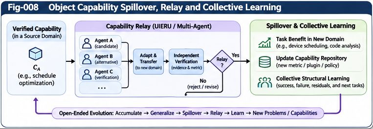

# EXT-003 — Multi-Agent Object Intelligence and Relay

**OCSRE — Object-Centric Structural Reasoning and Evolution**  
**Research extension:** EXT-003  
**Version:** v1.0.0 — Research Framework and Contracts  
**Authors:** Sizhe Tan & GPT-Obot  
**Status:** Proposed architecture and falsifiable research program; not empirically validated  
**License:** Apache-2.0

## Abstract

A multi-agent system does not become collectively intelligent merely by multiplying model instances, assigning roles, or exchanging messages. Its potential advantage depends on whether independently generated capabilities, evidence, objections, and validated state changes can be represented, compared, transferred, and retained without destroying their semantic boundaries. This extension proposes **Multi-Agent Object Intelligence and Relay (MAOIR)** as an OCSRE-compatible research architecture. Agents operate on typed WE/Object references, submit proposals through versioned contracts, challenge one another's assumptions, and use independent conformance gates before candidate changes become accepted state or reusable capabilities. The framework integrates Object Differential Kernel (ODK), Object Plugins, WE-native Constrained Delta Evolution (CDE), SIF localization, UIERU relay, competitive strategy generation, and Collective Structural Learning. Four synthetic scenarios illustrate the approach: school-bus scheduling, transaction compositional-identity analysis, SQL-to-WE adaptation, and AI-generated-code governance. The contribution is a specification-first coordination model, not a claim of autonomous general intelligence or demonstrated performance gains. We provide testable hypotheses, failure modes, a reference protocol, conformance obligations, and a validation plan.

**Keywords:** object-centric intelligence; multi-agent systems; WE; ODK; CDE; structural relay; collective learning; conformance; epistemic governance; SIF; UIERU.

---

  

*Figure 8. Proposed object capability relay: governed transfer, independent validation, residual capture, and collective structural learning across domains.*

---

## 1. Research question and central thesis

**Research question:** Under what conditions can multiple agents collectively produce more reliable, reusable, and transferable structural intelligence than an equally resourced single-agent baseline?

The proposed thesis is conditional: multi-agent advantage may emerge when (a) agents have meaningfully different search perspectives or competencies, (b) outputs are expressed through stable object and capability contracts, (c) counterevidence can alter or defeat proposals, (d) verification is sufficiently independent, and (e) accepted results are stored with provenance and transfer restrictions. None of these conditions alone guarantees improvement.

The proposed unit of coordination is not a chat message or a self-declared agent identity. It is a **typed object-centered artifact**: a reference to a WE, a state, a hypothesis, a constraint, a candidate Delta, a test result, or a capability with a declared interface.

## 2. Scope, non-goals, and epistemic status

This paper specifies a research architecture and executable-test targets. It does **not** assert that agent collectives are generally superior, that consensus establishes truth, that ODK similarity proves equivalence, or that a passing sandbox test authorizes production execution. It does not specify a universal ontology, complete identity-resolution algorithm, or unrestricted self-modifying agent system.

Terms such as *MUST*, *SHOULD*, and *MAY* describe proposed conformance behavior for a future implementation. They do not imply that an implementation already exists. All examples are synthetic. Reported outcomes are reference expectations under stated assumptions, not measured empirical results.

## 3. Relationship to the OCSRE research stack

The architecture builds on distinct, noninterchangeable components:

| Component | Proposed role | Boundary |
|---|---|---|
| WE/Object and `Object[metricIndices]` | Stable typed referents, scoped metrics, state and relations | An object reference is not an unrestricted permission token |
| ODK | Compare typed attributes and candidate differentials | A score is not a proof or feasibility certificate |
| Object Plugins | Encapsulate reusable capabilities and contracts | Reuse requires receiver-side semantic binding |
| SIF Localization / UTN / MDT / WE-HDT | Find relevant problems, objects, capabilities, evidence and state regions | Addressing does not imply truth or authorization |
| WE-native CDE | Generate and test constrained candidate state transitions | Candidate state is not committed state |
| UIERU / Structural Relay | Exchange and accumulate transferable intelligence units | A received artifact is not automatically validated |
| SSICR-style competition | Maintain distinct strategies and adversarial challenges | Competition is not a substitute for independent verification |
| Collective Structural Learning | Retain evidence-backed successes, failures and residuals | Frequency or consensus is not correctness |

The interfaces follow OCSRE-004, -005, -007, -008, -009, -010, and -011; the normative companion contracts are SPEC-001, -002, -004, -005, and -006. EXT-002 supplies the referential/evolutionary localization distinction.

## 4. What makes an agent contribution structural?

A contribution becomes structurally reusable when it declares at least: (1) the referenced object and its identity scope; (2) perspective and granularity; (3) state version and observation time; (4) claim type—deduction, observation, hypothesis, score, or action proposal; (5) source evidence and confidence semantics, if any; (6) required capabilities and constraints; (7) reproducible verification procedure; and (8) authorization boundary.

An eloquent recommendation without these elements may be useful for discussion but is not a promoted structural capability. A correct-looking conclusion without provenance is not equivalent to a verifiable derivation.

## 5. Proposed multi-agent role decomposition

Roles are functional contracts, not fixed personalities. A single implementation may perform several roles, but separation should be preserved for evaluation.

- **Problem Locator:** maps a request to typed objects, state regions, and candidate capabilities.
- **Candidate Generator:** proposes plans, explanations, Object Plugins, or Typed Deltas.
- **Counterexample Agent:** searches for violating inputs, contradictory evidence, or missing constraints.
- **Constraint Validator:** checks invariants, typing, temporal consistency, and policy gates.
- **Evidence Auditor:** evaluates provenance, source dependence, and epistemic classification.
- **Differential Evaluator:** computes ODK metrics only within declared comparability contracts.
- **Relay Curator:** packages validated artifacts with scope and receiver obligations.
- **Control-Plane Approver:** enforces explicit authority before irreversible actions.
- **Monitor:** observes deployment outcomes and routes residuals back to the learning loop.

Role assignment must not be confused with independence. Two agents sharing a prompt, model, retrieval cache, and training assumptions can produce correlated errors.

## 6. The shared Object Intelligence Workspace

A proposed workspace maintains an append-only evidence and decision ledger plus versioned object views. Its minimal logical record is:

```text
WorkspaceRecord {
  record_id, artifact_kind, object_refs[], perspective_id,
  granularity, state_version, time_scope,
  agent_role, agent_run_id, tool_and_model_provenance,
  assertion_kind, content_hash, dependency_refs[],
  evidence_refs[], constraints[], authorization_scope,
  verification_status, lifecycle_status, supersedes_refs[]
}
```

A `record_id` identifies an artifact; `object_refs[]` identify domain entities. Neither may be silently substituted for the other. Agent-specific working memory can remain private, but claims used for promotion must be reproducible or explicitly marked unverifiable.

## 7. Object identity, perspective, and granularity

An agent analyzing a bus route, a student, a fleet, or a school district is operating at different granularity levels. A route-level performance metric cannot automatically become a student-level safety conclusion. Likewise, a wallet cluster is a compositional-identity hypothesis, not a verified human identity. Every cross-granularity inference must declare a valid mapping contract and its exceptions.

Perspectives may legitimately differ: cost, reliability, equity, security, and time are not interchangeable objectives. An aggregate score is permitted only when its aggregation policy is explicit and auditable. Agents must preserve unresolved disagreement where perspectives cannot be commensurated.

## 8. The proposed Relay Artifact Contract

```text
RelayArtifact {
  relay_id, source_domain, target_domain_candidate,
  capability_id, capability_version,
  input_schema, output_schema, object_binding_contract,
  metric_semantics, perspective_and_granularity,
  assumptions[], invariants[], forbidden_inferences[],
  test_fixtures[], expected_results[], negative_tests[],
  evidence_manifest, source_provenance,
  security_and_privacy_policy, failure_modes[],
  receiver_validation_requirements[],
  status: PROPOSED | CHALLENGED | VERIFIED_LOCAL |
          ACCEPTED_SCOPED | REJECTED | RETIRED
}
```

A receiving domain MUST bind its own identities, metrics, constraints, and policy before adoption. `VERIFIED_LOCAL` does not mean `ACCEPTED_SCOPED`; a successful source-domain test does not establish target-domain correctness.

## 9. Competitive candidate generation without forced consensus

Multiple agents may produce a portfolio of candidate Deltas or explanations. Their proposals are kept distinct, with explicit parent states and evidence. Candidate generation can be diversified by algorithm, perspective, problem decomposition, or available information; merely sampling the same model repeatedly is a weaker diversity intervention.

The collective may choose to retain several nondominated candidates. For instance, one bus schedule can minimize fleet size while another reduces long student rides. A control plane determines the authorized selection policy; the agent with the highest private score does not automatically win.

## 10. WE-native CDE as a governed evolution engine

Let a composite state be \(S_t\), a typed candidate Delta be \(\delta_i\), and a validator be \(V\). The proposed search step is:

\[
S'_{i} = \operatorname{ApplyCandidate}(S_t,\delta_i),\qquad
V(S'_i,\mathcal C,\mathcal P) \in \{\text{pass},\text{fail},\text{unknown}\}.
\]

Here \(\mathcal C\) denotes domain constraints and \(\mathcal P\) denotes policy/authority conditions. Only candidates that pass required gates may be considered for promotion; `unknown` is not `pass`. A separate authorization decision is required before execution. Agents can propose M→N branches, but path-memory rules, forbidden Delta reuse, NoSubtree semantics, loop-back limits, and termination budgets must be enforced as specified by the applicable CDE profile.

The exact meaning of “Delta reuse” is path- and contract-dependent: globally prohibiting an operation type would be overrestrictive, while allowing the same state transition to cycle indefinitely would defeat termination safeguards.

## 11. ODK scoring and the validator separation

A candidate evaluator may compute:

\[
\mathbf m(S) = (\text{fleet size},\text{ride-time burden},\text{lateness},\text{risk proxy})
\]

and a typed differential \(\Delta\mathbf m = \mathbf m(S')-\mathbf m(S)\). However, lower fleet size does not justify violating student coverage, capacity, driver-hour limits, or authorization policy. ODK supplies comparative evidence within compatible metric semantics; it does not determine truth, legality, safety, or authority by itself.

Agents must not compare incompatible metrics solely because both are represented as numbers. Metric definitions, units, normalization and observation windows must be recorded.

## 12. Evidence independence and correlated failure

Independent verification is a property to be tested, not a role label. A validator that simply restates a generator's rationale has little evidential independence. Proposed independence controls include separate test construction, adversarial fixtures, diverse retrieval sources, holdout cases, tool-level recomputation, and provenance disclosure.

A challenge record should identify the exact claim it defeats or narrows. Contradictory evidence must be retained even when a proposal is accepted for a narrower scope. Majority voting may prioritize review, but cannot convert a logically invalid proof or a failed invariant into a valid one.

## 13. A reference multi-agent protocol

```text
1. LOCALIZE problem, objects, state version, perspective, authority.
2. DISCOVER eligible Object Plugins and required contracts.
3. GENERATE a diverse candidate portfolio and record provenance.
4. CHALLENGE each candidate with counterexamples and alternatives.
5. CHECK type, identity, temporal, security, and global invariants.
6. EVALUATE admissible candidates using compatible ODK metrics.
7. REVIEW evidence quality, residuals, and conflicts of interest.
8. APPROVE only within the explicit control-plane authority scope.
9. COMMIT a version-checked state change, or retain as hypothesis.
10. MONITOR outcomes; package scoped results for Relay.
11. REVALIDATE each Relay artifact in the receiver's domain.
12. RETAIN successes, failures, and unresolved residuals.
```

Every step emits a machine-checkable or explicitly human-reviewed record. Timeouts, unavailable validators, and contradictory evidence yield a blocked or degraded status rather than silent success.

## 14. Worked scenario A — school-bus scheduling

**Objects:** `Student`, `Trip`, `Bus`, `Driver`, `RoutePlan`, `Fleet`, and a composite schedule state. **Goal:** reduce vehicles without violating coverage, time windows, capacity, and rider constraints.

A generator proposes merging duties for a bus whose first trip ends at 07:40 and whose later trip begins at 08:05. A second agent challenges deadhead travel, driver availability, and boarding-time assumptions. A validator checks the entire composite state, not merely the two selected trips. ODK records the change in fleet size and rider-time burden. The control plane approves only after required evidence and authorization are present.

**Expected reference behavior:** A feasible merge may reduce the fixed-trip synthetic baseline from three vehicles to two under explicit simplifying assumptions (CASE-003). The result must be rejected or marked unknown if realistic deadhead or driver constraints are missing. No real-world savings claim follows from the synthetic fixture.

## 15. Worked scenario B — compositional transaction identity

**Objects:** transactions, accounts, wallets, keys, time-scoped evidence, and candidate composite actors. Different agents propose alternative control hypotheses: common operator, independent counterparties, or intermediary service. An evidence auditor tests whether the signals are genuinely independent; a counterexample agent supplies plausible alternative transaction explanations.

**Expected reference behavior:** The system may rank hypotheses for investigation while preserving uncertainty. It MUST NOT assert a real-world identity merely because two wallets share timing or flow patterns. Public keys and network metadata are evidence with limitations, not automatic identity certificates. Access to sensitive external records requires separate legal and authorization review (CASE-004).

## 16. Worked scenario C — SQL-to-WE plugin relay

A source agent packages a typed capacity-utilization transformation. A receiving inventory agent attempts to reuse the generic ratio-computation Kernel while substituting domain-specific inventory definitions. The relay curator preserves SQL NULL semantics, join cardinality, aggregation grain, provenance, and row-level access controls. A counterexample agent tests missing denominators, duplicated joins, and incompatible observation windows.

**Expected reference behavior:** A generic ratio operator may be reused after rebinding, but school-bus load thresholds must not be transplanted into inventory risk policy. A test that passes on the source domain cannot substitute for target-domain conformance (CASE-002 and CASE-005).

## 17. Worked scenario D — AI-generated-code governance

A coding agent proposes a cache optimization to an authorization check. A Calling Graph locator finds callers, while additional agents examine data flow, cache keys, tenant boundaries, configuration, security policy, and tests. A challenger supplies cross-tenant cache-collision fixtures. The candidate is represented as a CDE Delta on a versioned code-and-policy state; merge and deployment remain separate authorization gates.

**Expected reference behavior:** An unchanged Calling Graph MUST NOT be accepted as evidence that authorization semantics are unchanged. The candidate is rejected if tenant isolation is violated even when latency metrics improve. The complete path is Calling Graph → UTN localization → OCSRE typed governance, not Calling Graph alone (CASE-006).

## 18. Relay portfolios and collective structural learning

The collective maintains a **Relay Portfolio** rather than one winner. Each entry records the capability, compatible domains, rejected bindings, test coverage, expected benefit, known failure modes, and owner of ongoing validation. An accepted artifact can be downgraded when new evidence appears.

A minimal collective learning cycle is:

\[
\text{Experience} \rightarrow \text{Structured Claim} \rightarrow
\text{Challenge} \rightarrow \text{Conformance} \rightarrow
\text{Scoped Relay} \rightarrow \text{New Experience}.
\]

Repeated execution can constitute a data-accumulation relay when outcomes and provenance are preserved. Repetition without informative feedback or changed evidence is not automatically learning. Negative results and unresolved residuals are first-class assets, not material to hide from a publication record.

## 19. Multi-agent governance and safety boundaries

The proposed architecture separates five permissions: read, propose, validate, approve, and execute. A capability token must be scoped to objects, actions, time, and environment. Agents may not grant themselves higher authority through Relay artifacts or by writing to a shared ledger. The design should support immutable audit trails, sandbox isolation, secret minimization, least privilege, version checks, rollback or compensation plans, and explicit treatment of irreversible actions.

Where agents handle sensitive evidence, source access restrictions survive transformations and relay. Privacy preservation must be evaluated end-to-end, including derived attributes and cross-domain joins. Safety-critical execution should fail closed when mandatory checks cannot be completed.

## 20. Coordination economics and when multi-agent methods lose

Multi-agent systems introduce token, compute, latency, orchestration, verification, and coordination costs. Duplicate work, shared blind spots, role confusion, and excessive deliberation can make a collective worse than a single capable agent. Evaluation must therefore compare against **budget-matched** baselines, not against a weaker or less expensive single-agent setup.

Candidate advantage should be measured on task completion, valid-solution rate, detected counterexamples, transfer cost, error recovery, and net utility. A larger candidate portfolio can be useful only if the added diversity offsets the cost of review and validation.

## 21. Proposed conformance obligations (MAO-001–MAO-022)

| ID | Proposed requirement |
|---|---|
| MAO-001 | Each promoted artifact MUST reference typed, versioned objects. |
| MAO-002 | Identity, label, account, and actor hypothesis MUST remain distinct. |
| MAO-003 | Perspective and granularity MUST be explicit. |
| MAO-004 | Claim type MUST distinguish proof, observation, hypothesis, score, and proposal. |
| MAO-005 | Candidate generation MUST NOT mutate committed state. |
| MAO-006 | Typed Delta application MUST check preconditions and state version. |
| MAO-007 | Required global constraints MUST be independently evaluated. |
| MAO-008 | Unknown validation MUST NOT be treated as pass. |
| MAO-009 | ODK metrics MUST declare units, semantics, and comparability. |
| MAO-010 | ODK scores MUST NOT override hard invariants. |
| MAO-011 | Adversarial challenges MUST be linked to challenged claims. |
| MAO-012 | Verification provenance and dependence risks MUST be recorded. |
| MAO-013 | Conflicting evidence MUST be retained and reviewable. |
| MAO-014 | Relay artifacts MUST declare source and receiver contracts. |
| MAO-015 | Receiver-side conformance MUST precede target-domain acceptance. |
| MAO-016 | Agent roles MUST NOT imply authorization rights. |
| MAO-017 | Approval and execution MUST be separate from proposal. |
| MAO-018 | Sensitive evidence MUST preserve access and derivation restrictions. |
| MAO-019 | CDE path memory, NoSubtree and loop limits MUST be enforced per profile. |
| MAO-020 | Failed and rejected transfers MUST remain in the learning ledger. |
| MAO-021 | Promotion MUST support revocation or scope narrowing on new evidence. |
| MAO-022 | Empirical improvement claims MUST use budget-matched baselines. |

These obligations are proposed design requirements, not claims of completed conformance certification.

## 22. Positive reference tests (MAP-001–MAP-012)

| Test | Fixture and expected outcome |
|---|---|
| MAP-001 | Two agents propose different admissible bus schedules; preserve both as distinct candidates. |
| MAP-002 | A valid version-matched Typed Delta passes a synthetic invariant checker; remain candidate pending approval. |
| MAP-003 | A challenger identifies an omitted deadhead constraint; affected bus merge is blocked. |
| MAP-004 | Compatible utilization metrics with declared units are compared through ODK. |
| MAP-005 | Distinct cost and equity perspectives remain visible in a Pareto portfolio. |
| MAP-006 | Transaction hypotheses with incomplete evidence retain `HYPOTHESIS` status. |
| MAP-007 | SQL ratio operator transfers after target schema and metric rebinding. |
| MAP-008 | Receiver passes its own conformance fixtures before scoped acceptance. |
| MAP-009 | Calling Graph result is augmented with data-flow and policy analysis. |
| MAP-010 | Independent counterexample changes a previously favorable candidate to rejected. |
| MAP-011 | Repeated execution adds traceable observations without claiming new capability. |
| MAP-012 | A formerly accepted plugin is retired after a reproducible regression. |

## 23. Negative and adversarial tests (MAN-001–MAN-024)

| Test | Violation; required response |
|---|---|
| MAN-001 | Two agents agree on a false assertion; consensus MUST NOT certify truth. |
| MAN-002 | An agent changes object identity using a display label; reject binding. |
| MAN-003 | A group metric is asserted for each member; reject granularity crossing. |
| MAN-004 | Stale state version is used for a Delta; reject or rebase explicitly. |
| MAN-005 | A candidate bypasses a global capacity constraint; reject. |
| MAN-006 | Missing validator output is labeled pass; block promotion. |
| MAN-007 | Metric units differ but are silently compared; reject ODK operation. |
| MAN-008 | Soft score compensates for a security invariant violation; reject. |
| MAN-009 | Two validators share the same faulty test oracle; record dependence and require independent check. |
| MAN-010 | A challenge is deleted after majority vote; preserve ledger entry. |
| MAN-011 | A source-domain threshold is transferred as target-domain policy; reject binding. |
| MAN-012 | Target domain omits receiver conformance; do not promote. |
| MAN-013 | A proposer self-approves production execution; deny. |
| MAN-014 | Relay artifact expands source data access privileges; deny. |
| MAN-015 | A wallet-flow correlation is asserted as human identity; reject inference. |
| MAN-016 | SQL NULL becomes zero without declared semantics; reject transformation. |
| MAN-017 | Join multiplicity silently changes aggregate metrics; fail semantic test. |
| MAN-018 | A CDE loop repeats a forbidden path Delta; prune or terminate. |
| MAN-019 | An irreversible action lacks required approval; block execution. |
| MAN-020 | Calling Graph unchanged but tenant cache isolation breaks; reject change. |
| MAN-021 | A promoted plugin fails after schema change; downgrade and revalidate. |
| MAN-022 | Evaluation omits collective coordination cost; disallow net-gain claim. |
| MAN-023 | Agent output fabricates a test run; reject evidence provenance. |
| MAN-024 | A private hypothesis is leaked through a derived metric; deny relay and audit. |

## 24. Hypotheses, metrics, and proposed validation program

### 24.1 Falsifiable hypotheses

- **MAH-001 (structured coordination):** Given matched budgets, typed object artifacts improve traceability and reproducibility over unstructured message-only coordination.
- **MAH-002 (adversarial diversity):** Independent counterexample generation increases detection of invalid candidate Deltas compared with self-review alone.
- **MAH-003 (receiver-side relay):** Contract-checked transfer reduces negative transfer relative to unvalidated plugin copying.
- **MAH-004 (portfolio value):** A diverse, governed candidate portfolio improves valid-solution coverage under selected multiobjective tasks.
- **MAH-005 (learning retention):** Explicit failure and residual ledgers improve later correction and regression detection.
- **MAH-006 (cost boundary):** Multi-agent gains diminish or reverse under low task complexity or high coordination cost.

These are local extension hypotheses, not substitutes for the OCSH registry. Their closest program links are OCSH-002, -003, -004, -005, -006, -008, -009, -010, and -011.

### 24.2 Experimental arms

**A0:** single agent, unstructured workflow. **A1:** single agent with OCSRE typed contracts and validators. **A2:** multiple agents exchanging free-form messages. **A3:** multi-agent OCSRE with structured Relay, adversarial challenge, and independent validation. All arms receive matched data access, comparable tools, and separately reported compute/token/time budgets. Include held-out tasks and at least one deliberately incompatible transfer.

### 24.3 Metrics and falsification

Measure invariant violation rate, invalid promotion rate, counterexample recall, provenance completeness, independent reproducibility, valid candidate diversity, receiver-side transfer success, regression detection, coordination cost, latency, and net task utility. Pre-register thresholds, sample sizes, and statistical analysis before running experiments. Negative results, including A3 losing to A1, must be published. A single synthetic success does not establish general spillover or scaling.

### 24.4 Validation stages

**E0:** contracts, fixtures, counterexamples, and mock ledgers. **E1:** isolated conformance tests. **E2:** sandbox multi-agent trials. **E3:** cross-domain transfer and adversarial evaluation. **E4:** supervised, authorized operational pilot with monitoring. **E5:** longitudinal studies of capability retention and spillover. This manuscript supplies E0 design only; no later-stage completion is claimed.

## 25. Traceability to companion research assets

| Asset | Relationship |
|---|---|
| OCSRE-001, -003 | Object-centered thesis, relational and multi-granular reasoning |
| OCSRE-004, -005 | ODK and Object Plugin interfaces |
| OCSRE-007, -008, -009 | In-situ feedback, WE-native CDE, epistemic separation |
| OCSRE-010, -011, -012 | SIF localization, capability spillover, open-ended hypotheses |
| SPEC-001, -002 | Identity/state and differential-comparator contracts |
| SPEC-004, -005, -006 | Plugin composition, evidence governance, CDE/Relay contracts |
| CASE-002, -003, -004, -005, -006 | SQL, bus, transaction, cross-domain relay, code governance fixtures |
| EXT-001, EXT-002 | Logical preservation and localization/addressing boundaries |
| UIERU, SSICR, ISGFTR, SIF, CDE | Related research programs; conceptual interfaces require separate conformance |

A future `HYPOTHESIS-REGISTRY.md`, `COUNTEREXAMPLE-REGISTRY.md`, and `UNRESOLVED-RESIDUALS.md` should register local MAH/MAN items without silently upgrading their validation status.

## 26. Explicit leftovers and unresolved research questions

1. A canonical WE/Object serialization and interoperability standard is not fixed.
2. Agent identity and delegation semantics remain implementation-specific.
3. The minimum sufficient independence between validators is unknown.
4. Correlated model and retrieval failures require systematic measurement.
5. Cross-perspective metric aggregation needs domain governance.
6. Cross-granularity inference contracts are incomplete.
7. The universal boundary between evidence and hypothesis is domain-sensitive.
8. Efficient versioned workspace storage remains unbenchmarked.
9. Conflict resolution under simultaneous state updates is not implemented.
10. Delta path-memory equivalence classes require formalization.
11. NoSubtree and loop-back termination guarantees remain profile-specific.
12. The appropriate M→N branching policy remains an empirical question.
13. The costs of adversarial review may exceed its benefits on easy tasks.
14. Independent verification of nondeterministic outputs needs stronger protocols.
15. The portability of negative tests across domains is uncertain.
16. Receiver-side ontology alignment remains partly manual.
17. Privacy-safe derivation and relay need formal non-disclosure tests.
18. Authority delegation and revocation require concrete security models.
19. Irreversible actions need domain-specific compensation policy.
20. Longitudinal retention of capabilities has not been demonstrated.
21. Scaling from agent count to net intelligence gain is unproven.
22. Benchmark design must resist overfitting to synthetic cases.
23. Human oversight workload must be measured rather than assumed negligible.
24. Empirical comparisons with strong single-agent baselines remain outstanding.

## 27. Conclusion

Multi-Agent Object Intelligence and Relay proposes a disciplined route from distributed agent activity to auditable structural capability. The central design choice is to coordinate through typed WE/Object artifacts, independent challenges, explicit validation gates, constrained state evolution, and receiver-verified Relay—not through conversational agreement alone. This structure may allow OCSRE, UIERU, SIF localization, and CDE to cooperate while preserving their distinct semantics. Whether the resulting system improves reliability, transfer efficiency, or sustained capability growth is a falsifiable empirical question. The next step is to implement the proposed contracts, execute the counterexample-first tests, and report both successful and unsuccessful transfers.

## References and internal research links

- OCSRE-004 — *Object Differential Kernel and Generic Operators*.
- OCSRE-005 — *Object Plugins and Composable Intelligence Capabilities*.
- OCSRE-007 — *In-Situ Object Learning, Decision, and Feedback*.
- OCSRE-008 — *WE-Native CDE and Composite State Evolution*.
- OCSRE-009 — *Epistemic Separation and Object-Centric Evidence Governance*.
- OCSRE-010 — *UTN, WE-HDT, and SIF Localization Through Shared Object Interfaces*.
- OCSRE-011 — *Object Capability Spillover, Relay, and Collective Structural Learning*.
- SPEC-004 — *Object Plugin and Capability Composition Contract*.
- SPEC-005 — *In-Situ Learning, Feedback, and Epistemic Governance Contract*.
- SPEC-006 — *WE-Native CDE, Composite State, and Relay Contract*.
- CASE-003 — *School-Bus Scheduling and Composite WE State*.
- CASE-004 — *Transaction and Compositional Identity*.
- CASE-005 — *Cross-Domain Object Plugin Relay*.
- CASE-006 — *AI-Generated Code Governance Through Calling Graphs and CDE*.
- EXT-002 — *Object-Centric SIF Localization and Addressing*.

**Citation note:** The OCSRE companion documents above are internal research-program references, not claims of external peer review. External scholarly citations and independent empirical studies should be added in a later literature-review revision.
