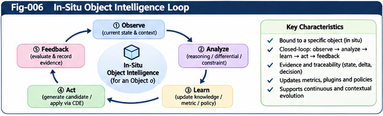

# EXT-004 — Open-Ended Metric, Plugin, and Policy Evolution

**Project:** Object-Centric Structural Reasoning and Evolution (OCSRE)  
**Document:** EXT-004 — Research Extension  
**Version:** v1.0.0 — Research Framework and Contracts  
**Authors (proposed):** Sizhe Tan & GPT-Obot  
**Status:** Proposed architecture and falsifiable research program; not empirically validated  
**License:** Apache-2.0

## Abstract

A structural intelligence system with a fixed metric catalog, fixed plugin repertoire, and fixed policy set can improve performance within its initial design but cannot, on that basis alone, claim open-ended structural growth. This extension proposes **Open-Ended Metric, Plugin, and Policy Evolution (OMPP-E)** as a contract-governed research program for generating, testing, retaining, composing, revising, and retiring the very instruments through which an Object-Centric Structural Reasoning and Evolution (OCSRE) system observes and acts. It distinguishes three evolution surfaces: **metrics** (what is represented and compared), **plugins** (what operations can be performed), and **policies** (what is permitted, prioritized, or escalated). Candidate changes are expressed as typed artifacts associated with WE/Object identities, perspectives, versions, evidence, and explicit authority. The Object Differential Kernel (ODK) supports comparative evaluation; WE-native Constrained Delta Evolution (CDE) supplies bounded candidate generation and state transition governance; SIF localization and UIERU relay provide discovery and transfer pathways. We specify invariants, a co-evolution protocol, synthetic cases, falsifiable hypotheses, adversarial tests, and explicit residuals. The proposal does not demonstrate autonomous improvement, unbounded novelty, or a scaling law.

**Keywords:** object-centric structural intelligence; open-ended evolution; metric discovery; Object Plugins; policy governance; WE; ODK; CDE; SIF; UIERU; structural capability relay; conformance.

---



*Figure 6. Proposed in-situ object intelligence loop with qualified observations, differential feedback, learning proposals, and governed decisions.*

---

## 1. Research question and thesis

**Question:** Under which conditions can a system discover *new useful measurements, operations, and governance rules* while preserving semantic consistency, epistemic traceability, and control over its own evolution?

The proposed thesis is conditional: useful structural growth may become more sustainable when metric, plugin, and policy evolution are treated as **separate but interacting typed search spaces**, rather than as unreviewed changes to a monolithic agent. A proposed improvement is not accepted merely because it improves a local score. It must survive contract checking, independent challenge, resource accounting, and the appropriate authorization gate.

The research objective is not perpetual growth of an artifact count. It is a sequence of **validated, nonredundant, useful capability changes** that can be retained or revoked with reproducible evidence. An expanding registry with declining usefulness is not evidence of open-ended intelligence.

## 2. Scope and nonclaims

This paper specifies a prospective framework, not an implemented runtime. Terms **MUST**, **MUST NOT**, **SHOULD**, and **MAY** denote proposed conformance obligations, not certification of any deployed system. Synthetic cases and expected tests are design targets; no experiments are represented as completed.

The framework does not assert that a system can generate an unlimited number of useful metrics, that plugin synthesis is generally safe, or that self-generated policies can legitimately supersede external governance. It does not claim mathematical equivalence between UTN, MDT, WE-HDT, SIF localization, and CDE. Their proposed integration occurs through shared, typed interfaces.

**Core non-equivalences:** metric novelty ≠ metric validity; high score ≠ truth; plugin execution ≠ authorization; policy proposal ≠ policy enactment; sandbox success ≠ production safety; local improvement ≠ cross-domain transfer; transfer ≠ sustained scaling.

## 3. Position in the OCSRE research stack

| Existing component | Role in OMPP-E | Boundary preserved |
|---|---|---|
| WE/Object; SPEC-001 | Identity, perspective, state and permission scopes | An ObjectRef is not an authorization token |
| ODK; SPEC-002 | Metric projection and typed differential evaluation | A metric score does not prove validity or authorize mutation |
| Classical reasoning; SPEC-003 | Preserve entailment in declared restricted fragments | Empirical evidence cannot silently become a deductive premise |
| Object Plugins; SPEC-004 | Typed capabilities, effects, composition and dependencies | Schema compatibility is not semantic compatibility |
| In-situ learning; SPEC-005 | Feedback, provenance, evidence and revision | Learning does not automatically commit world state |
| WE-native CDE; SPEC-006 | Candidate Delta search, composite invariants, relay | Candidate state is not committed state |
| SIF, UTN, MDT, WE-HDT | Locate gaps, objects, capabilities and evolution paths | Localization does not establish correctness |
| UIERU, MLIU, ISGFTR | Transfer and accumulate validated capabilities | Relay receipt is not independent validation |

OCSRE-004, -005, -007, -008, -009, -011 and -012 are the primary conceptual companions. EXT-002 distinguishes referential localization from evolutionary localization; EXT-003 provides multi-agent challenge and relay roles. This extension studies the **evolution of the instruments** used by those systems.

## 4. Three evolution surfaces

### 4.1 Metric evolution: changing what can be seen

A metric is not merely a numeric column. A metric definition binds a property to a unit, population, time window, perspective, granularity, missing-value policy, provenance and comparator semantics. Metric evolution may introduce a new dimension, refine an existing dimension, replace an unreliable proxy, or retire a misleading measurement.

### 4.2 Plugin evolution: changing what can be done

A plugin exposes one or more typed capabilities: observe, transform, infer, compare, generate candidates, validate constraints, or propose actions. Evolution may add a new capability, compose existing ones, specialize an adapter, or remove an unsafe dependency. The plugin's manifest must specify preconditions, postconditions, effects, failure modes and tests.

### 4.3 Policy evolution: changing how decisions are governed

A policy specifies permissions, admissible risks, review thresholds, priorities, budgets, escalation conditions, or deployment restrictions. A system may **propose** policy revisions; it must not infer authority to **enact** them. The governing authority and the policy being proposed for change are distinct objects with distinct provenance and lifecycle controls.

## 5. Why co-evolution is necessary—and dangerous

The three surfaces interact. A new metric may reveal a capability gap; a plugin may make a previously impractical metric measurable; a policy may require additional evidence before a plugin can be deployed. Conversely, co-evolution creates feedback traps. If a candidate metric and the plugin it evaluates are optimized together, the system can manufacture apparent progress. If the policy governing acceptance is also changed by the same candidate, evaluation becomes circular.

**Anti-circularity principle:** a candidate change MUST NOT be the sole source of its own acceptance criterion, validation evidence, or execution authority. Frozen baselines, external constraints, independent evaluators, and holdout tasks provide distinct checks.

## 6. Object-centered artifact model

A minimal proposed registry separates identity, semantics, provenance and lifecycle:

```text
EvolutionArtifact {
  artifact_id, artifact_kind: Metric | Plugin | Policy,
  version, object_scope[], perspective_id, granularity,
  time_scope, owner_and_authority, dependencies[],
  semantic_contract, evidence_refs[], test_suite_refs[],
  cost_and_risk_budget, lifecycle_status,
  proposed_by, reviewed_by[], supersedes[],
  rollback_plan, explicit_leftovers[]
}
```

A `MetricArtifact` additionally declares `quantity_kind`, `unit`, `normalization`, `missing_policy`, `comparator`, `validity_domain`, and `drift_monitor`. A `PluginArtifact` declares typed inputs/outputs, effects, permissions, invariants and dependency closure. A `PolicyArtifact` declares issuer authority, precedence, effective interval, affected subjects, escalation and revocation rules.

Artifact identity MUST NOT be confused with WE identity. The same metric can apply to multiple WE types under distinct bindings; the same WE can have different authorized metric views.

## 7. Lifecycle and promotion states

The proposed lifecycle is:

`Observed Gap → Candidate → Typed → Sandbox-Eligible → Tested → Challenged → Reviewed → Approved → Promoted → Monitored → Revised / Retired / Revoked`.

Each transition produces an append-only event with actor, authority, time, evidence and dependency hashes. A rejected candidate remains in the registry with a reason, including its counterexample or failed test. A retired artifact remains addressable for reproducibility but is not silently selected for new executions.

**Important:** approval to publish a metric definition does not approve a plugin execution. Approval to run a sandbox does not approve deployment. Approval to change a policy's text does not imply that the proposed policy has acquired authority over existing higher-priority controls.

## 8. Metric discovery operators

Candidate metric operators include:

1. **Residual decomposition:** split a persistently unexplained score residual into candidate causal or descriptive factors.
2. **Perspective differentiation:** propose distinct metrics for stakeholder perspectives instead of collapsing conflicting objectives.
3. **Granularity refinement:** separate group-level averages from individual-level distributions.
4. **Temporal differentiation:** introduce recency, stability, drift, or windowed measures where static snapshots are misleading.
5. **Counterexample-driven repair:** replace a proxy that fails on adversarial or distribution-shift cases.
6. **Cross-domain abstraction:** propose a shared quantity kind while retaining domain-specific units and validity contracts.
7. **Redundancy reduction:** merge metrics only after demonstrating semantic and predictive sufficiency under declared conditions.

These operators generate hypotheses about useful measurements. They do not establish causal validity or guarantee improved decisions.

## 9. Metric comparability and ODK invariants

For a metric `m`, define a contract-scoped projection:

`m(ObjectRef, stateVersion, perspective, timeWindow, granularity) -> Value | Missing | Inapplicable`.

An ODK differential is defined only when both projections satisfy the declared comparability relation. Normalization MUST preserve the distinction between zero, missing, withheld, and inapplicable. A scalar difference across incompatible units or populations MUST be rejected rather than coerced into an apparently meaningful score.

A candidate metric is promoted only if it demonstrates a declared advantage over baseline alternatives, such as improved calibration, lower error, better constraint-violation detection, or more useful problem localization—without unacceptable regressions. Any claim of improvement must include uncertainty and resource costs.

## 10. Plugin synthesis and composition operators

Proposed plugin evolution operators include **adapter generation**, **capability composition**, **specialization**, **parameterization**, **substitution**, **decomposition**, and **retirement**. A candidate may be generated by an LLM, search procedure, human author, or hybrid team; origin does not determine trust.

A composed plugin must recheck input/output semantics, side effects, dependency versions, privilege scope and postconditions. A sequence of locally conformant components is not automatically globally conformant. Where composition crosses object granularity or perspective, an explicit bridge contract is required.

Example:

```text
CapacityMetricPlugin
  -> CandidateFleetMergePlugin
  -> CompositeStateConstraintValidator
  -> HumanOrPolicyReview
```

The capacity metric may help rank candidates, but cannot substitute for a school-bus fleet's global feasibility check. A candidate fleet merge remains a proposed CDE Delta until approved and committed.

## 11. Policy proposal and governance boundaries

Policy evolution is the most sensitive of the three surfaces because it can change the rules under which metrics and plugins are accepted. The following separation is proposed:

- **Immutable external floor:** legal, organizational, safety, privacy and platform restrictions that the candidate system cannot self-waive.
- **Delegated policy surface:** configurable thresholds or preferences that an authorized controller may revise.
- **Advisory policy proposals:** recommendations requiring external acceptance.
- **Emergency suspension:** a preauthorized mechanism to halt unsafe actions without granting unrestricted policy-writing powers.

Policy precedence must be explicit and versioned. Conflicts resolve according to declared authority, not according to a metric's score or the proposing agent's confidence. Every enacted policy change must have a rollback path and an audit record; irreversible actions require additional controls.

## 12. CDE over a composite evolution state

A proposed evolution workspace is a composite WE State-Container:

```text
EvolutionState = {
  MetricRegistry, PluginRegistry, PolicyRegistry,
  CapabilityGraph, EvidenceLedger, EvaluationSuites,
  AuthorizationGraph, ResourceBudget, DeploymentState
}
```

Candidate typed Deltas include `AddMetric`, `RefineMetric`, `DeprecateMetric`, `AddPlugin`, `ComposePlugins`, `RestrictPlugin`, `ProposePolicyRevision`, `ApprovePolicyRevision`, and `RollbackArtifact`.

CDE may generate M→N candidate branches with NoSubtree pruning, path-Delta nonreuse and bounded Loop-Back controls. A metric revision that changes a downstream plugin's assumptions triggers dependency invalidation. A policy revision that narrows access may invalidate an otherwise conformant plugin invocation. Global invariants apply to the **composite state**, not merely to the changed artifact.

## 13. Candidate generation, challenge and promotion protocol

A proposed ten-step loop is:

1. **Localize** a residual, failed task, missing distinction, or policy conflict through SIF.
2. **Freeze** the baseline, evaluation suites, resource budget and authority constraints.
3. **Generate** metric, plugin or policy candidates with typed dependency declarations.
4. **Bind** candidates to WE/Object scopes, perspectives and versioned states.
5. **Check** syntax, typing, effects, permission and semantic preconditions.
6. **Sandbox** candidate Deltas in isolated composite states.
7. **Challenge** with counterexamples, adversarial cases and independent evaluators.
8. **Compare** net value against frozen baselines, including risk and compute costs.
9. **Review and authorize** only the specific artifact and action scopes supported by evidence.
10. **Monitor and relay** promoted artifacts with receiving-context conformance requirements.

A failed step returns an explicit residual or rejection; it must not be reinterpreted as success by changing the evaluation metric after observing the result.

## 14. Multi-agent role separation

An OMPP-E experiment can assign different agents to Gap Detection, Metric Design, Plugin Synthesis, Policy Analysis, Counterexample Generation, Semantic Validation, Security Review, Cost Evaluation, and Relay Curation. These are functional roles, not proof of independence. Agents that share the same model, prompt, data source or generated test oracle may have correlated errors.

The independent evaluator SHOULD be shielded from the candidate's optimization feedback on holdout tasks. A policy approver MUST have authority external to the candidate-generating process. A relay receiver MUST run its own binding and conformance tests rather than accepting the sender's success label.

## 15. Synthetic case A: school-bus metrics evolve

Consider CASE-003's school-bus optimization setting. The initial metric catalog contains `FleetCount` and `AverageRideDuration`. A candidate generator notices that an improved average can conceal a small set of students with unacceptably long rides. It proposes `P95RideDuration` and `MaxRideDuration`, each scoped to a school day, student population and declared measurement procedure.

The new metrics may expose a previously hidden equity or service-quality issue, but adding them is not by itself an improvement. A conformance test must verify that a proposed fleet reduction does not violate hard individual ride-time limits. A policy may require that any reduction in fleet count be rejected when a protected maximum is exceeded; that policy must be enacted by the proper authority, not by the optimization plugin itself.

**Reference expectation:** a candidate with lower `FleetCount` but a hard ride-time violation is rejected even if its aggregate score is favorable. A candidate metric that mislabels missing ride durations as zero fails the semantic gate.

## 16. Synthetic case B: SQL-to-WE plugin adaptation

In CASE-002, a SQL adapter transforms rows into typed WE/Object projections. A proposed plugin generalizes a capacity-utilization calculation from buses to inventory bins. The quantity kind may be reusable, but the meaning of capacity, time window, unit, null policy and allowed actions differ.

A candidate `UtilizationRatio` metric is accepted only if source and target definitions satisfy their contracts. For example, `NULL` stock quantity cannot be treated as zero inventory without an explicit and justified missing-value policy. An inventory restocking plugin cannot inherit authority from a read-only bus-capacity adapter.

**Reference expectation:** the shared ODK comparator may remain unchanged while target adapters and validation suites differ. This is a test of contract-based reuse, not a declaration of universal equivalence.

## 17. Synthetic case C: compositional identity and evidence policy

In CASE-004, a transaction graph supports multiple competing compositional-identity hypotheses. A candidate metric proposes combining timing similarity, amount patterns and transaction-path overlap. A naive design can double-count correlated evidence or treat a shared service as proof of common control.

The candidate metric MUST declare its evidence dependence assumptions and uncertainty semantics. A policy proposal may raise the evidence threshold for identity claims, but the system must distinguish *hypothesis ranking* from *identity assertion*. A high score cannot authorize deanonymization, external accusation, or account restriction.

**Reference expectation:** the evaluator rejects a metric that converts correlated evidence into an unjustified certainty claim, even if it improves synthetic classification accuracy.

## 18. Synthetic case D: AI-generated code governance

In CASE-006, an AI proposes a cache optimization for an authorization function. The Calling Graph may be unchanged while tenant isolation is weakened. A candidate code-analysis plugin adds data-flow and security-policy dependencies to the impact graph. A proposed metric measures coverage of affected authorization paths, not merely reachable call sites.

A policy revision may require independent security review when a change touches authentication or authorization semantics. The system can suggest that revision but cannot grant itself exemption from review. A plugin whose tests pass under a stale security policy must be revalidated after the policy changes.

**Reference expectation:** a fast, passing patch is rejected when it violates tenant isolation. The added security metric is useful only if it detects relevant failures under controlled comparisons and acceptable costs.

## 19. Failure modes and adversarial patterns

| Failure mode | Illustrative mechanism | Required response |
|---|---|---|
| Metric gaming | Candidate plugin optimizes the metric it authored | Frozen external baseline and independent holdout |
| Proxy collapse | Aggregate metric hides individual harm | Granularity-sensitive counterexample |
| Unit laundering | Similar field names conceal incompatible quantities | Typed quantity and unit validation |
| Plugin privilege creep | Adapter requests write access during read-only transfer | Least privilege and effect checking |
| Dependency drift | Metric revision changes downstream plugin assumptions | Version pinning and invalidation |
| Policy self-authorization | Candidate changes its own approval threshold | External authority and immutable floor |
| Evidence duplication | Multiple agents reuse the same source as corroboration | Provenance and dependence audit |
| Benchmark contamination | Candidate learns hidden evaluation examples | Holdout rotation and leakage checks |
| Novelty inflation | Renamed artifacts count as new capabilities | Semantic deduplication and net-value tests |
| Reward hacking | Short-term score improves while global constraints fail | Composite-state validation |
| Relay overreach | Source-domain permission treated as portable | Receiver-side binding and review |
| Rollback illusion | Policy or plugin has irreversible external effects | Effect classification and staged deployment |

## 20. Measuring structural growth without assuming scaling

Let `A_t` be the accepted artifact portfolio after round `t`, and `H_t` a held-out evaluation portfolio with fixed resource and risk budgets. A proposed research measure is:

`NetStructuralValue(t) = ValidatedTaskBenefit(t) - ComputeCost(t) - IntegrationCost(t) - RegressionPenalty(t) - GovernanceCost(t)`.

This is an accounting template, not a universal scalar metric. Its terms must be operationalized per experiment, with uncertainty intervals and explicit stakeholder perspectives. Novelty should be reported separately from usefulness, and cross-domain reuse separately from source-domain improvement.

A sustained-growth claim requires multiple rounds, task refresh, ablations, regression monitoring and comparisons to strong baselines. A positive slope in registry size or local benchmark score is insufficient. When multiple objectives are incommensurable, use a Pareto analysis rather than a forced single score.

## 21. Falsifiable research hypotheses

| ID | Hypothesis | Primary falsification route |
|---|---|---|
| OMPH-001 | Contract-governed metric discovery improves detection of previously hidden constraint violations | Compare against frozen metrics on held-out cases |
| OMPH-002 | ODK can remain unchanged across some successful plugin transfers | Demonstrate necessary kernel modification or failed semantic binding |
| OMPH-003 | Independent challenge reduces acceptance of invalid metric/plugin candidates | Compare independent vs shared-oracle review under matched budgets |
| OMPH-004 | Explicit policy-authority separation prevents self-authorizing candidate changes | Adversarial attempts to bypass higher-priority controls |
| OMPH-005 | Composite CDE validation catches failures missed by local artifact checks | Compare local-only vs global-invariant gates |
| OMPH-006 | Registry lineage improves rollback and failure localization | Timed recovery experiments with controlled regressions |
| OMPH-007 | Relay artifacts with receiver-side conformance outperform naive transfer | Held-out cross-domain tasks and cost accounting |
| OMPH-008 | Joint metric/plugin evolution yields net benefit over single-surface evolution in some tasks | Factorial ablation with frozen policy floor |
| OMPH-009 | Governance overhead can outweigh apparent gains on small tasks | Equal-budget and latency-sensitive benchmarks |
| OMPH-010 | Repeated rounds yield persistent, nonredundant gains beyond initial target tasks | Longitudinal holdouts and benchmark refresh; null result allowed |

These local hypotheses support but do not establish OCSH-002, OCSH-003, OCSH-004, OCSH-005, OCSH-008, OCSH-009 and OCSH-010. In particular, OCSH-010 remains E0 until sustained longitudinal evidence exists.

## 22. Proposed conformance obligations

A future implementation claiming OMPP-E conformance MUST satisfy the following proposed obligations:

| ID | Obligation |
|---|---|
| OMP-001 | Stable artifact IDs distinct from WE/Object IDs |
| OMP-002 | Typed and versioned metric semantics |
| OMP-003 | Explicit perspective, granularity and time scopes |
| OMP-004 | Distinguish zero, missing, withheld and inapplicable |
| OMP-005 | Enforce comparator and unit compatibility |
| OMP-006 | Plugin preconditions, postconditions and effects declared |
| OMP-007 | Plugin permissions bound to invocation context |
| OMP-008 | Composition checks include global invariants |
| OMP-009 | Policy issuer and precedence recorded |
| OMP-010 | Candidate cannot self-authorize promotion |
| OMP-011 | External immutable policy floor enforced |
| OMP-012 | Candidate CDE Deltas isolated from committed state |
| OMP-013 | Dependency invalidation on semantic changes |
| OMP-014 | Frozen baseline and resource accounting preserved |
| OMP-015 | Independent counterexample and adversarial review supported |
| OMP-016 | Evidence provenance and dependence recorded |
| OMP-017 | Negative transfer and rejected proposals retained |
| OMP-018 | Promotion, monitoring, revocation and rollback audited |
| OMP-019 | Receiver-side conformance required for relay |
| OMP-020 | Novelty distinguished from net utility |
| OMP-021 | No scaling claim without longitudinal evidence |
| OMP-022 | Explicit Leftovers retained across releases |

## 23. Positive reference tests

These are **unexecuted test specifications** with expected outcomes.

| Test | Input / condition | Expected outcome |
|---|---|---|
| POS-001 | New ride-time tail metric with correct population and units | Candidate reaches sandbox evaluation |
| POS-002 | Metric revision with complete dependency graph | Downstream consumers marked for revalidation |
| POS-003 | Read-only capacity plugin transferred with compatible binding | Receiver may test without core ODK modification |
| POS-004 | Candidate fleet merge preserves every hard constraint | Eligible for review, not automatic commitment |
| POS-005 | Proposed policy threshold with authorized issuer | Reviewable under recorded precedence |
| POS-006 | Metric proposal finds previously missed violation on holdout | Report benefit with uncertainty and costs |
| POS-007 | Adversarial agent produces valid counterexample | Candidate rejected or revised; evidence retained |
| POS-008 | Plugin composition with compatible effects and types | Composition admitted to global validation |
| POS-009 | Retired metric referenced by historical experiment | Historical result remains reproducible |
| POS-010 | Cross-domain relay passes independent target tests | Qualified transfer recorded with scope |
| POS-011 | Safe rollback of reversible candidate plugin | Prior version restored and audit trail retained |
| POS-012 | No improvement after controlled evaluation | Candidate rejected without forced positive narrative |

## 24. Negative and adversarial reference tests

These are **unexecuted test specifications**. Each must fail closed or produce the stated warning.

| Test | Invalid or adversarial condition | Expected rejection / response |
|---|---|---|
| NEG-001 | Compare occupancy percentage with passenger count | Reject incompatible quantity kinds |
| NEG-002 | Treat SQL NULL as zero without policy | Reject semantic coercion |
| NEG-003 | Group average used as proof of individual compliance | Reject granularity inference |
| NEG-004 | Metric candidate chooses its own acceptance threshold after scoring | Reject circular evaluation |
| NEG-005 | Plugin invokes unauthorized external write | Block effect |
| NEG-006 | Plugin passes unit tests but violates composite capacity invariant | Reject promotion |
| NEG-007 | Candidate policy waives its own review requirement | Reject self-authorization |
| NEG-008 | Lower-priority policy overrides external safety floor | Reject precedence violation |
| NEG-009 | Stale metric version used by downstream plugin | Invalidate and revalidate |
| NEG-010 | Two agents cite the same source as independent evidence | Flag dependence |
| NEG-011 | A renamed plugin is counted as new structural capability | Reject novelty claim |
| NEG-012 | Relay carries source-domain write permission into target domain | Deny inherited privilege |
| NEG-013 | Sandbox pass represented as production authorization | Reject lifecycle transition |
| NEG-014 | A metric's missingness is concealed in normalization | Reject projection |
| NEG-015 | Evaluation set contaminated by candidate training | Invalidate claimed improvement |
| NEG-016 | Faster code patch breaks tenant isolation | Reject on security invariant |
| NEG-017 | Identity score represented as conclusive identity proof | Reject epistemic promotion |
| NEG-018 | CDE candidate reuses forbidden path Delta | Reject path and log reason |
| NEG-019 | Loop-back search exceeds declared budget | Terminate bounded search |
| NEG-020 | Policy revision has no rollback or effect classification | Block enactment pending review |
| NEG-021 | Source task improves while held-out task regresses materially | Record negative transfer; withhold broad claim |
| NEG-022 | Repeated rounds add artifacts but no net utility | Do not claim open-ended growth |
| NEG-023 | Comparator changes during an experiment without baseline reset | Invalidate comparison |
| NEG-024 | Agent consensus substitutes for independent validation | Reject unsupported promotion |

## 25. Experimental roadmap and ablations

**Phase E0 — specification:** finalize schemas, threat models, invariant catalog, test fixtures and registry protocol. The present paper is at this phase.

**Phase E1 — local conformance:** implement isolated metric, plugin and policy registries; run POS/NEG tests; verify provenance, authorization and rollback behavior.

**Phase E2 — controlled co-evolution:** compare fixed catalog, metric-only evolution, plugin-only evolution, metric+plugin evolution under frozen policy, and full proposal-with-external-policy-approval. Match compute, data and human-review budgets.

**Phase E3 — cross-domain transfer:** use school-bus, inventory, transaction analysis and code-governance cases. Freeze source evaluation before testing in target domains. Record failures, adaptation costs and target-side conformance.

**Phase E4 — longitudinal validation:** repeat rounds on refreshed, partially untargeted tasks; audit benchmark contamination, metric gaming, dependency drift, artifact redundancy and cumulative maintenance costs. Stop or narrow claims when gains fail to persist.

Primary endpoints: valid new metrics, verified capabilities, policy violations prevented, net task benefit, transfer success, regression rate, review cost, rollback recovery time and number of genuinely new task families addressed. Report distributions and failures, not only best-case examples.

## 26. Explicit Leftovers

The following items are deliberately unresolved and must not be silently treated as implemented or proven:

1. Machine-readable schema for all three artifact classes.
2. Canonical ontology of metric quantity kinds.
3. Formal equivalence tests for metric versions.
4. Cross-perspective comparability semantics.
5. Principled missing-data and withheld-data handling.
6. Measurement uncertainty propagation through ODK.
7. Dependence-aware evidence combination rules.
8. Safe plugin synthesis sandbox specification.
9. Compositional effect-system completeness.
10. Plugin dependency and supply-chain trust model.
11. Formal policy precedence language.
12. External authority and delegation verification.
13. Emergency suspension and appeal process.
14. Safe rollback of partially irreversible actions.
15. CDE termination guarantees under complex Loop-Back.
16. Cross-artifact global invariant solver.
17. Multi-agent independence measurement.
18. Benchmark contamination detection.
19. Causal versus predictive metric discovery criteria.
20. Fairness and stakeholder-conflict arbitration.
21. Cross-domain adaptation cost normalization.
22. Sustainable portfolio maintenance accounting.
23. Longitudinal open-endedness stopping criteria.
24. Independent replication and public conformance implementation.

A repeated failure, unexecuted test, or unverified hypothesis is a legitimate relay artifact if recorded with its precise status. **Explicit Leftover is not permission to claim completion.**

## 27. Research interpretation and conclusion

The potential of OCSRE is not exhausted by adding more fixed-purpose Object Plugins. A richer research direction is to make **measurement, capability and governance themselves inspectable objects of constrained evolution**. Metric discovery expands what the system can notice; plugin discovery expands what it can attempt; policy evolution, under external authority, determines which attempts are admissible. The three processes may reinforce one another, but they may also create circular scoring, privilege escalation and misleading novelty.

OMPP-E therefore proposes a conservative research discipline: typed artifacts, frozen baselines, explicit provenance, independent challenges, composite-state conformance, bounded CDE search, authority-separated policy decisions, and receiver-side relay validation. It is a framework for asking whether useful structural capabilities can continue to grow—not evidence that such growth has already been achieved. The next extension, **EXT-005 — Structural Capability Spillover and Scaling Hypotheses**, examines the stronger claim that these mechanisms could yield repeatable gains beyond their original task contexts.

## References and companion documents

### Internal OCSRE research corpus

- OCSRE-004 — Object Differential Kernel and Generic Operators.
- OCSRE-005 — Object Plugins and Composable Intelligence Capabilities.
- OCSRE-007 — In-Situ Object Learning, Decision and Feedback.
- OCSRE-008 — WE-Native CDE and Composite State Evolution.
- OCSRE-009 — Epistemic Separation and Object-Centric Evidence Governance.
- OCSRE-010 — UTN, WE-HDT and SIF Localization Through Shared Object Interfaces.
- OCSRE-011 — Object Capability Spillover, Relay and Collective Structural Learning.
- OCSRE-012 — Open-Ended Object-Centric Structural Intelligence.
- SPEC-001 through SPEC-006 — Proposed normative research contracts.
- CASE-002 through CASE-006 — Synthetic application and governance cases.
- EXT-002 — Object-Centric SIF Localization and Addressing.
- EXT-003 — Multi-Agent Object Intelligence and Relay.

### Established research traditions for comparison

The proposed architecture should be compared, without claiming equivalence, to work on automated feature engineering, program synthesis, constraint programming, Bayesian experimental design, multiobjective optimization, safe reinforcement learning, policy-as-code, software verification, and open-ended learning. A formal, edition-specific bibliography is deferred until a literature verification pass; no uncited historical priority claim is intended.
