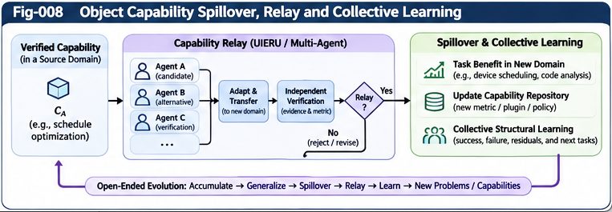

# EXT-005 — Structural Capability Spillover and Scaling Hypotheses

**Project:** Object-Centric Structural Reasoning and Evolution (OCSRE)  
**Document:** EXT-005 — Research Extension  
**Version:** v1.0.0 — Research Framework and Contracts  
**Authors (proposed):** Sizhe Tan & GPT-Obot  
**Status:** Proposed research framework and falsifiable hypotheses; not empirically validated  
**License:** Apache-2.0

## Abstract

This extension examines a demanding proposition: a structural intelligence capability developed for one problem may produce useful effects in tasks, domains, or organizational settings that were not its original targets, and repeated validated transfers may alter the rate at which a system acquires further capabilities. We call the first phenomenon **structural capability spillover** and reserve **structural scaling** for an independently measured relationship between accumulated structural resources and validated performance or capability growth. The Object-Centric Structural Reasoning and Evolution (OCSRE) framework supplies a possible substrate: stable World Entity (WE) references, typed `Object[metricIndices]` projections, Object Differential Kernel (ODK) comparisons, contract-governed Object Plugins, in-situ feedback, WE-native Constrained Delta Evolution (CDE), and relay through SIF localization and UIERU collective learning. None of these mechanisms alone establishes a scaling law. We distinguish reuse, transfer, generalization, unanticipated spillover, cumulative capability growth, and scaling; propose causal evaluation protocols with prospective holdouts and resource-matched baselines; specify anti-leakage and epistemic controls; and define falsifiable hypotheses, positive and adversarial tests, conformance obligations, and explicit leftovers. This is a research agenda rather than evidence of achieved autonomous or open-ended improvement.

**Keywords:** OCSRE; structural capability spillover; scaling hypotheses; ISGFTR; cross-domain transfer; Object Plugins; ODK; WE; CDE; UIERU; collective structural learning; capability provenance; causal evaluation.

---

  

*Figure 8. Proposed object capability relay: governed transfer, independent validation, residual capture, and collective structural learning across domains.*

---

## 1. Central research question

Can the accumulation of validated, composable object-centric capabilities improve performance on **previously unselected tasks**, beyond the gains explainable by additional computation, task-specific engineering, larger catalogs, or benchmark contamination?

The proposal has two levels. The modest level is that a reusable capability can sometimes be adapted to a second domain under explicit contracts. The stronger level is that a sufficiently interoperable capability ecosystem may generate useful **unanticipated** applications and make subsequent discovery more productive. The strongest level—a persistent structural scaling law—is an empirical hypothesis that requires longitudinal measurements and stringent controls. This extension does not treat the levels as interchangeable.

The relevant research outcome is not how many plugins or documents a system accumulates. It is how much **validated, nonredundant, transferable capability** becomes available at a measurable total cost and within preserved safety constraints.

## 2. Scope, assumptions, and nonclaims

This document is a conceptual and experimental specification. It provides no measured scaling exponent, validated performance curve, deployed system, or proof of autonomous recursive self-improvement. Examples are synthetic and all test outcomes are expectations, not executed results. Normative **MUST**, **MUST NOT**, **SHOULD**, and **MAY** refer to proposed conformance requirements.

It does not assume that language-model scaling laws automatically transfer to OCSRE. Structural capability accumulation differs from parameter scaling, inference-time scaling, dataset scaling, and brute-force search: its resource units include validated contracts, reusable operators, semantic adapters, evidence, and relay pathways. Whether these units predict useful capability is a question for experiments.

The framework does not equate semantic similarity with task transfer, successful transfer with novelty, novelty with value, or growth in artifact count with growth in intelligence. It also does not infer authorization from capability.

## 3. Relationship to the OCSRE and SI research stack

| Component | Proposed contribution to spillover | Required boundary |
|---|---|---|
| WE/Object and SPEC-001 | Persistent identity, perspective, state, granularity, authority | Shared identifiers do not imply equivalent semantics |
| ODK and SPEC-002 | Typed comparisons and measurable differential signals | A favorable differential does not prove causal transfer |
| Classical reasoning and SPEC-003 | Preservation of entailment in a declared restricted fragment | Evidence scores must not be promoted to logical proofs |
| Object Plugins and SPEC-004 | Portable, typed capabilities and composition contracts | API compatibility is not behavioral equivalence |
| In-situ learning and SPEC-005 | Feedback, evidence revisions, failure memory | Observations are not automatically committed truth |
| WE-native CDE and SPEC-006 | Constraint-preserving candidate search and state evolution | Candidate feasibility is not authorization |
| SIF, UTN, MDT, WE-HDT | Locate tasks, gaps, capabilities and object bindings | Localization is not independent validation |
| UIERU and ISGFTR | Relay, accumulation, cross-boundary transfer hypotheses | Receipt and reuse do not establish scaling |
| EXT-003 and EXT-004 | Multi-agent challenge; metric/plugin/policy evolution | Self-evaluation and self-authorization are prohibited |

The principal companions are OCSRE-005, -007, -008, -009, -010, -011, and -012; CASE-002 through CASE-006 supply proposed task families. ISGFTR motivates the distinction between capability creation and capability movement, but its broader claims remain research hypotheses here.

## 4. A taxonomy of increasingly strong claims

1. **Reuse:** the same component is invoked again in a sufficiently similar setting without meaningful semantic adaptation.
2. **Adaptation:** a component is made usable in another setting through an explicit adapter, new configuration, or domain-specific contract.
3. **Transfer:** an adapted capability improves an independently evaluated target task compared with an appropriate baseline, after accounting for costs.
4. **Generalization:** a capability family performs across a predeclared distribution of different tasks, not merely one handpicked success.
5. **Spillover:** a capability yields a validated benefit on a task not selected or optimized for when the capability was created; provenance and chronology make this claim auditable.
6. **Cumulative growth:** the system retains multiple useful capabilities, including interactions between them, without unacceptable regression or maintenance burden.
7. **Structural scaling:** increasing a defined structural resource produces a reproducible quantitative relationship with validated outcomes across resource budgets, tasks, and time.
8. **Open-ended growth:** the system continues discovering substantively new useful capabilities under changing task families and constraints; no finite demonstration can establish an unlimited horizon.

Each stronger claim requires additional evidence. A single SQL-to-inventory adapter, for example, may establish adaptation; it does not by itself establish spillover or scaling.

## 5. What is the unit of structural capability?

A capability should be represented as a **versioned contract-bound artifact**, not an informal statement that an agent 'knows how' to do something. A proposed record includes:

```yaml
capability_id: cap:typed-capacity-ratio:v1
source_task_id: task:school-bus-load
created_at: T0
object_types: [VehicleDuty, CapacityObservation]
input_contract: contract:capacity-ratio-input:v1
output_contract: contract:ratio-with-units:v1
metric_semantics: [numerator, denominator, time_window, granularity]
plugin_manifest: plugin:typed-ratio:v1
preconditions: [denominator_positive, compatible_units]
postconditions: [ratio_dimensionless, provenance_preserved]
validation_evidence: [test_suite_hash, evaluator_version]
authority_scope: read_only
resource_profile: [compute, integration_hours, validation_hours]
known_failures: [null_denominator, mismatched_window]
relay_history: []
```

The record must distinguish the capability definition from its deployment instances. Two plugins with different names but equivalent tested behavior should not automatically count as two independent capabilities. A capability whose contracts are incompatible with a target task is not transferable merely because both use numeric metrics.

## 6. Object-centric substrate for spillover

An object-centric substrate offers a possible reduction in transfer friction. WE identity stabilizes referents; `Object[metricIndices]` makes selected observations comparable under declared semantics; ODK provides reusable differential operators; Object Plugins express domain-independent operations behind domain-specific adapters; and CDE governs changes to composite state. These are **candidate mechanisms**, not demonstrated causal explanations.

A target domain must bind at least: object type and identity; metric definitions and units; perspective; time horizon; aggregation grain; missingness semantics; provenance; allowed operations; constraints; and authority. A common object interface can facilitate translation while leaving important domain-specific rules untouched.

For example, vehicle seat utilization and warehouse shelf utilization may share a dimensionless ratio kernel, but they differ in capacity definitions, time aggregation, operational constraints, and consequences. Reusing the ratio calculation is not the same as reusing a vehicle routing policy.

## 7. Spillover pathways

We propose five separable pathways:

- **Operator spillover:** a validated differential or normalization kernel supports a new task without altering its mathematical core.
- **Representation spillover:** a typed object schema or composite-state model reduces the effort required to describe another domain.
- **Search spillover:** a CDE candidate-generation and validation protocol can be rebound to new typed deltas and constraints.
- **Governance spillover:** provenance, independent challenge, and authorization gates improve traceability in an unrelated workflow.
- **Question-generation spillover:** a new metric, residual, or failure case exposes previously unasked questions in another task family.

The last pathway connects to AQSI and open-ended structural learning. It is particularly difficult to validate because an evaluator must determine whether a question is both genuinely new relative to a declared corpus and useful under independent criteria.

## 8. A formal but deliberately limited model

Let $\mathcal{C}_t$ be the set of available, versioned capabilities at time $t$, and let $\mathcal{T}_t$ be a prospectively sampled evaluation set. For task $\tau$, define $U(\tau,\mathcal{C}_t,B)$ as an externally evaluated utility under resource budget $B$, including relevant constraint violations and operational costs. A conditional spillover gain can be written as

$$
G_{\mathrm{spill}}(c,\tau)=U(\tau,\mathcal{C}_t\cup\{c\},B)-U(\tau,\mathcal{C}_t,B),
$$

where $\tau$ was not selected or optimized for during the development of $c$, and both conditions receive comparable budgets and evaluation procedures. The difference is an **observed association** unless treatment assignment, controls, and interference are handled adequately.

A prospective structural resource index might be

$$
R_t = w_1 N_{\mathrm{validated}} + w_2 N_{\mathrm{interoperable}} + w_3 N_{\mathrm{reproducible\ relay}} - w_4 M_{\mathrm{maintenance}},
$$

with weights fixed before evaluation and with sensitivity analyses. This is an illustrative index, not a discovered law. Avoid interpreting the index as a sufficient statistic for intelligence.

A scaling hypothesis might test whether a prespecified outcome $Y$ is fit by $Y=a+b\log(1+R)$, a power law, a saturating curve, or no systematic relationship. Model selection, uncertainty, and out-of-distribution prediction must be reported. A visually smooth curve is not proof of a universal scaling law.

## 9. The crucial distinction: targeted versus untargeted benefit

A capability designed for warehouse inventory and evaluated on warehouse inventory does not constitute spillover. A capability designed for school-bus load calculations and later found useful for warehouse inventory may qualify **only if** the warehouse task was not part of the design, tuning, or selection process, and if the benefit survives a prospective or otherwise defensible evaluation.

A chronological ledger should freeze the capability, development-task set, selection rationale, and excluded target domains at T0. After T0, an independent process samples target tasks from a registered universe. The evaluation must document any human adaptation, prompt changes, code changes, extra data, or domain-specific tuning. Otherwise, a reported spillover may merely be hidden engineering effort.

## 10. Experimental program: four stages

**Stage A — Contract-preserving reuse.** Verify that a generic operator produces semantically correct outputs under multiple declared object bindings. Measure correctness, integration effort, and runtime cost.

**Stage B — Prospective transfer.** Freeze the capability and test on target tasks sampled from unseen domains. Compare against domain-specific implementations, generic tools without object contracts, and matched-budget retraining or prompt engineering.

**Stage C — Unanticipated spillover.** Hold out task families that were not part of capability design. Use blinded external evaluators to assess whether the capability provides net benefit, including costs and safety regressions.

**Stage D — Longitudinal structural growth.** Repeat capability acquisition, retention, retirement, and relay across multiple rounds. Examine performance on fresh tasks and detect plateaus, regressions, dependency explosions, and maintenance costs. Fit scaling curves only after collecting enough independent observations.

The progression is not automatic. Failure at an earlier stage should block stronger claims.

## 11. Baselines and ablations

At minimum, compare:

| Arm | Configuration | Question addressed |
|---|---|---|
| B0 | Task-specific baseline, matched budget | Is there any net gain? |
| B1 | Shared code library without WE contracts | Is ordinary reuse sufficient? |
| B2 | ODK and typed metrics, no relay | Does object-centric representation help? |
| B3 | ODK + Object Plugins + contract checks | Do interfaces improve adaptation? |
| B4 | B3 + CDE candidate search | Does constrained evolution help? |
| B5 | B4 + UIERU relay and independent validation | Does collective relay add benefit? |
| B6 | B5 + metric/plugin proposal, frozen governance | Does governed instrument evolution help? |

All arms must receive comparable compute, engineering, retrieval access, evaluator calls, and time budgets. Where exact matching is impossible, report both raw outcomes and cost-adjusted results. Ablate identity binding, provenance, holdout protection, independent validation, and negative-transfer controls separately.

## 12. Evaluation metrics

Report a multidimensional outcome rather than a single favorable score:

- **Task utility:** success rate or domain-specific quality on a prospectively specified test set.
- **Net transfer value:** utility improvement minus compute, adaptation, verification, maintenance, and failure costs.
- **Transfer breadth:** number and diversity of independently validated target task families, with task-family sampling described.
- **Unexpected-benefit rate:** fraction of frozen capabilities that help prospectively held-out, untargeted tasks.
- **Novelty and nonredundancy:** independently assessed distinction from existing capabilities and solutions.
- **Relay fidelity:** preservation of semantics, evidence, and safety obligations after handoff.
- **Regression rate:** degradation on previously validated tasks after integration.
- **Capability survival:** fraction of promoted artifacts still useful after later data, policy, and dependency changes.
- **Governance integrity:** unauthorized actions, missing provenance, or self-approval incidents.
- **Discovery efficiency:** validated new useful capabilities per total resource unit, with uncertainty.

Predeclare aggregation rules; do not allow a large gain on one easy task to conceal failures on safety-critical tasks.

## 13. Synthetic Track A: SQL capacity ratio to inventory utilization

**Source task:** CASE-002 and CASE-003 provide a typed capacity-utilization operator for school-bus observations. Its mathematical kernel is $r=n/d$ for compatible quantities with $d>0$, preserving time window, unit semantics, and missingness.

**Candidate target:** warehouse bin utilization, using `occupied_volume / usable_volume` under a new domain adapter. The ratio kernel may remain unchanged; the domain adapter must define usable volume, item packing assumptions, measurement times, and uncertainty.

**Positive expectation:** with numerator 60 cubic meters and denominator 80 cubic meters, the output is 0.75, provided both values refer to the same valid snapshot and volume basis.

**Negative expectation:** numerator in kilograms and denominator in cubic meters must not silently produce a utilization percentage. A ratio of 0.75 does not imply equivalent safety or operating policies across the two domains.

This is a **candidate reuse demonstration**. To claim spillover, inventory tasks must be prospectively withheld from the source capability's design and selection process.

## 14. Synthetic Track B: school-bus CDE to equipment scheduling

**Source:** CASE-003 defines composite states, typed reassignments, non-overlap constraints, and candidate validation for bus duties.

**Target:** a laboratory equipment scheduler with instruments, jobs, setup times, maintenance windows, and operator qualifications.

The reusable element is the *search and validation protocol*, not the domain-specific feasibility predicate. A valid adaptation must replace school-bus constraints with equipment-specific contracts. For instance, two nonoverlapping jobs may still be infeasible if the required decontamination interval is omitted.

A favorable result would be reduced scheduling cost under independent feasibility verification, compared with matched-budget baselines. A negative result includes a candidate with fewer instruments but invalid maintenance or calibration windows. No improvement is asserted without execution.

## 15. Synthetic Track C: transaction hypotheses to code impact analysis

**Source:** CASE-004 uses compositional hypotheses, provenance, directional weak evidence, and competing explanations for transaction graphs.

**Target:** CASE-006 analyzes possible change-impact paths across calling, data-flow, configuration, policy, and deployment graphs.

A potential transferable capability is **hypothesis governance**: keep candidate explanations defeasible, record supporting and contradicting evidence, and avoid equating graph proximity with proven causal control. However, financial actor inference and software dependency analysis have different truth conditions, error costs, and admissible evidence. The graph representation may transfer while the inference rules do not.

A negative test must reject a change-impact conclusion based solely on unchanged call edges when data-flow or authorization semantics have changed.

## 16. Synthetic Track D: metric evolution creates new questions

Suppose a fleet scheduler initially optimizes vehicle count and mean ride time. Independent review identifies a residual: a small subgroup experiences excessive ride times. A candidate plugin introduces a **tail-risk metric** (for example, the 95th percentile of ride time with a declared sampling method). This may expose a previously untracked fairness or service-quality question.

The system must not claim improvement merely because it invented the metric. Validation requires that the metric is meaningful, robust to small samples, and useful in a prespecified decision task. If the metric merely restates a preexisting feature or is optimized against its own scoring rule, novelty and utility claims fail. Any policy change prompted by the metric requires independent authority.

## 17. Candidate-to-capability promotion protocol

1. **Discover:** identify a residual, opportunity, or externally supplied candidate capability.
2. **Register:** freeze the source task, artifact version, authorship/provenance, dependencies, and intended uses.
3. **Bind:** establish typed WE/Object interfaces and target-domain semantic adapters.
4. **Challenge:** run adversarial counterexamples and negative-transfer tests.
5. **Evaluate:** use independent, cost-matched, prospective tests and record uncertainty.
6. **Authorize:** require the relevant Control Plane to approve any privileged use or deployment.
7. **Promote or reject:** retain reproducible evidence and explicit failure reasons.
8. **Relay:** transmit a complete artifact and its limits, not merely a successful score.
9. **Monitor:** detect regressions, drift, dependency changes, and unexpected harms.
10. **Retire or revise:** revoke unsupported claims and preserve the audit trail.

A capability can be retained as an experimental artifact without being authorized for production. Repeated execution may contribute feedback and data accumulation, but repetition alone is not evidence of new capability.

## 18. Relay artifact and evidence ledger

A relay record SHOULD contain `capability_id`, immutable version and hash, source-task chronology, intended and excluded target domains, WE/Object binding schema, metric and comparator contracts, plugin effects, CDE delta types if applicable, conformance tests, negative examples, resource profile, evaluator identity, authorization scope, dependency graph, observed outcomes, uncertainty, and explicit leftovers.

The receiver MUST rerun relevant conformance checks in its own context. It must not inherit the sender's permissions or assume that a successful source-domain validation applies to its domain. Failed relay attempts are first-class research data; discarding them biases measured transfer success.

## 19. Multi-agent and collective learning mechanisms

Multi-agent systems may improve candidate diversity and independent challenge, but additional agents introduce coordination overhead and correlated failure. A defensible architecture separates **Generator**, **Adapter**, **Counterexample Agent**, **Evaluator**, **Evidence Auditor**, **Relay Manager**, and **Authorization Authority**. Role separation does not guarantee independence when agents share a model, context, or training data.

The collective learning target is a growing registry of *validated capabilities and documented failures*, not a rising volume of agent messages. Evaluate diversity of proposals, quality of counterexamples, independent reproducibility, and the net benefit of additional agents under fixed total budgets. Agent agreement is not evidence of truth.

## 20. Scaling-law study design

To investigate scaling, preregister at least three independent resource axes: (i) validated capability count or diversity; (ii) semantic interoperability coverage; and (iii) cumulative validation and maintenance expenditure. Sample tasks prospectively across domains and time. Hold out complete task families, not merely rows from a familiar dataset. Use multiple seeds, repeated trials, uncertainty intervals, and out-of-sample forecasting.

Compare logarithmic, power-law, piecewise, and saturating models against a no-trend baseline. Report model sensitivity to resource definitions and the effect of removing redundant capabilities. Look for threshold effects, negative transfer, coordination saturation, and catastrophic regression. A curve obtained by increasing compute while holding structural resources constant is not evidence of **structural** scaling.

Longitudinal results should report capability additions and retirements, not only the cumulative maximum. The ecosystem may plateau or decline as maintenance and dependency costs rise.

## 21. Falsifiable research hypotheses

These hypotheses refine OCSH-002, OCSH-003, OCSH-008, OCSH-009, and OCSH-010; they do not replace the repository-wide registry.

| ID | Hypothesis | Disconfirming observation |
|---|---|---|
| SSH-001 | Typed ODK kernels reduce adaptation effort across compatible domains | Matched-budget baselines match or outperform them after total integration costs |
| SSH-002 | Contract-governed plugins reduce semantic transfer failures | Failure rates are unchanged or higher on blinded target tasks |
| SSH-003 | CDE protocols improve feasible composite-state search in new domains | No gain over matched-budget search or higher constraint violation rates |
| SSH-004 | Relay with independent validation improves retained cross-domain utility | No increase in retained utility, or prohibitive verification overhead |
| SSH-005 | Some frozen capabilities benefit genuinely untargeted tasks | Prospectively sampled holdouts show no positive net gains |
| SSH-006 | Provenance and failure ledgers reduce repeated negative transfer | Repeated failures persist at the same rate after controlling for task mix |
| SSH-007 | Metric/plugin co-evolution yields independently useful new capabilities | Novel artifacts are redundant, unhelpful, or fail independent tests |
| SSH-008 | Multi-agent challenge improves evidence quality at fixed budgets | Equal-budget single-agent or conventional review performs as well or better |
| SSH-009 | Accumulated validated capabilities predict fresh-task gains beyond compute | Resource-adjusted longitudinal results show no predictive association |
| SSH-010 | Some domains exhibit repeatable structural scaling over measured ranges | Trends vanish under holdouts, cost adjustment, or independent replication |
| SSH-011 | Transfer benefits persist under moderate distribution shifts | Small domain changes cause systematic regressions or invalid semantics |
| SSH-012 | Capability retirement improves long-term net ecosystem value | Retirement policies remove useful capabilities or do not reduce overhead |

SSH-010 deliberately concerns **measured ranges**, not infinite or universal scaling. A null result is a valid contribution.

## 22. Proposed conformance obligations

| ID | Requirement |
|---|---|
| SCS-001 | Every capability has a stable, versioned identifier and immutable artifact reference |
| SCS-002 | Source-task chronology and intended-use scope are recorded before spillover evaluation |
| SCS-003 | Object identities, perspectives, and granularity are explicit |
| SCS-004 | Metric units, windows, and missing-value semantics are declared |
| SCS-005 | ODK comparisons reject incompatible metric bindings |
| SCS-006 | Plugin preconditions, effects, and postconditions are testable |
| SCS-007 | Target-domain adapters are versioned separately from reusable kernels |
| SCS-008 | Cross-domain claims include independently verified target outcomes |
| SCS-009 | Untargeted-task claims document exclusion from development and tuning |
| SCS-010 | Baseline budgets include compute, engineering, verification, and maintenance |
| SCS-011 | Negative transfer and failed attempts remain in the evidence ledger |
| SCS-012 | Candidate CDE deltas preserve target-domain global constraints |
| SCS-013 | Candidate, validated, authorized, and committed states remain distinct |
| SCS-014 | Relay does not propagate permissions by default |
| SCS-015 | Receivers perform target-context conformance checks |
| SCS-016 | Capability novelty is evaluated against a declared comparison registry |
| SCS-017 | Self-generated metrics cannot be sole acceptance criteria |
| SCS-018 | Policy proposals cannot self-authorize deployment |
| SCS-019 | Scaling analyses preregister resource axes and outcome definitions |
| SCS-020 | Scaling claims report uncertainty, negative results, and out-of-sample checks |
| SCS-021 | Dependency drift and regressions trigger revalidation or retirement |
| SCS-022 | Explicit leftovers and unresolved safety boundaries remain visible |

These are proposed obligations, not evidence that any implementation conforms.

## 23. Positive reference tests (proposed)

| Test | Input / procedure | Expected outcome |
|---|---|---|
| POS-001 | Rebind a dimensionless ratio kernel to compatible inventory volumes | Correct result with preserved units and provenance |
| POS-002 | Freeze capability before target-domain sampling | Chronology supports a legitimate untargeted-task test |
| POS-003 | Compare identical target tasks under matched resource budgets | Cost-adjusted transfer estimate is computable |
| POS-004 | Rebind CDE scheduler to new equipment constraints | Only feasible candidate states are promoted |
| POS-005 | Send relay artifact with full manifest and tests | Receiver can reproduce source claims within declared limits |
| POS-006 | Discover a candidate tail-risk metric | Independent evaluator can test usefulness and novelty |
| POS-007 | Record a failed transfer attempt | Failure persists in registry and future selection can use it |
| POS-008 | Change a plugin dependency version | Revalidation is triggered before reuse |
| POS-009 | Separate independent evaluation from policy approval | Validated artifact remains uncommitted until authorized |
| POS-010 | Sample fresh tasks after capability accumulation | Outcome supports longitudinal estimation without leakage |
| POS-011 | Retire a redundant capability | Registry preserves history and dependency integrity |
| POS-012 | Compare multiple scaling models on held-out periods | Model uncertainty and saturation alternatives are reported |

## 24. Negative and adversarial reference tests (proposed)

| Test | Failure injection | Required response |
|---|---|---|
| NEG-001 | Claim spillover on a task used to tune the capability | Reject untargeted classification |
| NEG-002 | Compare mass to volume using a generic ratio kernel | Reject incompatible units |
| NEG-003 | Reuse a school-bus safety policy for warehouse bins | Reject domain-policy equivalence |
| NEG-004 | Report target gains without adaptation labor | Flag incomplete cost accounting |
| NEG-005 | Count renamed duplicate plugins as new capabilities | Reject inflated novelty count |
| NEG-006 | Omit failed transfer attempts from the denominator | Flag selection bias |
| NEG-007 | Promote a high-scoring but constraint-violating CDE candidate | Reject promotion |
| NEG-008 | Infer identity or causality from graph proximity | Preserve hypothesis status |
| NEG-009 | Use an unchanged Calling Graph as proof of semantic safety | Require additional dependency and behavior checks |
| NEG-010 | Let a generated metric certify its own value | Require independent acceptance criterion |
| NEG-011 | Let a candidate policy grant itself deployment rights | Reject unauthorized enactment |
| NEG-012 | Transfer source permissions with a relay artifact | Strip permissions and require receiver authorization |
| NEG-013 | Leak target holdout tasks into plugin development | Invalidate the affected evaluation |
| NEG-014 | Increase compute while claiming structural scaling | Separate resource axes and reject causal overclaim |
| NEG-015 | Fit a power law to a few selected positive points | Report insufficiency and alternatives |
| NEG-016 | Ignore regression on earlier domains | Reject unqualified cumulative-growth claim |
| NEG-017 | Treat agent consensus as independent verification | Require independent evidence |
| NEG-018 | Evaluate a different task mix at each time point without adjustment | Flag confounding |
| NEG-019 | Use stale metric definitions after schema drift | Trigger compatibility checks |
| NEG-020 | Claim unlimited growth from finite observations | Reject open-ended conclusion |
| NEG-021 | Count successful invocation without task benefit | Reject utility claim |
| NEG-022 | Ignore deployment risk because sandbox tests pass | Require separate authorization and risk review |
| NEG-023 | Cherry-pick the best domain after observing outcomes | Require multiplicity correction or exploratory labeling |
| NEG-024 | Hide unresolved failures from the receiving agent | Reject incomplete relay manifest |

## 25. Interpretation and decision rules

A study may report **verified reuse** when contracts and outputs pass in a compatible second setting. It may report **verified transfer** when a target-task improvement survives independent testing and complete cost accounting. It may report **observed spillover** only with a defensible untargeted-task chronology and controls. It may report **evidence consistent with structural scaling** only when a preregistered quantitative relationship predicts fresh outcomes across resource ranges with uncertainty and alternatives reported.

A negative result can be localized: a kernel may be reusable while a policy is not; a relay may preserve semantics but cost more than building a new adapter; a metric may be novel but unhelpful; a capability catalog may grow while net performance plateaus. These distinctions should remain visible rather than being folded into a single aggregate success score.

## 26. Threats to validity and failure modes

**Selection bias:** developers test domains they already expect to succeed. **Benchmark contamination:** held-out tasks leak through prompts, data, or manual tuning. **Survivorship bias:** only successful plugins are retained in reports. **Resource confounding:** more structural artifacts are accompanied by more compute and engineering. **Interference:** adding one capability changes the performance of others, complicating marginal attribution. **Metric gaming:** newly invented metrics favor the plugins that produced them. **Correlated agents:** multiple reviewers share blind spots. **Domain mismatch:** formally similar quantities encode different operational meanings. **Policy drift:** changing permissions alters which results are feasible or admissible. **Nonstationarity:** task distributions, data sources, and external constraints evolve.

Mitigations include prospective sampling, frozen artifacts, blinded independent evaluation, matched budgets, explicit failure registries, dependency-aware analysis, and repeated out-of-distribution trials. These mitigations reduce but do not eliminate uncertainty.

## 27. Explicit leftovers and open research questions

1. A canonical empirical definition of a *capability* across heterogeneous domains remains unresolved.
2. A principled metric for capability novelty without dependence on evaluator taste is lacking.
3. The appropriate task-universe sampling frame is domain dependent.
4. Reliable proof of a task being genuinely untargeted is difficult for pretrained systems.
5. The cost of constructing and maintaining semantic adapters is not yet measured.
6. ODK operator invariance under heterogeneous metric ontologies needs formal study.
7. CDE search efficiency may be highly sensitive to candidate generators and constraints.
8. Composite-state granularity can change feasibility and evaluation semantics.
9. A universal cross-domain utility scale may be impossible or misleading.
10. The role of human insight in apparent autonomous spillover must be measured.
11. Independent agent verification is difficult when agents share model families.
12. Causal attribution across interacting plugins is unresolved.
13. A stable definition of structural resource units is not established.
14. Potential power laws may instead be finite-range artifacts or saturation curves.
15. Capability maintenance debt may overwhelm acquisition gains.
16. Policy and authority boundaries vary substantially across deployment environments.
17. Failed relay artifacts need privacy-preserving yet informative retention methods.
18. Provenance of external data and tools may be incomplete.
19. Metric invention can produce false novelty and self-serving evaluation loops.
20. Capability retirement may create unforeseen downstream dependency failures.
21. Real-world latency and operational risk may dominate synthetic benchmark gains.
22. Question-generation spillover lacks robust external value criteria.
23. Long-horizon open-endedness cannot be proven by finite empirical trials.
24. A robust boundary between structural scaling and ordinary software engineering reuse requires further conceptual and empirical refinement.

Each leftover is a research target, not a hidden assumption that the system already satisfies.

## 28. Proposed validation roadmap

**Phase 0 — Registry and measurement design:** freeze definitions, task families, resource accounting, artifact schemas, and evaluator independence criteria. Map all hypotheses to tests and counterexamples.

**Phase 1 — Single-operator portability:** implement one ODK kernel and multiple domain adapters. Establish semantic preservation and cost baselines.

**Phase 2 — Controlled relay:** evaluate plugins and CDE protocols across two or more prospectively selected domains, retaining all failures.

**Phase 3 — Untargeted-task challenge:** use independently sampled held-out tasks with blinded scoring and preregistered adaptation budgets.

**Phase 4 — Longitudinal accumulation:** track validated additions, retirements, dependencies, regressions, and net utility over repeated rounds.

**Phase 5 — Scaling assessment:** test competing quantitative models with fresh time periods and task families; publish null results and residuals.

No phase should be skipped merely because a prior phase produced promising illustrative results.

## 29. Relationship to the broader SI research program

This extension connects the OCSRE object-centered interface to the ISGFTR proposition that intelligence can spill across boundaries, generalize, flow, transfer, and be relayed. SIF contributes the problem-to-capability and capability-to-problem addressing framework; UTN, MDT, and WE-HDT provide complementary localization structures; CDE contributes constrained evolutionary localization; UIERU supports relay and collective accumulation; AQSI suggests ways to generate new questions; SSICR and multi-agent systems suggest competitive candidate production and challenge.

These are proposed compositional relationships, not claims that the frameworks are algorithmically equivalent or that their combined operation has been empirically demonstrated. The most useful test may be one that reveals a boundary where a supposedly general capability **does not** transfer.

## 30. Conclusion

OCSRE offers a coherent research vocabulary for investigating structural capability spillover: identifiable objects, typed measurements, reusable kernels, composable plugins, constrained state transitions, independent evidence, and governed relay. Its central opportunity is to make cross-domain capability transfer **auditable and experimentally testable**. Its central risk is to confuse a growing collection of artifacts with growing intelligence.

The decisive research sequence is therefore: **define → bind → challenge → validate → measure net value → relay → monitor → retire or improve**. If prospective experiments show gains on genuinely untargeted tasks and those gains accumulate predictably after costs and regressions, they would provide evidence for structural scaling over the measured regime. If they do not, the framework should preserve that result and refine its claims. Either outcome advances the scientific program.

## Appendix A. Repository cross-reference and traceability

| Research theme | Primary documents | Primary hypotheses |
|---|---|---|
| Reusable ODK operators | OCSRE-004; SPEC-002; CASE-002 | OCSH-002; SSH-001 |
| Plugin adaptation and composition | OCSRE-005; SPEC-004; CASE-005 | OCSH-003; SSH-002 |
| CDE composite-state transfer | OCSRE-008; SPEC-006; CASE-003 | OCSH-005; SSH-003 |
| Evidence and feedback | OCSRE-007, -009; SPEC-005 | OCSH-004; SSH-006 |
| Relay and spillover | OCSRE-011; CASE-005; EXT-003 | OCSH-008, -009; SSH-004, -005 |
| Open-ended instrument evolution | OCSRE-012; EXT-004 | OCSH-010; SSH-007 |
| Code governance and untargeted transfer | CASE-006; EXT-002 | OCSH-011; SSH-011 |
| Structural scaling | OCSRE-011, -012; EXT-005 | OCSH-009, -010; SSH-009, -010 |

## Appendix B. Suggested reproducibility bundle

A future empirical release SHOULD include: versioned task definitions and sampling procedures; source capability snapshots; domain adapter manifests; frozen holdout partitions; independent evaluator protocols; baseline configurations; compute and labor accounting; raw trial logs; negative-transfer cases; uncertainty estimates; regression tests; artifact dependency graphs; policy approval records; and a machine-readable mapping from SCS obligations to test evidence. Until such a bundle exists, this extension remains a **specification-first research proposal**.
